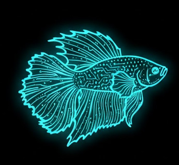

<!-- SPDX-License-Identifier: LicenseRef-FNCL-1.1 | Copyright (c) 2026 Cpt_Kirk | Modified 2026 by andre68723 in the andre68723/BETTA-HA-PANEL fork, see docs/release-notes.md -->

# BETTA HA Panel

A Home Assistant dashboard for ESP32-P4 touchscreens. Arrange widgets, import rooms and
choose your appearance in the panel's browser editor. Everyday layout changes need no
YAML and no firmware rebuild.

[Documentation site](https://andre68723.github.io/BETTA-HA-PANEL/) · [Guides](docs/README.md) · [Getting started](docs/getting-started.md) ·
[Features](docs/features.md) · [Release notes](docs/release-notes.md)

The panel image uses public demo data rendered by the firmware's LVGL simulator.
See the [feature tour](docs/features.md) for controls and the [web editor](docs/editor.md) for configuration.

## Why this fork

I found BETTA, Cpt_Kirk's firmware for Home Assistant touch panels, interesting because
it needs no YAML and no code: you lay out the dashboard in a browser editor on the panel
itself. I started with the 4-inch Waveshare panel. Then I bought a larger display that
BETTA did not support yet, and added it. Along the way I added widgets I was missing for my own
use: solar forecast, evcc wallbox, Bambu printer, Matter-based vacuums and more weather
information. A few other things changed with them. The list of what is
different from upstream v0.8.2 is in the [release notes](docs/release-notes.md).

This is a personal project, built around the panels I own. All of them are ESP32-P4
devices, so I removed the ESP32-S3 variant of upstream: I have no test device for it, and
its 480 px screen cannot hold the newer widgets. Use the fork as it is; the hardware table
below says what has been tried on a device.

## What you can do

- **Build your dashboard:** drag, resize and configure widgets across multiple pages;
  start with a Home Assistant room or a room overview grouped by floor.
- **Control your home:** lights, heating, blinds, fans, media players, vacuums,
  scenes and locks, with controls matched to each entity's capabilities.
- **See what matters:** sensor values, Recorder history, weather, solar forecasts,
  energy flows and a 24-hour energy timeline.
- **Make it yours:** Flat, Glow, Glass or Matte appearance, six color themes,
  English/German UI and custom themes or translations.
- **Manage the panel:** brightness and night mode, HTTP/MQTT notifications,
  backup/restore, OTA updates and device diagnostics from the editor.

The [feature guide](docs/features.md), [widget library](docs/widgets/README.md) and
[integration guide](docs/home-assistant.md) cover the details.

## Hardware

| Variant | Device | Screen | Fork verification |
| --- | --- | --- | --- |
| `panel4` | Waveshare ESP32-P4-WIFI6-Touch-LCD-4B, 4-inch | 720 × 720 | Runs on hardware |
| `tab5` | **M5Stack Tab5**, 5-inch | 1280 × 720 / 720 × 1280, automatic rotation | ST7121/v1.3 device trial on 2026-10-05 |
| `panel10` | Waveshare ESP32-P4-WIFI6-Touch-LCD-10.1 | 1280 × 800 | Profile compile checked with Nano BSP; LCD-X trial pending |
| `paneljc` | Guition JC8012P4A1, 10.1-inch, original/V1 panel | 1280 × 800 | Runs on hardware |
| `paneljc-v2` | Guition JC8012P4A1, 10.1-inch, V2 panel | 1280 × 800 | Compile checked |

All five variants share the dashboard engine and web editor. Choose the build for
your exact display device and panel revision. Ports, memory limits, revision identification
and Tab5's pending hardware checks are in [the hardware guide](docs/choose-display.md).

## Get started

Follow [Install and set up](docs/getting-started.md) to choose the matching factory image,
install it over USB in desktop Chrome or Edge, connect Wi-Fi and link Home Assistant.
The guide ends with adding and operating your first light. No ESP-IDF installation or compiling is needed.
Read the [upgrade notes](docs/release-notes.md#upgrading-from-upstream-v082) before changing an existing panel.

Daily layout changes use the panel's browser editor. MQTT is optional; HTTP notification setup uses YAML.
Use the panel on a trusted LAN; the editor uses HTTP, with an optional admin password.

## Development

Firmware builds, the simulator, checks and documentation maintenance are in
[Development](docs/development.md). To contribute code, start with
[Build and flash](docs/development/build.md) and the [contribution guide](docs/contributing.md).

## Contributing

You are welcome to fork this project and adapt it to your own setup, just as this
fork grew from the upstream project. Found a bug, missing feature or unclear guide?
[Open an issue](https://github.com/andre68723/BETTA-HA-PANEL/issues) or
[send a pull request](https://github.com/andre68723/BETTA-HA-PANEL/pulls).
Code, documentation, translations and device feedback are all welcome.
Please follow the project's non-commercial [license](LICENSE) and retain its notices;
see [Contributing](docs/contributing.md) for a few practical tips.

## Fork and license

Maintained by [andre68723](https://github.com/andre68723/BETTA-HA-PANEL), based on
[cptkirki/BETTA-HA-PANEL](https://github.com/cptkirki/BETTA-HA-PANEL) at upstream
v0.8.2 (`420df764`). Changes are grouped in the
[v0.9.0 release notes](docs/release-notes.md#v090), as required by
the license's change-marking clause. Added or substantially modified fork files
carry corresponding notices.

Source is released under [LicenseRef-FNCL-1.1](LICENSE). Vendored components and
fonts retain their own licenses and attribution; see the license's Third-Party
Components section and the individual file headers. The original BETTA OS logo is
retained unchanged; see [image attribution](docs/img/brand/README.md).
