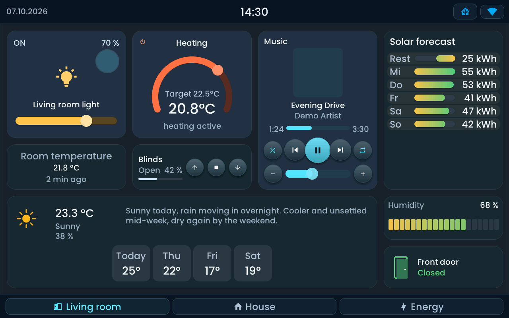
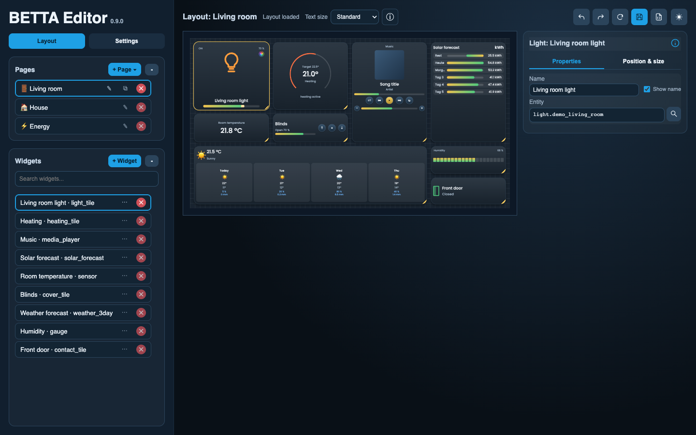

<!-- SPDX-License-Identifier: LicenseRef-FNCL-1.1 | Copyright (c) 2026 andre68723 -- modified in the andre68723/BETTA-HA-PANEL fork, see docs/release-notes.md -->

# BETTA HA Panel

A touchscreen for your Home Assistant: control lights, heating and music, see weather and energy,
and answer a doorbell alert. Arrange your dashboard in the panel's browser editor, without YAML
or recompiling firmware.

[Explore the features](features.md){ .md-button }
[Install and set up](getting-started.md){ .md-button .md-button--primary }

Design it in your browser; use it on the touchscreen. These examples use synthetic data and the
firmware's LVGL simulator. Click either image to enlarge it.

## Getting started

1. [Choose your display](choose-display.md) and check its supported revision.
2. [Install the firmware](getting-started.md#2-flash-the-panel) over USB in desktop Chrome or Edge.
3. [Connect Wi-Fi and Home Assistant](getting-started.md#3-connect-wi-fi).
4. [Add your first light](getting-started.md#5-control-your-first-light) and try it on the panel.

You need a supported ESP32-P4 panel, a USB data cable and a Home Assistant installation.
BETTA has its own pages and widgets: you configure them from your existing HA entities;
it does not import Lovelace dashboards or custom Lovelace cards. MQTT is optional.
Doorbell alerts are configured in the editor; messages from HA can use MQTT's graphical actions.
The optional HTTP notification route needs YAML.

!!! info "Development fork"

    These guides cover the fork by [andre68723](https://github.com/andre68723/BETTA-HA-PANEL), based on
    upstream v0.8.2: release v0.9.0 and the development version v0.9.1-rc2. Hardware validation is listed in
    [Choose your display](choose-display.md).

The [Widget library](widgets/README.md) has focused setup guides for each tile.

For firmware development, builds and technical references, see [Development](development.md).
