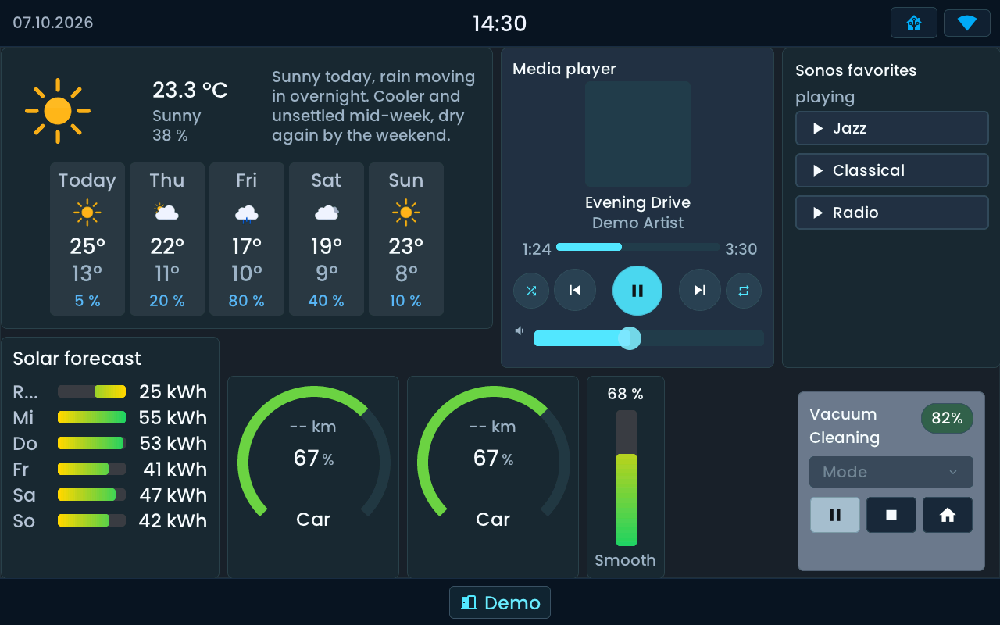
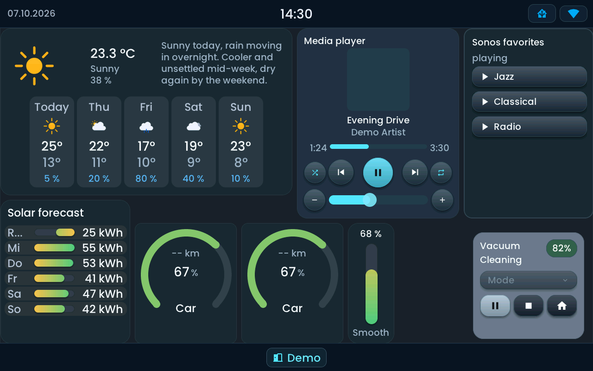
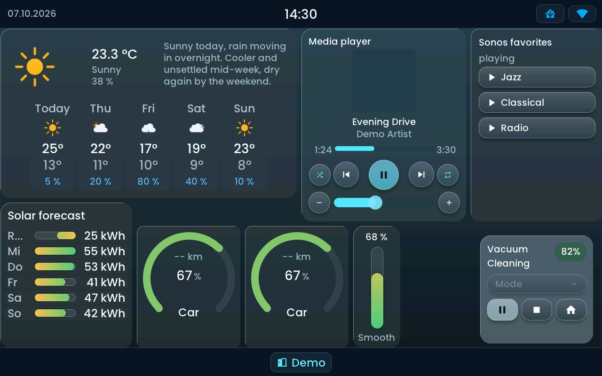
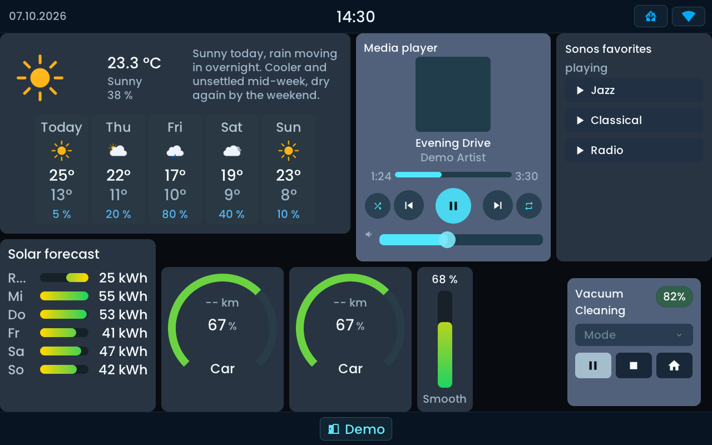

<!-- SPDX-License-Identifier: LicenseRef-FNCL-1.1 | Copyright (c) 2026 andre68723 -- file added in the andre68723/BETTA-HA-PANEL fork, see docs/release-notes.md -->
# Appearance

Choose **Flat, Glow, Glass or Matte** under **Settings → Design**.
Appearance changes apply live to the dashboard and editor preview. The colour
theme is a separate choice, so each style can use Dark, Light or another palette.

## Compare the four styles

The same dashboard, Dark colour theme and demo states are shown in every image.
Only the appearance changes. Click a screenshot to enlarge it; Escape closes the
viewer. These are 1280 × 800 LVGL simulator renders from the firmware sources.

  <figure>
    
    <figcaption><strong>Flat</strong> · Crisp outlines and simple surfaces.</figcaption>
  </figure>
  <figure>
    
    <figcaption><strong>Glow</strong> · Raised cards, soft shadows and rounded controls.</figcaption>
  </figure>
  <figure>
    
    <figcaption><strong>Glass</strong> · Translucent cards and highlighted edges.</figcaption>
  </figure>
  <figure>
    
    <figcaption><strong>Matte</strong> · Opaque surfaces and broad touch controls.</figcaption>
  </figure>

For an exhaustive tile-by-tile style comparison, the optional [Gallery](gallery.md) is in Development.

All four use the same Poppins text and Material Design Icons. Values and actions
keep their meaning when the style changes; the available controls still depend
on the Home Assistant entity.

## Colour themes

Choose **Dark, Classic, Light, Ocean, High Contrast or Pure Black**, or import a
custom theme in the editor. A colour theme changes the palette; an appearance
changes card surfaces and controls. **Classic** is a theme, while **Flat** is a
style.

Fill colours on gauges, solar forecasts and car rings can represent a value or
level. Those gradients stay meaningful in every style, including Flat and Matte.

## Button colours

The theme accent (gold in Classic) marks an **active function, selected option or an explicitly highlighted primary action**.
The media player's central **Play/Pause** button stays accented while available, including when paused or stopped;
its symbol shows the next action. Previous and Next stay neutral.
A selected charging mode stays highlighted even when it is **Off** or the car is not charging.
Vacuum Start/Pause and printer Pause/Resume are highlighted while the process runs;
they become neutral when paused or stopped. Car preconditioning is highlighted while switched on.

Buttons that open a list, adjust a value or trigger a scene stay neutral. Inside a list, the
selected option is highlighted. Other primary controls keep their prominent position and follow their state.
Unavailable controls are dimmed and lose their accent. The printer's **Abort** action is separate from
Pause/Resume, uses the danger colour and asks for confirmation before ending the print.

## Optional widget names

Most widget inspectors offer **Show name**. Disable it to give the reading and
controls more room; weather tiles hide their name by default. A detail popup may
still use the name to identify its entity. The preference applies to every style.

## Text size

In the layout editor, **Text size** in the header makes all text on the panel
larger: **Standard**, **Larger** or **Largest**. It applies at once, without a restart, to the dashboard, the
bars, popups and notifications.
The info icon beside the selector explains the text sizes and shows their comparison.

Names stay smaller than values, so the hierarchy is kept. A tile that is too small for larger text keeps a
smaller size instead of overlapping, so a compact sensor may stay at Standard while a wide weather tile
grows; give such a tile more room to see it grow. Nothing is cut off silently. Notifications show supported
emoji in the text colour, a selected set in color ([list](notifications.md#emoji)); flags, joined emoji and keycaps appear as `[Emoji]`.

## Readability

Panel4 and Tab5 use larger text for their denser screens. Give important readings and touch controls enough
room, use short titles and choose fewer forecast columns when space is tight; hiding a repeated name frees
space too. The screenshots demonstrate layout fit, so judge comfortable reading on your own display at its
usual viewing distance.

New installations use **Glow**. If a saved style is no longer available the panel shows **Flat** until you
choose another; custom themes keep working.

## Related guides

[Web editor](editor.md#settings) ·
[Top bar](top-bar.md) · [Display and brightness](display.md) ·
[Appearance implementation](appearance-implementation.md) (for developers)
