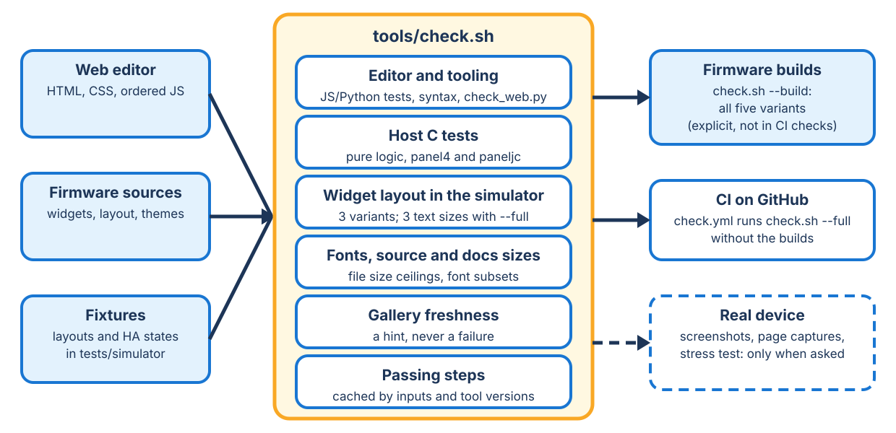

<!-- SPDX-License-Identifier: LicenseRef-FNCL-1.1 | Copyright (c) 2026 andre68723 -- file added in the andre68723/BETTA-HA-PANEL fork, see docs/release-notes.md -->
# Checks and device tests

## Checks without a device

The daily command is `uv run --locked --only-group checks scripts/check.sh --changed`.
Add `--list` to explain its selection, `--quick` for the fast stage, or use `--full --force` for the complete gate.
The [run levels](tools.md#checks) explain the existing stamp inputs, logs and cache. There is no separate path map.

- **Host C:** real policies, parsers, stores and workers with injected failures and strict compiler warnings.
  Both panel4/paneljc suites remain complete, including the fixed Tab5 orientation case; hardware APIs are stubbed.
- **Node editor:** functions and event → model → JSON/reload contracts, translations, firmware parity and controls.
  VM DOM/canvas stubs do not establish browser layout.
- **Python tooling:** local HTTP isolation, persistence/preview expiry, catalog projection and checker/cache failures.
  No device or Home Assistant access.
- **Metadata:** HTML/i18n, bundles/gzip roundtrip, links, ceilings, fonts, cases and simulator field names.
  Field-name parity does not prove matching parsing semantics.
- **SDL:** real LVGL controls, popups, service payloads and lifecycle/memory regressions on three geometries.
  No real HA calls or asynchronous network asset pipeline.
- **Layout/test pages:** overlaps, bounds, clipping/readability and selected expected content. Failed checkers fail
  the overview; rectangles alone cannot establish completeness or text placement on an arc.
- **Docs:** strict build validation; HTTP/file browser checks establish image loading, zoom and overflow separately.

The runner executes SDL groups `controls`, `wallbox`, `bambu`, `history`, `energy`, `fonts`, `notification`, `price`
and `parqet`. Camera lifecycle checks run within controls. The history/energy memory tests compare300 popup/page
cycles with their baseline lifecycle; extra retained memory must stay within the tested allowance.
`test_cover_request_lifetime.c` covers request ownership separately from the synchronous simulator cover adapter.

Host tests need system libcjson development files or fetched cJSON sources; missing cJSON exits2. Missing Node/SDL
prerequisites are reported as unavailable and fail in CI. Node22 requires test files, not a directory argument.
Firmware builds and SDL/host results never establish physical touch, display rotation/colors or optical backlight behavior.
Device tests remain deliberate, separately authorized actions; they are not triggered by a changed source path.

## Popup contracts

Native dialogs share `ui_popup_card_create()` and semantic label roles. The controls suite checks the base in
all six built-in themes and four styles at Standard/Largest text, including an unstyled legacy label and the
real close-button event. It also opens connectivity, Room, weather-report/day and Energy-detail dialogs.

The existing control, wallbox, printer, history, energy, notification and price suites audit their opened cards
through `sim_popup_contract_check()`. Solar popup cases cover content, theme colours, missing values, repeated
updates and timeout. Picker/PIN, climate, date/time, light, printer and charging popups retain their behavioral
tests. The simulator's fixture-based `tap_widget`, `history_popup`, `notification` and `open_popup` paths also
run the audit, allowing captures with the actual production widgets.

The audit checks opaque card backgrounds, inherited text, screen bounds, nonzero labels and near-invisible text
(contrast below 1.5 against the composited ancestor backgrounds). Non-scrolling labels must remain inside their card;
scrolling content may extend beyond it. This is a regression guard, not accessibility certification or a pixel
assessment of gradients/images. Review rendered views for overlap, clipping, scrolling and comfortable reading.
Camera fullscreen and display-protection overlays use separate explicit black-background contracts.

## Test clocks

Routine SDL checks and Gallery/test-page renders share the Gallery's fixed Berlin clock,2026-10-15 12:00.
The runner fingerprints the effective clock; standalone layout checks accept `--now`, and `BETTA_SIM_NOW=real`
selects the real clock for a diagnostic run (use `--force` in the runner). Real/fixed passes have different stamps.
Simulator virtual time also changes delay duration: compare timing measurements only at the same clock setting.

The price regression independently checks normal/spring/autumn calendar boundaries, both repeated02 hours and
post-rollback selection, preserving wide/narrow controls, no-data, average and history-popup assertions. Test data
uses local calendar days, not24 elapsed hours per day. The known repeated-hour label remains unchanged.
Host weather and history-worker calendar fixtures are fixed separately; real pthread deadlines and late replies
remain real. Node solar/crash scenarios inject a date only into their own VM; supplied timestamp parsing is retained.
Auxiliary HTTP-worker and EVCC tests keep their existing virtual clocks. These are not live HA or panel tests.

## Widget layout check

`python3 tools/check_widget_layout.py` renders every gallery widget in the simulator in all four styles and reads each
object's rectangle (`--dump-layout`). It fails when two texts overlap, a text overlaps a button or lies half on a panel,
bar or picture, or anything reaches outside its tile. `check.sh`, CI and `tools/generate_simulator_gallery.py` run it
(panel4; `--variant paneljc|tab5` for the 1280 px geometry; the panel4-only readability fixtures are skipped there). It
also renders the Matte comparison (`tests/simulator/matte_reference.json`) and edge cases
(`tests/simulator/layout_cases.json`: tiles at minimum and large sizes and in every variant). A text recorded as essential
(`ui_text_record(label, role, true)`) also fails when it is cut: record states, readings and button words that way, while
names may end in dots.

- Rectangles cannot see a ring's shape, and a widget that leaves content out passes: look at the images for text on
  arcs and knobs and for whether a tile still shows what it is for.
- A new or changed widget layout needs a tile in the gallery fixture (a `gallery` tag in `tools/test_layout_cases.json`,
  projected by `build_spec()` in `tools/gallery_content.py`) and its minimum size and variants in `layout_cases.json`.
- Two LVGL traps behind most findings: an object placed with `lv_obj_align()` keeps that anchor, so a later
  `lv_obj_set_pos()` offsets from it (use `lv_obj_align(obj, LV_ALIGN_TOP_LEFT, x, y)`); sizes read right after creation
  are 0 until `lv_obj_update_layout()` runs.
- The [simulator](../simulator.md) renders a local layout and state fixture at the panel's pixel size. Compare with a
  device screenshot before calling a result hardware-verified.

## Semantic readability checks

The simulator JSONL dump reports role, font identity (including Poppins fallback wrappers), nominal size, line height,
H/x/0 ink boxes and H angles at 30/40 cm (71.93 mm active panel4 width). `tools/check_readability.py --strict
<dump.jsonl>` checks reviewed essential text for clipping and capital height below the 16 arcminute reference; compact
20 px fits are reported and unassigned labels stay diagnostics. Font height alone does not establish comfort. The layout
check includes `tests/simulator/readability.json` (saved geometry, lower-density alternatives, negative and large
values, German titles, unknown and unavailable states, missing dates, rain) and two `readability_history_*.json`
fixtures for numeric and discrete details.

## Screenshots

`scripts/screenshot.sh <panel-ip> [out.png]` saves what the panel shows (popups and the update screen included) via
`GET /api/screenshot.bmp`. Do not give `curl` a short timeout: the image is about 3 MB on the 10-inch panel and a timeout
truncates it silently.

## Test layouts

`tools/test_layout_cases.json` is the shared widget catalog. A case's `gallery` metadata selects its preview title,
size and order; `gallery_caps` holds descriptions shared by preview variants. Cases needed only for a gallery image
live in `gallery_only`: they never enter topic packs, generated edge/state cases or test coverage counts.
Cases define a topic, 10-inch size and `{role}` entities, optional `expect` texts and simulator-only `sim` fields.

`tools/test_layouts.py` builds test pages for every widget and variant from `tools/test_layout_cases.json`, grouped by
topic (energy, climate, controls, status, devices, finance) and placed for each board: `paneljc` (1280 x 680), `tab5`
(1280 x 600) and `panel4` (720 x 600). Cases keep their 10-inch size, tallest first; a topic that exceeds the board's
pages or 32 KB is split. Two generated topics add every type at its minimum size with a long name, without its name and
with a missing entity (`grenzen`), and at its maximum size (`maximal`). The generated `zustaende` topic adds
idle, running, paused, returning, selected Off, alert and unavailable control states, including the legacy Roborock name.

**Simulator**

`scripts/test_pages.sh panel4 tab5 paneljc` (`test_layouts.py view`) renders every page with the demo entities and opens an
overview with board, style, text step and language buttons. `--styles`, `--text-steps` and `--languages` choose the
renders (default: four styles, step 0, German). The launcher builds each requested size, writes
`${TMPDIR:-/tmp}/betta-test-pages/simulator.log`, then opens the browser; `--no-open` skips opening.
Run it by its path from any working directory. Topic links remain below the fixed size/style bar;
States & controls, Small tiles & edge cases and Large tiles identify their respective coverage.
Part numbers split topics to fit the board page/layout limits. The overview is a static
page that each run rewrites; reload it after a run. `simulate <board> [--suite NAME]` prints the same in the terminal.

The renders use a fixed clock (Thursday 15 October 2026, 12:00 Berlin; `--now` changes it, `--now real` uses the
host clock), so two runs give identical images. Per text step the run reports:

- layout findings of `check_widget_layout.py`, in every style, German and English;
- content findings in the first style: a widget with an existing entity that shows a loading or unavailable text, and
  texts its case lists in `expect` but does not draw (at text step 0; larger text may leave optional rows out);
- demo entities without a state (`Demo-Daten`), and widget types or validated field values without a case.

**Cases**

A case is a widget definition with `w`, `h` and `{role}` entities. The roles come from
`tools/test_layout_entities_demo.json` (its `_states` add demo states the gallery data lacks). `expect` lists texts that
must be drawn, `sim` holds fields only the simulator fixture gets (for example to-do `items`); neither reaches a panel
layout. `tools/widget_cases.py` adds control-state cases with `sim_state` overrides: each overridden binding
gets its own synthetic entity and retains its original attributes. Shared demo readings and generated device layouts
stay unchanged. Room bindings retain membership in their room's entity list. These fixture rules have unit tests in
`tests/tools/test_simulator_state_cases.py`.
A new widget type or enumerated field value needs a case, or the run names it.

**Panel**

`generate <board>` writes the layouts to `.local/test-layouts/<board>/` with the entities of
`.local/test-layouts/entities.json` when it exists (the household's own, not committed; same roles). `load <panel-ip>
<file>` replaces the panel's layout with one topic and saves the panel's own layout once to
`.claude/layout-backups/testenv-<ip>.json`; `restore <panel-ip>` puts it back and checks it, `status` tells which is
loaded. Saving a layout deletes the panel-only history of graphs it no longer contains, which `restore` cannot bring
back: `load` refuses while the panel has such graphs, unless `--discard-graph-history`. Use it on a test panel.

## Device page captures

`tools/capture_device_pages.py <panel-ip> [--reference-dir DIR]` visits every page of the saved layout, saves each
framebuffer as PNG and writes `manifest.json` (firmware commit, layout hash, with `--reference-dir` the SHA-256 of the
compared images). It never overwrites an existing set and returns the panel to its first page. Then
`tools/import_device_captures.py [--board panel4|paneljc] --from <set>` replaces `docs/img/<board>/` and rewrites
`docs/gallery-<board>.md` (one current set per board). Keep household captures and their metadata under ignored
local storage, such as `.local/`, rather than committing them. Only import captures made with public synthetic
data and owned or licensed artwork; inspect every image and the manifest before publication. The maintained
documentation examples use the simulator's public fixtures.

## Gallery

`python3 tools/generate_simulator_gallery.py` regenerates the widget images of `docs/gallery.md` with the
[simulator](../simulator.md) from `tests/simulator/gallery_data.json`, in each style. It needs no panel and no Home
Assistant; re-run it after every change to a widget's look. Each tile is rendered alone on its own page (free size up to
720 × 600); the packing in `build_spec()` only matters for a capture on a real panel. `--variant paneljc|panel10|
paneljc-v2|tab5` renders only the house and energy pages at that geometry into `docs/img/gallery-<variant>/` and
`docs/gallery-sim-<variant>.md`. The special pages come from the simulator too: House from the fixture's `house`, Energy
from its `energy` sensors, the doorbell popup from its `doorbell` notification with a placeholder camera picture
(`tests/simulator/doorbell_camera.png`, via a `file:` entity_picture).

- Both generators share `build_rows()` in `tools/gallery_content.py`. The fan rotor lands differently on each run:
  discard those three images when nothing else changed.
- `tools/generate_gallery.py <panel-ip>` compares against hardware: it screenshots every widget and page on a real
  panel4 against real entities (`tools/gallery_entities.json`, gitignored, copy the `.example.json`), backs up and
  restores the panel's layout and style, and replaces the simulator images until the next simulator run. Optional extras
  (car precondition row, segmented gauge) render only with compatible entities configured; a missing extra is silently
  left out.
- Never hand-edit the generated files or `docs/img/gallery/*.png`. Image names are stable
  (`<slug of the title>_<style>.png`), so a commit touching one widget changes only its images. A run prunes unreferenced
  images and writes `docs/img/gallery/sources.json`, a hash stamp of every rendering input. `check.sh` runs
  `tools/gallery_freshness.py`, which warns (never fails; `--strict` fails) when sources changed since the stamp.
  Regenerate only on that warning and commit the images separately as `docs(gallery): ...`. After a refactor that did
  not change rendering, `generate_simulator_gallery.py --stamp-only` refreshes the stamp.
- The published gallery contains demo-data widgets and special pages from the simulator. Real household pages captured
  with `tools/capture_device_pages.py` remain local test evidence.

## Memory and stability stress test

`tools/stress_test.py <panel-ip>` combines rapid page navigation, repeated entity discovery (Room/House import) and
concurrent loads of every editor asset in `index.html` (six connections, `--webui-concurrency`). It reports memory from
`GET /api/version` before, during and after a cool-down, counts failed requests and exits nonzero on any failure or
memory probe. `--no-navigate --no-discovery` isolates the editor load, `--no-webui-load` reproduces the older test.
A one-time cache allocation drops once and stays flat; a leak keeps dropping after the load stops. It only does GETs and
page switches and never touches USB. Errors under combined load count as failures even if the panel recovers.

## Bottom navigation: full and compact tabs

`ui/nav_layout.c` (pure, host-tested) places the tabs, `ui_pages.c` draws them. Tabs are **full** (icon and title) while
each is at least `NAV_FULL_TAB_MIN_W` (112 px) wide: 5 pages on the 4-inch bar, 10 on the 10-inch bar
(`nav_layout_full_pages()`, `full_nav_pages` in `/api/version`). Beyond that the bar is **compact**: the shown page keeps
icon and title (at most a quarter of the bar), the others are 64-96 px icon tabs (the page number without an icon).
`nav_layout_max_pages()` is the limit at 64 px: 8 pages at 720 px, 12 at 1280 px (`APP_MAX_PAGES`, `max_pages`). 64 px is
6.4 mm on the 4-inch panel (254 ppi) and 10.8 mm on the 10-inch panel (150 ppi). The editor asks for a distinct icon per
page once the bar is compact (`navIconIssue()`); the simulator draws every icon as the list glyph, so judge icons in the
editor or on a panel. More tabs would need a "More" list or lazy page building (owner decision 2026-10-01: not wanted).
The widget total stays 224 (`APP_MAX_WIDGETS_TOTAL`).

Dense stock layouts validate a full page set under the 32 KiB limit, then collect every quote, including the last one.
A deliberately smaller collection buffer must report every omitted entity; registry tests cover 1,056 simultaneous
quotes and more layout changes than the cache capacity. Pruning scratch stays in PSRAM rather than on the HA task stack.
