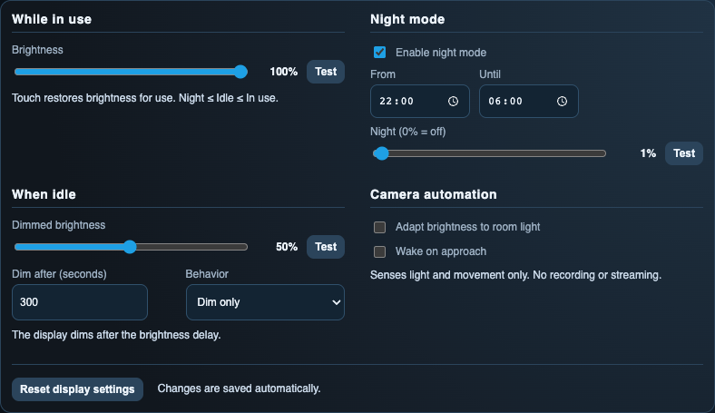

<!-- SPDX-License-Identifier: LicenseRef-FNCL-1.1 | Copyright (c) 2026 Cpt_Kirk | Copyright (c) 2026 andre68723 -- file added in the andre68723/BETTA-HA-PANEL fork, see docs/release-notes.md -->

# Display and brightness

**Settings → Display** in the [web editor](editor.md) holds everything about the backlight: night mode, brightness,
display protection and the camera options. All of it applies live, without a restart.

[{ .float-shot }](img/examples/editor-display.png)

## Brightness

Three levels apply, always in the order **night ≤ dimmed ≤ active**; the editor keeps them in order.

- **Active:** while you use the panel, and for a moment after a touch. 1–100 %.
- **Dimmed:** after the dim delay, outside the night window. 1–100 %.
- **Night:** inside the night window. 0–100 %; **0 % turns the backlight off**.

The three situations have their own groups: **While in use**, **When idle** and **Night mode**. Idle brightness,
the dim delay and the behavior afterwards belong together under **When idle**.

**Test** beside each slider shows that percentage on the panel for 30 seconds, regardless of the clock, idle timer
or automatic room-light adjustment. The dashboard stays visible. Adjusting the slider updates the running test and
saves the chosen setting normally; it does not extend the test. **Stop test**, a touch on the panel, or the timeout
returns to brightness for use. The first touch only ends the test, including at 0 %, and operates no widget.
The night schedule is unchanged. The panel ends the test even if the browser disconnects.

## Night mode

Enable it, pick start and end (for example **22:00–06:00**, across midnight is fine) and a night brightness: **0 %**
for darkness, a low value for a dim display. The schedule uses local time, so check the time zone under
**Settings → Language & time**. A touch brings back active brightness until the dim delay ends. The panel keeps
running with the backlight off.

New installations start with night mode on from 22:00 to 06:00 at 1 %; saved settings keep their values.
The Display page uses headings for use, inactivity, night mode and camera settings, with two columns when
space allows. Disabled features hide their dependent controls without clearing saved values. Camera sensitivity and
testing, and LCD pixel movement, are under expandable options. Changes apply immediately; this page shows Reload instead of a Save action.
One **Reset display settings** button at the bottom restores every group: brightness (100/50 %, 300 s),
night mode (on, 22:00–06:00, 1 %), protection (brightness only, default timings), camera sensitivity (5), and the
board's camera/rotation defaults. Sounds and settings on other pages keep their values.

Notification sounds are muted by the same schedule, see [Panel sound](notifications.md#sound).

## Display protection

Choose what happens after the idle time:

=== "Brightness only"

    The normal dim delay and night schedule, nothing more. This is the default.

=== "Turn off"

    A black overlay and 0 % backlight.

=== "Weather, then off"

    Live weather from a `weather.*` entity at its own 1–30 % brightness, moved every minute, then off. Without
    usable data the display goes straight to off. The saver reads current states only.

=== "Cycle pages, then off"

    Steps through the pages at dimmed brightness (interval 1–30 minutes, duration 1–120 minutes), then turns off.
    Its widgets stay loaded, so use it when you want those pages shown while idle.

The first touch on the protection screen only wakes the panel and does not operate anything underneath. The wake
option returns to the first page or keeps the last one. A night level of 0 % always uses the off presentation.

??? info "Move LCD pixels while the display is off"

    Redraws small colour patches every five seconds with the backlight at 0 %. It is an optional measure against
    image persistence, adds display traffic and does not guarantee protection from afterimages.

## Room light and presence

The camera of the Guition JC8012P4A1 and the M5Stack Tab5 senses light and movement. It records and streams nothing.

- **Adapt to room light** scales active and dimmed brightness; night brightness stays as chosen.
- **Wake on approach** wakes a dimmed or protected display on movement. Set the sensitivity; **Wake at night** is a
  separate switch.

Both options are off by default. On one Tab5 (2026-10-05) covering the camera dropped the measured light factor from
89 % to 27–28 %. More in [Cameras and chimes](hardware/peripherals.md#ambient-camera-paneljc-and-tab5).

## Tab5: automatic rotation

On the M5Stack Tab5 **Rotate automatically** is on by default: hold it upright in a new orientation for about a second
to switch between portrait and landscape, upside down included. Lying flat or shaking keeps the current orientation;
turn the option off for fixed landscape. Other panels do not show it.

The startup screen uses the mounting orientation too. If the panel is lying flat or the sensor is unavailable,
it starts in the last stable orientation; without a saved orientation it uses normal landscape.

- The current page stays selected. Portrait shows the same widgets in reading order, swipe vertically for long pages;
  with more than eight pages swipe the bottom navigation sideways.
- Rotation waits until an open popup or the protection screen is dismissed.
- The editor loads the orientation the panel shows; reload the layout after turning the panel. Saving an older
  orientation is refused. Portrait and landscape keep separate widget positions and share everything else; backups
  hold both.

[Top bar](top-bar.md) · [Notifications](notifications.md) · [Display devices](choose-display.md) ·
[Brightness implementation](hardware/resources.md#brightness-and-display-policy) (for developers)
