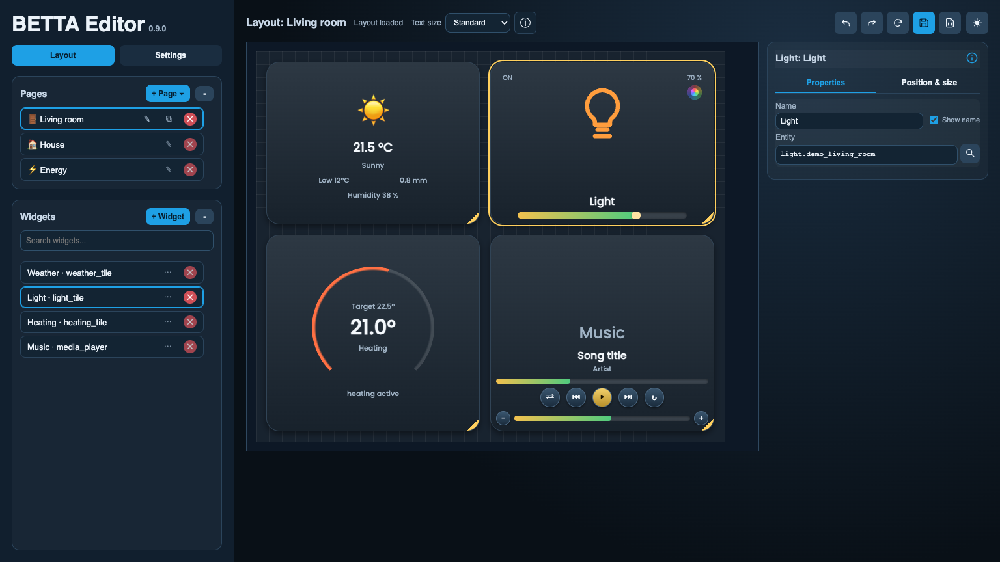
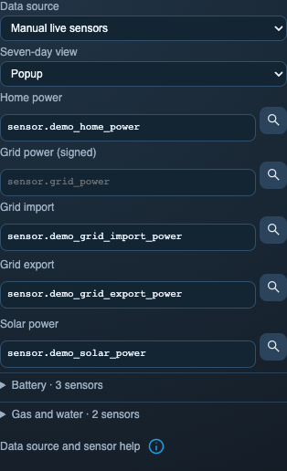

<!-- SPDX-License-Identifier: LicenseRef-FNCL-1.1 | Copyright (c) 2026 andre68723 -- file added in the andre68723/BETTA-HA-PANEL fork, see docs/release-notes.md -->
# Web editor

Open `http://<panel-ip>` in a browser once the panel has joined your Wi-Fi. The editor runs on the panel and
edits its saved layout and settings. First-time Wi-Fi and Home Assistant setup are in
[Install and set up](getting-started.md).

## Layout: pages and widgets { #layout-workspace }

The **page list** and **widget list** are on the left, the dashboard **preview** in the centre and the
**inspector** of the selected widget on the right.
On desktop, the two lists scroll independently so the preview and actions stay in view.

1. Under **Pages**, choose **+ Page → Blank page**. Use the pencil beside its name to rename it; choose a navigation icon in the page inspector
   ([Pages and layouts](pages.md)). For a complete first exercise, follow [your first light](getting-started.md#5-control-your-first-light).
2. Add a widget with **+ Widget**, or search for an entity first and pick a compatible widget.
3. Drag it into place and resize it. Select it to edit its entity, title and options.
4. **Save** to apply the layout to the panel.

The preview follows the display's dashboard area and the active theme and style. It is a browser
representation: check the panel itself for exact fonts, clipping and touch. The
[page examples](pages.md) use the firmware's LVGL simulator.
Click an empty spot (or press Esc) to leave a widget and edit the page itself.

The header groups the page title, status and **Text size** on the left. Undo, Redo, Reload and Save are icon buttons on the
right, beside the JSON menu and the dark/light toggle. Hover an icon to read its action; JSON offers Export and
Import JSON, from a file or pasted text. The info button beside Text size shows the panel's current font sizes. With **Panel follows** (off by default, remembered by
the browser) the panel shows the page you choose in the editor, as far as it is saved.
Standard, Larger and Largest apply immediately to the whole
panel and are saved on their own, independent of the layout's Save button.

??? info "Tab5: portrait and landscape"

    The editor loads the orientation currently shown on the device. Both layouts are stored separately, and
    rotating the panel does not change an already open layout: reload it to edit the other orientation.
    Saving from a stale orientation is refused with a reload message. See
    [automatic rotation](display.md#tab5-automatic-rotation).

An Energy page has its own options in the page inspector: the data source and **Seven-day view**
(popup or right-hand panel, see [Energy dashboard](pages.md#seven-day-details)). Both are saved with the layout.

{ width="314" }

The Inspector column stays reserved when changing selection. Its title has an info icon for each widget and
page, with the summary of its guide and a documentation link.

The widget inspector has the same order for every widget. Its header shows the widget type, the name (edit it
in place) and the main entity's device class and unit. Below follow **Entities** (what the
tile reads or controls, including its data source), **Display** (what it shows) and **Controls** (what tap and
long press do); a section without options is left out. **Placement** comes last and shows position and size in
its heading; it starts folded, since the canvas moves and sizes a widget by mouse. A click on a section heading folds it. Optional groups such as the Energy timeline's battery and forecast sensors fold and
start open when something is set in them. A section with explanations has an info icon behind its heading;
click it to read them in a popup. Close it with Escape, the Close button or a click outside.
The page inspector has the same form: the kind of page and its title (edit it in place), then **Navigation**
for the bar icon, **Rooms** on a Room overview, and **Entities** and **Display** on an Energy dashboard, where battery
and gas/water sensors fold.

Entities are rows: the role and the entity's Home Assistant name, for a widget shortened by the words all of
its entities share; the entity ID is in the tooltip. The Energy page's sensors and the weather and stock entities
in the settings use the same rows. A click opens the entity search, whose results match the field's allowed entity
types. The entity that is set stays on top with **Keep**, and the search starts with its ID without the last word,
which lists the other entities of the same device; typing replaces it. **Remove** clears an optional entity, and a
typed ID that Home Assistant does not list can be used as it is; it is marked as not found once a completed search
does not list it. Room
entities stay a list (choosing a result adds it); the extra field uses an entity already assigned to the card.

The widget list names each widget by its title (its kind and entity are in the tooltip); the search also finds
the widget type and entity ID, such as `media_player`. Use the widget row's **⋯** menu to duplicate it or **Copy to page** / **Move to page**.
Choose another normal page; all entity bindings and options are retained. The destination is selected
and the widget is placed in free space when available. Energy and Room overview pages have no editable widgets.

**Undo** and **Redo** cover widget, page and Inspector edits, including imports. One drag or continuous text edit
is one step. Use Ctrl/Cmd+Z and Ctrl/Cmd+Shift+Z (also Ctrl+Y); shortcuts inside fields keep their normal text behavior.
Save keeps the history; undoing a saved change requires saving again. A successful Reload or browser refresh
starts a new history. Failed loads and saves preserve current edits. History is limited to 50 steps and a memory budget.

Widget options change the editor model as you edit; **Save** writes it to the panel. Sensor history has two
separate switches: the Graph's [History from Home Assistant](widgets/graph.md#history-source) selects its data
source, [History on tap](history.md#enable-and-open-history) adds a detail popup to other widgets.

## Settings

Everything outside the dashboard is under **Settings**, in three groups:

| Group | Page | What you set |
| --- | --- | --- |
| Device and connections | **Device** | Room name (the device ID), status, restart, log |
| | **Network** | Wi-Fi network, country, password |
| | **Home Assistant & MQTT** | Address and token, optional MQTT broker for notifications |
| Display and messages | **Display** | Night mode, brightness, display protection, built-in camera ([guide](display.md)) |
| | **Design** | Appearance style and colour theme ([guide](appearance.md)) |
| | **Top bar** | Items beside the clock ([guide](top-bar.md)) |
| | **Sound** | Volume and night mute, on displays with audio ([guide](notifications.md#sound)) |
| | **Alerts** | Doorbell and event cards ([guide](notifications.md#doorbell-and-event-alerts)) |
| System | **Language & time** | Language, time zone from a list, time server |
| | **Backup & security** | Backup and restore, admin password, factory reset |
| | **Firmware** | Update check, manual install, versions and memory |

Many settings apply live; the Save button on the right applies the rest and restarts the panel only when Wi-Fi,
Home Assistant, MQTT, the time server or room settings changed. Custom themes and translations are JSON files.

## Backups and restore

Open **Settings → Backup & security** to export or restore the dashboard configuration.

| Export | Includes |
| --- | --- |
| Full backup | Layout, non-secret settings, custom themes and translations |
| Layout JSON (Layout tab) | Pages, widgets and configured alerts |

Wi-Fi and MQTT passwords, the Home Assistant token and the admin password are **excluded**: enter them again
after a factory flash or a move to another device. Local graph samples are not part of the exports. Backups
still contain entity IDs, network names and server addresses, so review them before sharing.

Saved layouts, language, appearance, text size and colours apply live. If the panel is busy, it retries automatically.

## Firmware updates

**Settings → Firmware** checks for new firmware daily and can install it at night. Use **Install manually** to
upload an image or enter an OTA URL, always for the exact variant of your display. Read the
[upgrade notes](release-notes.md#upgrading-from-upstream-v082) first: bootloader and partition-table changes
need USB, see [Install and set up](getting-started.md#update-later).

## Restart and crash reports

**Settings → Device → Restart panel** restarts the device without clearing layout or settings; the page also
shows the recent restart history, device information, memory and the log.

**Device status → C6 Wi-Fi memory** shows the Wi-Fi coprocessor's free heap, its lowest free heap since
the C6 started and its largest internal allocation block. A report arrives about once a minute; the minimum
appears after the first periodic report. Samples older than three minutes or from a lost transport are marked stale.
Expand **Memory details** for DMA memory, the last diagnostic error and the sample retained at the last
connection incident. That incident is separate from the live reading and can belong to an earlier panel boot.
Unavailable or unsupported diagnostics do not prevent Wi-Fi from working. C6 memory is separate from the
panel's RAM and PSRAM; internal and DMA memory overlap and cannot be added together.

If a crash report is stored, the editor shows a banner. Download the report under **Settings → Device** before
removing it; it may belong to an earlier run, so check its time, and it can contain private memory contents,
so share it only with someone you trust.

For access protection see the [Security](SECURITY.md). Developers: [Web editor source](editor-source.md) and
[crash-dump details](coredump.md).
