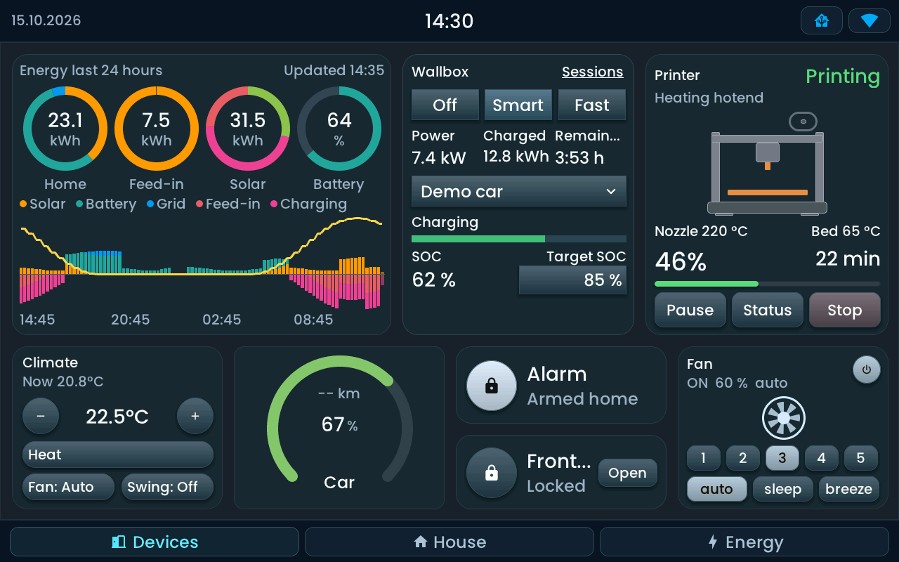

<!-- SPDX-License-Identifier: LicenseRef-FNCL-1.1 | Copyright (c) 2026 andre68723 -- file added in the andre68723/BETTA-HA-PANEL fork, see docs/release-notes.md -->

# Feature tour

Build a dashboard from the entities already in your Home Assistant. Pick widgets, place them in your
browser and save: the panel updates without YAML or a firmware rebuild. English and German are built in.

[Install and set up](getting-started.md){ .md-button .md-button--primary }
[Browse the widget library](widgets/README.md){ .md-button }

## Control your home

Switch lights and change brightness, adjust heating, move blinds, control music or start the vacuum.
Controls follow the selected entity's capabilities. The Camera widget shows snapshots, not live video.
Specialised widgets include evcc charging and Bambu printer controls; their HA integrations must be installed first.

**Set it up:** add a widget and select its entity in the [web editor](editor.md).
The [widget library](widgets/README.md) shows each widget with its requirements and touch controls.

## Design your dashboard

Choose freely arranged pages, a room overview or a fixed energy dashboard. An imported room starts with
entities from one HA area and remains freely editable. A room overview groups your areas by floor.
You can also start with a single light; areas and floors are optional.

**Set it up:** [Pages and layouts](pages.md) explains the three page types and room import.

## Energy and history

See grid, solar, home and battery flows on an Energy page, or add an Energy timeline widget to a normal page.
A Graph can show values collected on the panel or history from Home Assistant.
Optional detail popups show 24-hour history; numeric measurement sensors can also offer a seven-day view.
Tap Sensor, Binary sensor and Contact tiles for history; long-press Lock and Vacuum tiles to keep their normal controls available.

**Set it up:** choose an [Energy page](pages.md#energy-dashboard), an
[Energy timeline](widgets/energy_timeline.md) or [Graph](widgets/graph.md).
For popups, enable [History on tap](history.md) in the widget's inspector.

## Electricity prices

Show today's and tomorrow's prices, the current interval and the next cheap window with an Energy price forecast widget.
Choose bars or a stepped line. Missing intervals stay gaps, and all upcoming cheap windows remain available.

**Set it up:** [Energy price forecast](widgets/energy_price_forecast.md) lists supported price sensors, units and helper formats.

## Parqet portfolio

Show the value of a Parqet portfolio with its gain, XIRR, dividends and largest holdings with a Parqet portfolio widget.
It reads the sensors of the Parqet Companion integration. Tabs for Performance and Holdings, the intervals 1D, 1W, 1M, YTD and MAX and the choice of largest, best or worst holdings can be shown on the tile. An option hides all amounts and shows percentages only.

**Set it up:** [Parqet portfolio](widgets/parqet_portfolio.md) lists the sensors and what the tile shows at each size.

## Stocks and ETFs

Follow up to eight Easy Stock quotes in one tile, as a list with the day's change or as small charts.
A tap opens the details with the market state and a chart over 1D, 1W, 30D, YTD or 1Y; each chart names its source.

**Set it up:** [Stocks & ETFs](widgets/stock_quotes.md) lists the integrations and where each period comes from.

## Doorbell and messages

A doorbell or sensor can wake the screen and show a message, camera snapshot and optional action button.
Configure this directly on the panel, without an HA automation.
To send messages such as “The washing machine is done” from an HA automation, use the panel's MQTT Notify entity.
That route needs an MQTT broker; the alternative HTTP route needs YAML.

**Set it up:** [Notifications](notifications.md) starts with editor-configured alerts,
then the graphical HA notification action. Sound is optional and available on the 4-inch Waveshare and Tab5.

## Appearance and daily use

Choose Flat, Glow, Glass or Matte independently of six built-in colour themes. Three text sizes apply live.
Set a dimmed brightness, a night schedule and what the screen shows while idle. Guition and Tab5 can use their
onboard camera for room-light or movement sensing; it records and streams nothing. Tab5 sensing remains
opt-in with incomplete device validation.

**Set it up:** compare styles in [Appearance](appearance.md), set
[Display and brightness](display.md), and choose date, weather or stock items in the [Top bar](top-bar.md).

## Updates and backups

Upload a matching firmware update in the editor over Wi-Fi, or enable automatic updates.
Export a full backup before changing an installation. Passwords and tokens are excluded and must be entered again
when restoring to a new or factory-flashed panel.

**Set it up:** [Web editor](editor.md#backups-and-restore) covers backups;
[Install and set up](getting-started.md#update-later) explains updates and USB migrations.
