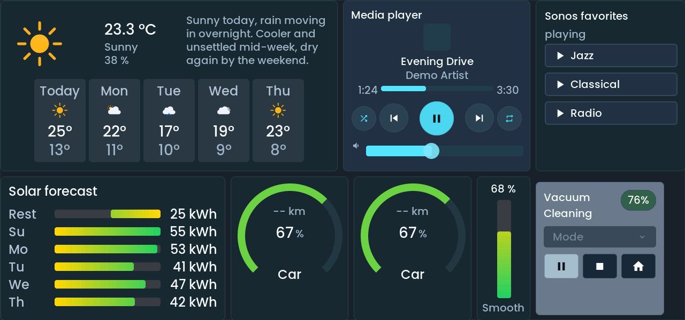
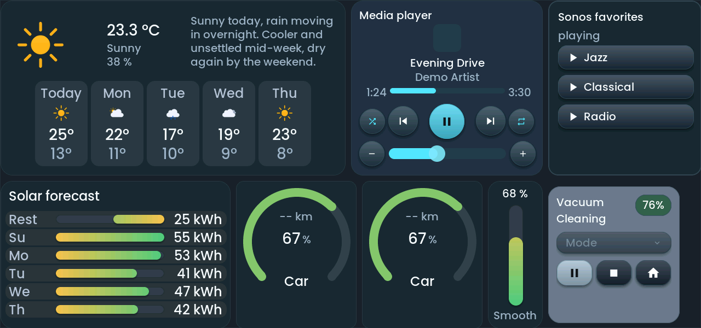
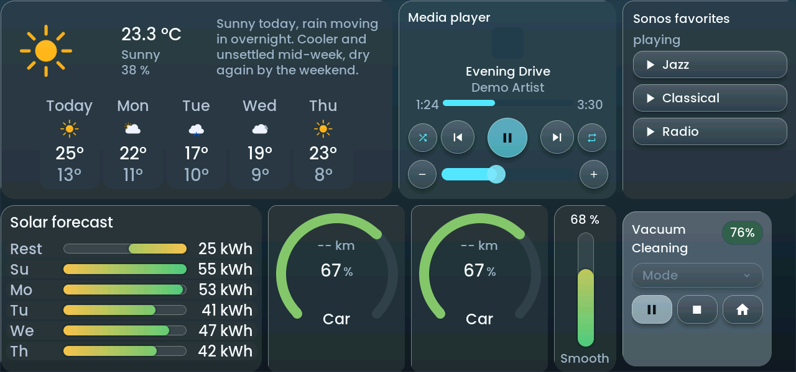
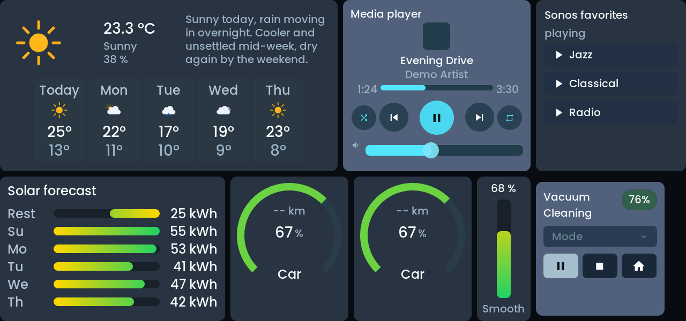
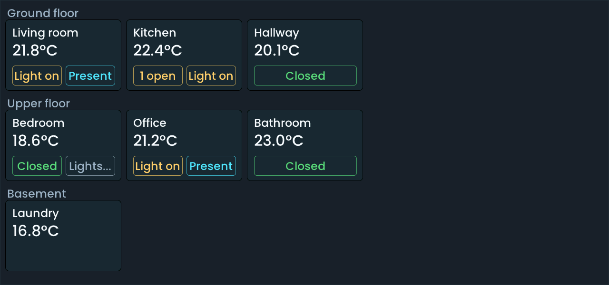
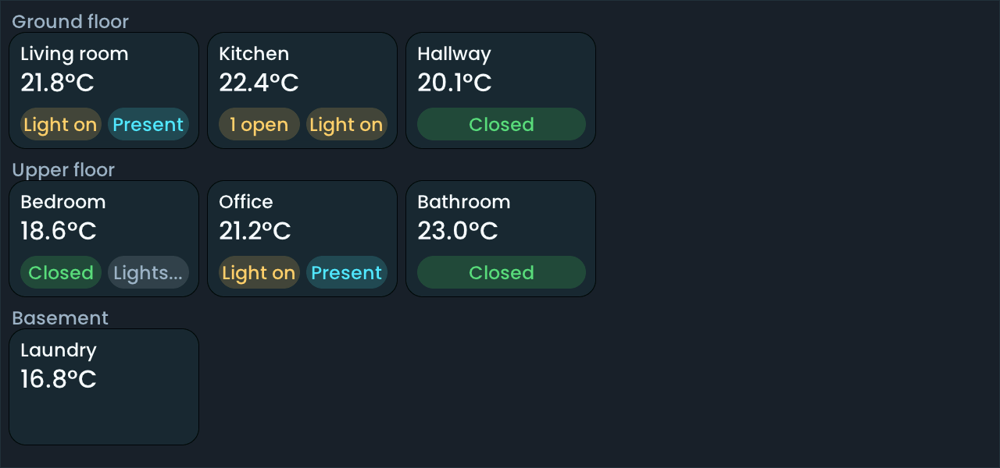
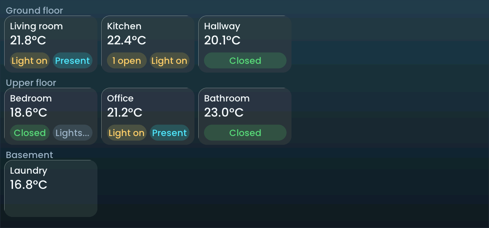
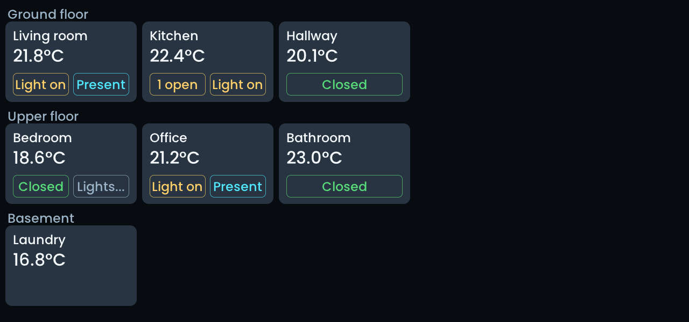
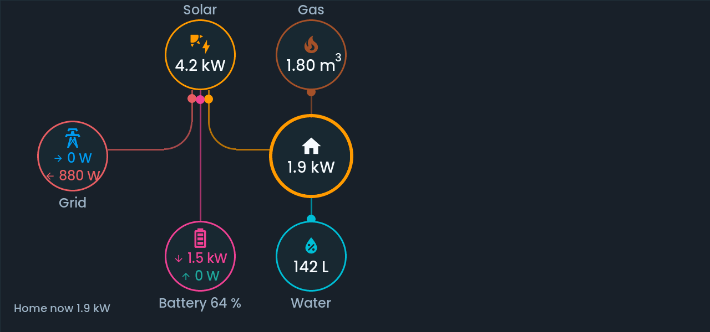
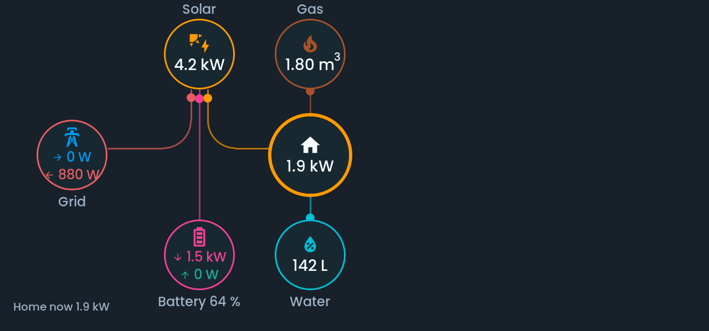

<!-- SPDX-License-Identifier: LicenseRef-FNCL-1.1 | Copyright (c) 2026 andre68723 -- file added in the andre68723/BETTA-HA-PANEL fork, see docs/release-notes.md -->

# 5" M5Stack Tab5: simulator gallery

Rendered from the current firmware sources by the SDL simulator at 1280x720 (content box 1280x600) from the synthetic fixture `tests/simulator/gallery_data.json`. The single widgets are shown at 4-inch size in [gallery.md](gallery.md). Regenerate with `python3 tools/generate_simulator_gallery.py --variant tab5`.

## Demo page

| Flat | Glow | Glass | Matte |
| --- | --- | --- | --- |
|  |  |  |  |

## House page

| Flat | Glow | Glass | Matte |
| --- | --- | --- | --- |
|  |  |  |  |

## Energy page

| Flat | Glow | Glass | Matte |
| --- | --- | --- | --- |
|  |  |  |  |
