<!-- SPDX-License-Identifier: LicenseRef-FNCL-1.1 | Copyright (c) 2026 andre68723 -- file added in the andre68723/BETTA-HA-PANEL fork, see docs/release-notes.md -->

# Gallery

Compare the same widgets in Flat, Glow, Glass and Matte. This is an optional visual reference; for choosing a look, use [Appearance](appearance.md). For features and setup, use the [widget library](widgets/README.md).

Examples use synthetic data. The columns change only the style, not the available functions.

## Widgets

| Widget | Flat | Glow | Glass | Matte |
| --- | --- | --- | --- | --- |
| [Sensor](widgets/sensor.md) | 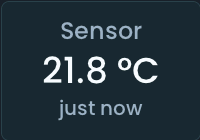 |  | 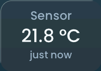 | 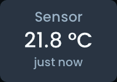 |
| [Sensor](widgets/sensor.md) | 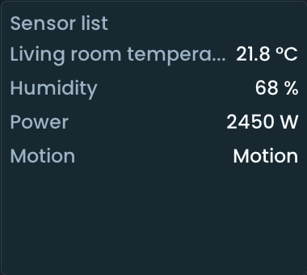 |  | 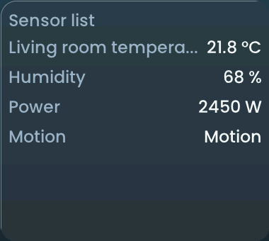 | 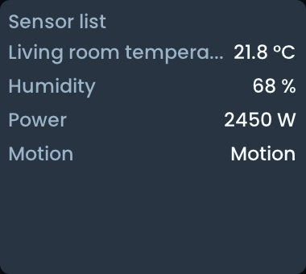 |
| [Gauge](widgets/gauge.md) | **Smooth** 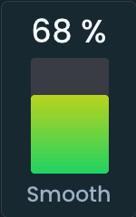 **Segmented**  **Horizontal gauge**  **Radial** 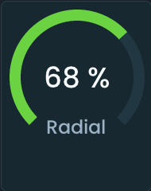 | **Smooth**  **Segmented**  **Horizontal gauge** 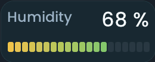 **Radial** 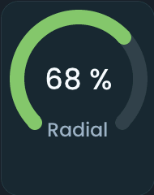 | **Smooth** 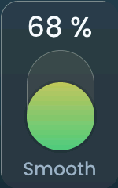 **Segmented**  **Horizontal gauge** 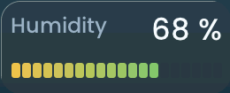 **Radial** 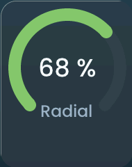 | **Smooth** 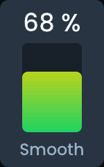 **Segmented**  **Horizontal gauge** 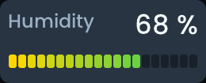 **Radial** 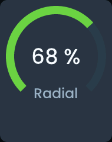 |
| [Graph](widgets/graph.md) | **Graph (line)** 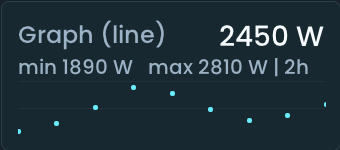 **Graph (bars)**  | **Graph (line)**  **Graph (bars)** 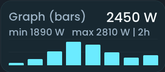 | **Graph (line)** 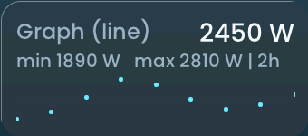 **Graph (bars)**  | **Graph (line)** 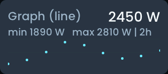 **Graph (bars)** 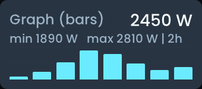 |
| [Binary sensor](widgets/binary_tile.md) |  |  |  |  |
| [Contact](widgets/contact_tile.md) |  |  |  |  |
| [Parqet portfolio](widgets/parqet_portfolio.md) | **Portfolio** 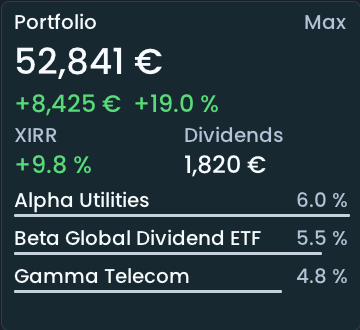 **Portfolio (small)** 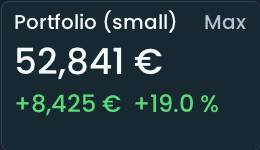 **Portfolio (percent only)** 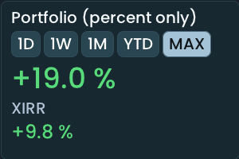 **Portfolio (1 month)** 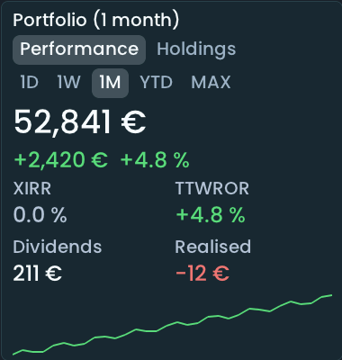 **Portfolio (holdings)** 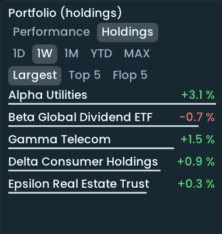 | **Portfolio**  **Portfolio (small)**  **Portfolio (percent only)** 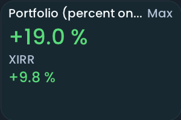 **Portfolio (1 month)** 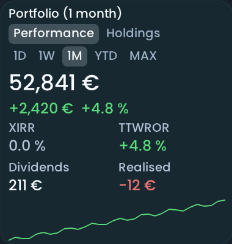 **Portfolio (holdings)** 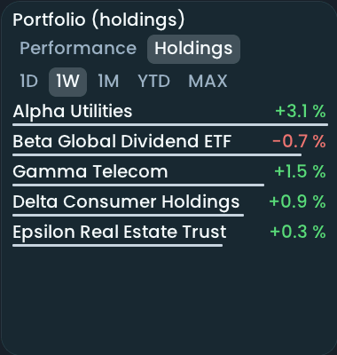 | **Portfolio** 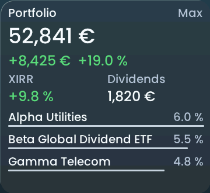 **Portfolio (small)** 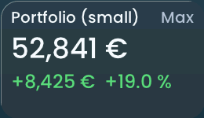 **Portfolio (percent only)** 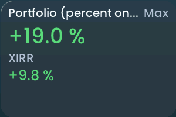 **Portfolio (1 month)** 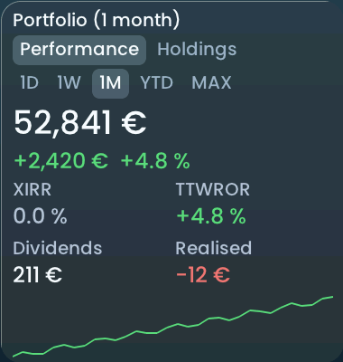 **Portfolio (holdings)** 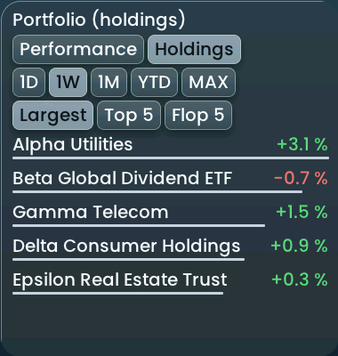 | **Portfolio**  **Portfolio (small)** 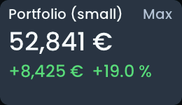 **Portfolio (percent only)**  **Portfolio (1 month)** 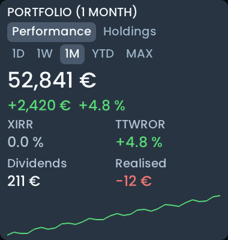 **Portfolio (holdings)** 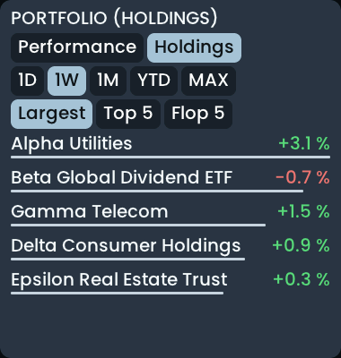 |
| [Stocks & ETFs](widgets/stock_quotes.md) | **Stocks list** 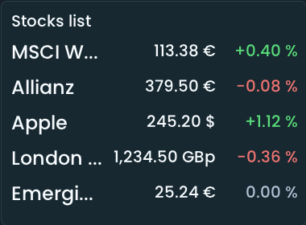 **Stocks list (symbol, both changes)** 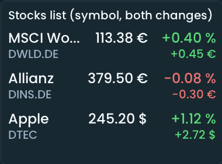 **Stocks charts** 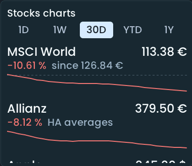 **Stocks tiles** 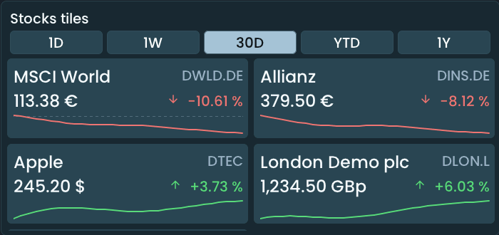 | **Stocks list**  **Stocks list (symbol, both changes)**  **Stocks charts**  **Stocks tiles**  | **Stocks list** 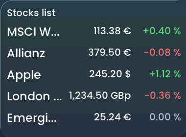 **Stocks list (symbol, both changes)** 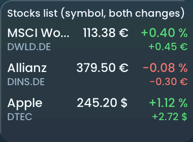 **Stocks charts** 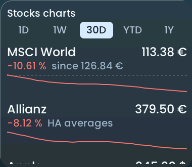 **Stocks tiles** 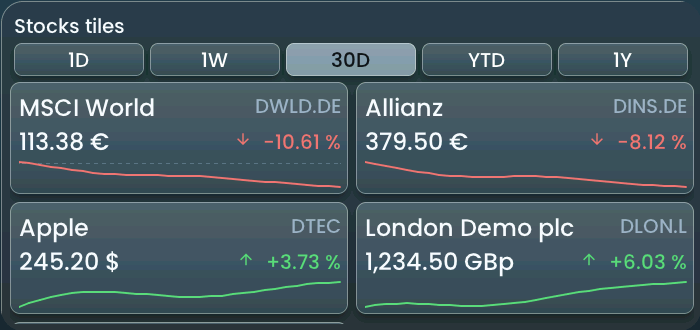 | **Stocks list** 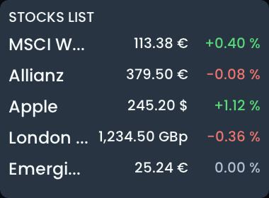 **Stocks list (symbol, both changes)** 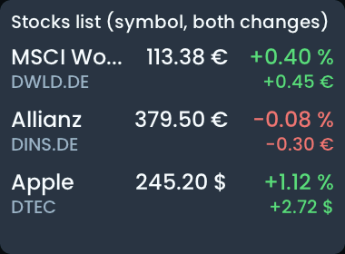 **Stocks charts** 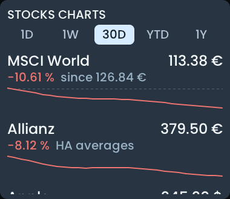 **Stocks tiles** 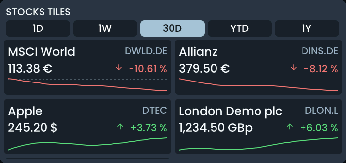 |
| [Button](widgets/button.md) | 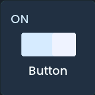 |  |  |  |
| [Slider](widgets/slider.md) | **Vertical**  **Horizontal**  | **Vertical**  **Horizontal**  | **Vertical**  **Horizontal**  | **Vertical**  **Horizontal**  |
| [Light](widgets/light_tile.md) |  |  |  |  |
| [Heating](widgets/heating_tile.md) | **Heating (default)**  **Heating (semi arc)**  | **Heating (default)**  **Heating (semi arc)**  | **Heating (default)**  **Heating (semi arc)**  | **Heating (default)**  **Heating (semi arc)**  |
| [Climate](widgets/climate_tile.md) |  |  |  |  |
| [Cover](widgets/cover_tile.md) |  |  |  |  |
| [Fan](widgets/fan_tile.md) |  |  |  |  |
| [Lock](widgets/lock_tile.md) |  |  |  |  |
| [Alarm](widgets/alarm_tile.md) |  |  |  |  |
| [Select](widgets/select_tile.md) |  |  |  |  |
| [Date/Time](widgets/datetime_tile.md) |  |  |  |  |
| [Scene](widgets/scene_tile.md) |  |  |  |  |
| [Room](widgets/room_tile.md) | **Room, humidity**  **Room, cover**  **Room, media player**  | **Room, humidity**  **Room, cover**  **Room, media player**  | **Room, humidity**  **Room, cover**  **Room, media player**  | **Room, humidity**  **Room, cover**  **Room, media player**  |
| [Room](widgets/room_tile.md) |  |  |  |  |
| [Weather (now)](widgets/weather_tile.md) |  |  |  |  |
| [Weather (now)](widgets/weather_tile.md) |  |  |  |  |
| [Weather forecast](widgets/weather_3day.md) |  |  |  |  |
| [Solar forecast](widgets/solar_forecast.md) | **Solar forecast**  **Solar forecast (vertical)**  | **Solar forecast**  **Solar forecast (vertical)**  | **Solar forecast**  **Solar forecast (vertical)**  | **Solar forecast**  **Solar forecast (vertical)**  |
| [Energy price forecast](widgets/energy_price_forecast.md) | **Energy price forecast**  **Energy price forecast (small)**  | **Energy price forecast**  **Energy price forecast (small)**  | **Energy price forecast**  **Energy price forecast (small)**  | **Energy price forecast**  **Energy price forecast (small)**  |
| [Energy timeline](widgets/energy_timeline.md) |  |  |  |  |
| [Energy timeline](widgets/energy_timeline.md) |  |  |  |  |
| [Media player](widgets/media_player.md) |  |  |  |  |
| [Sonos favorites](widgets/sonos_favorites.md) |  |  |  |  |
| [Todo list](widgets/todo_list.md) |  |  |  |  |
| [Vacuum](widgets/vacuum_tile.md) | **Vacuum**  **Vacuum with map**  | **Vacuum**  **Vacuum with map**  | **Vacuum**  **Vacuum with map**  | **Vacuum**  **Vacuum with map**  |
| [Camera](widgets/camera_tile.md) |  |  |  |  |
| [Car](widgets/car_widget.md) |  |  |  |  |
| [Bambu printer](widgets/bambu_printer.md) |  |  |  |  |
| [Wallbox](widgets/wallbox.md) |  |  |  |  |

## Special pages

[Pages and layouts](pages.md) explains their setup.

| Page | Flat | Glow | Glass | Matte |
| --- | --- | --- | --- | --- |
| House dashboard |  |  |  |  |
| Energy dashboard |  |  |  |  |

## Doorbell popup

Setup: [Notifications](notifications.md). Camera pictures are placeholders.

| Example | Flat | Glow | Glass | Matte |
| --- | --- | --- | --- | --- |
| Doorbell popup |  |  |  |  |

## Select detail popup

Setup: [Select](widgets/select_tile.md).

| Example | Flat | Glow | Glass | Matte |
| --- | --- | --- | --- | --- |
| Select detail popup |  |  |  |  |

## History popup

Setup: [History popups](history.md).

| Example | Flat | Glow | Glass | Matte |
| --- | --- | --- | --- | --- |
| History popup |  |  |  |  |

## Rendering

Everything is rendered from the current firmware sources by the LVGL/SDL simulator (`tools/generate_simulator_gallery.py`) with the synthetic states of `tests/simulator/gallery_data.json`, including the House and Energy pages and the doorbell popup with a stylized camera picture.

Regenerate images after visual changes with `python3 tools/generate_simulator_gallery.py`. For prose-only edits use `--markdown-only`; it preserves images and the source freshness record.
