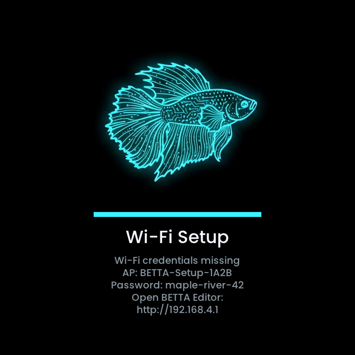
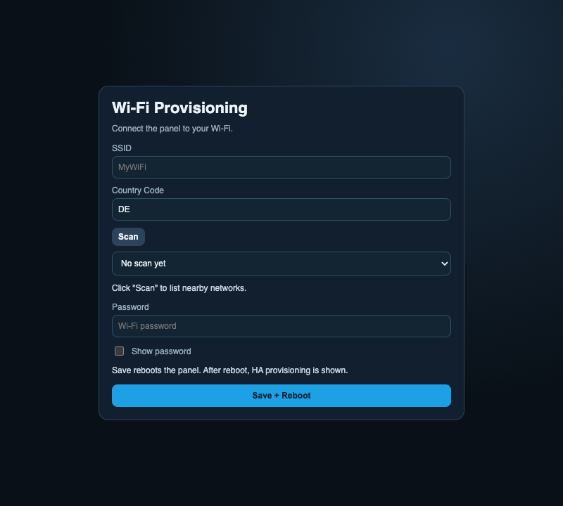
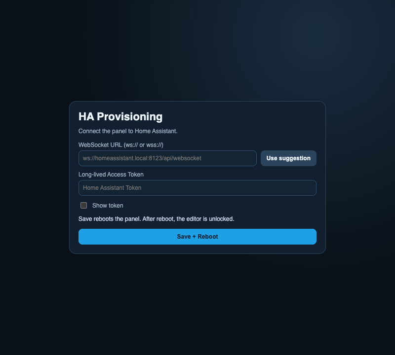
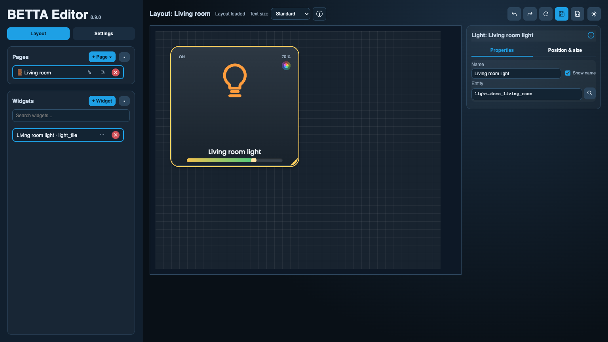
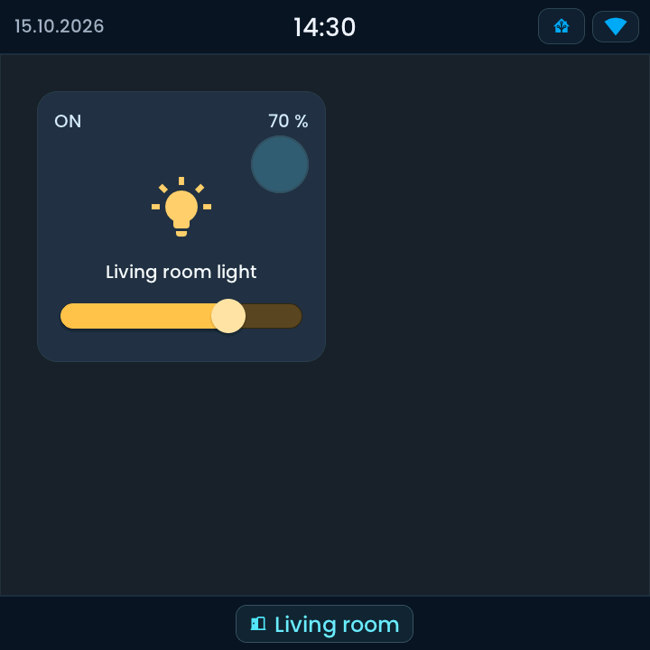

<!-- SPDX-License-Identifier: LicenseRef-FNCL-1.1 | Copyright (c) 2026 andre68723 -- file added in the andre68723/BETTA-HA-PANEL fork, see docs/release-notes.md -->
# Install and set up

Install a ready-made image, connect the panel and operate your first light. You need:

- A [supported display and revision](choose-display.md), with its power supply and a USB **data** cable.
- A computer with desktop **Chrome or Edge** for USB installation. Safari and Firefox do not offer this Web Serial route.
- Your home Wi-Fi name and password, and access to Home Assistant **2026.10 or newer**.
- An HA administrator account with at least one light already working in HA.
  If you have no light, use a Sensor widget instead and check that its value appears.

You do not need ESP-IDF, ESPHome, YAML or an MQTT broker for this first dashboard.
The editor can be opened in other browsers after installation.

## 1. Pick your display

Compare the devices in [Display devices](choose-display.md), then open the guide of yours for the flashing
port and revision checks. Images for different variants are not interchangeable.

Use the device guide's firmware name and flashing connector. The
[display comparison](choose-display.md) is the single list of supported devices and hardware validation.

!!! tip "Before changing an existing installation"

    Export a **full backup** in the editor and read the release's upgrade notes and the
    [fork's upgrade requirements](release-notes.md#upgrading-from-upstream-v082). A bootloader or
    partition-table change needs USB; an OTA upload only updates the app.

## 2. Flash the panel

### Download the files

1. Open the maintainer's [GitHub Releases](https://github.com/andre68723/BETTA-HA-PANEL/releases).
2. Read the release notes and expand **Assets**. Check the supported display devices, silicon
   revisions and installation mode.
3. For a first USB installation download the matching `*.factory.bin`; for a later OTA app update
   download `*.ota.bin`.
4. Keep the release notes open for any device-specific installation or upgrade instructions.
   Checksums and command-line verification are covered in the [download reference](development/build.md#install-a-downloaded-image).

The download names below refer to [v0.9.0](https://github.com/andre68723/BETTA-HA-PANEL/releases/tag/v0.9.0). `panel10` and `paneljc-v2` are only compile-checked: no maintainer has the hardware, so testers and feedback are welcome (see [Choose your display](choose-display.md)):

| Variant | First installation | OTA app update |
| --- | --- | --- |
| `panel4` | [panel4.factory.bin](https://github.com/andre68723/BETTA-HA-PANEL/releases/download/v0.9.0/betta86-ha-panel-v0.9.0-panel4.factory.bin) | [panel4.ota.bin](https://github.com/andre68723/BETTA-HA-PANEL/releases/download/v0.9.0/betta86-ha-panel-v0.9.0-panel4.ota.bin) |
| `paneljc` | [paneljc.factory.bin](https://github.com/andre68723/BETTA-HA-PANEL/releases/download/v0.9.0/betta86-ha-panel-v0.9.0-paneljc.factory.bin) | [paneljc.ota.bin](https://github.com/andre68723/BETTA-HA-PANEL/releases/download/v0.9.0/betta86-ha-panel-v0.9.0-paneljc.ota.bin) |
| `tab5` (device trial) | [tab5.factory.bin](https://github.com/andre68723/BETTA-HA-PANEL/releases/download/v0.9.0/betta86-ha-panel-v0.9.0-tab5.factory.bin) | [tab5.ota.bin](https://github.com/andre68723/BETTA-HA-PANEL/releases/download/v0.9.0/betta86-ha-panel-v0.9.0-tab5.ota.bin) |
| `panel10` (untested) | [panel10.factory.bin](https://github.com/andre68723/BETTA-HA-PANEL/releases/download/v0.9.0/betta86-ha-panel-v0.9.0-panel10.factory.bin) | [panel10.ota.bin](https://github.com/andre68723/BETTA-HA-PANEL/releases/download/v0.9.0/betta86-ha-panel-v0.9.0-panel10.ota.bin) |
| `paneljc-v2` (untested) | [paneljc-v2.factory.bin](https://github.com/andre68723/BETTA-HA-PANEL/releases/download/v0.9.0/betta86-ha-panel-v0.9.0-paneljc-v2.factory.bin) | [paneljc-v2.ota.bin](https://github.com/andre68723/BETTA-HA-PANEL/releases/download/v0.9.0/betta86-ha-panel-v0.9.0-paneljc-v2.ota.bin) |

### Connect USB and write the image

Use a **USB data cable** and the flashing port named in your display device guide. A power-only port or
cable powers the screen without a serial connection. Close any serial monitor first.

1. Open [Espressif ESP Launchpad](https://espressif.github.io/esp-launchpad/) in desktop Chrome or Edge.
   Click **Connect**, select the panel's serial device and check the detected chip/revision against its device guide.
2. Open **DIY**. In its single file row, replace the initial **`0x1000`** in **Flash Address** with **`0x0`**,
   then choose the matching `*.factory.bin`. Keep one row; the file contains the bootloader, partition table and app.
3. Click **Program** and keep the cable connected until it finishes.
4. Use **Console → Reset Device**, or reconnect power. The panel should show the Wi-Fi setup screen below.

This external tool needs no BETTA account or ESPHome. Browser installation has not yet been validated on the
maintainer's panels. If it cannot connect, try the checks under [Troubleshooting](#troubleshooting);
the [command-line alternative](development/build.md#install-a-downloaded-image) is an advanced recovery route.

Never write an OTA-only image at `0x0`. A factory write overwrites the credential region, so keep your
backup. Opening a serial port can restart the panel.

## 3. Connect Wi-Fi

<figure>

<figcaption>Panel: join the displayed setup network with its password, then open the displayed address.</figcaption>
</figure>
<figure>

<figcaption>Browser: choose your country and home Wi-Fi, then save and reboot.</figcaption>
</figure>

1. On first boot the display shows a setup access point `BETTA-Setup-XXXX`, its password and an address.
   *The name and `maple-river-42` in the picture are examples; use the credentials on your own panel.*
2. Join that Wi-Fi network and open `http://192.168.4.1`.
3. Choose your country, scan for your home Wi-Fi, enter its password and save.
4. After the reboot, read the panel's address from the display or your router's DHCP list and open
   `http://<panel-ip>` from the same network.

## 4. Connect Home Assistant

### Create an access token

The editor's entity search and room imports currently require an HA **administrator** account.
You can use a dedicated administrator account for the panel; a normal user account will not provide those features.

1. Sign in to Home Assistant as that user.
2. Select your **user profile** at the bottom of the sidebar, then **Security**.
3. Under **Long-lived access tokens**, select **Create token** and give it a name such as `BETTA living room`.
4. Copy the token when it is displayed; HA will not show the same token again. Paste it into the panel's
   **Access token** field. Keep it private.

See HA's [account security guide](https://www.home-assistant.io/docs/authentication/#managing-account-access)
if your profile layout differs.

### Enter the connection address

The **WebSocket URL** field needs the complete address, including `/api/websocket`:

| Address used to open Home Assistant | Enter on the panel |
| --- | --- |
| `http://homeassistant.local:8123` | `ws://homeassistant.local:8123/api/websocket` |
| `http://192.168.1.10:8123` | `ws://192.168.1.10:8123/api/websocket` |
| `https://ha.example.com` | `wss://ha.example.com/api/websocket` |

Replace the host and port with yours. Use an address reachable from the panel's network;
`localhost` refers to the panel itself. A normal `http://` or `https://` address is currently rejected by this field.

{ width="600" }

Save the Home Assistant connection, wait for the panel to restart, then reload the editor.
The Home Assistant status chip on the panel opens connection details; confirm that it is connected.
For missing entities or a refused token, see [Home Assistant setup](home-assistant.md).

## 5. Control your first light

1. Open the panel's address and select **Layout**.
2. Under **Pages**, choose **+ Page → Blank page**. Select the pencil beside the new page name,
   enter `Living room` and press **Enter**. You can also use an existing free page.
3. Select **+ Widget**, choose **Light**, and select a light you already control in Home Assistant.
   Search by its name; you do not need to type an entity ID.
4. Drag the widget into place and drag its corner to give it enough room. The selected widget's settings
   appear in the inspector on the right.
5. Select **Save** in the header (the disk icon). On the panel, open **Living room** in the bottom bar.
6. Tap the **lamp icon**. Confirm that the real light and the tile both change state. If supported,
   drag the brightness slider too.
7. Reload the editor and confirm that the page and selected light are still there.

<figure>

<figcaption>Browser editor with a single selected light.</figcaption>
</figure>
<figure>

<figcaption>Matching LVGL simulator example with synthetic data.</figcaption>
</figure>

The editor image uses the real editor with public demo data. Your light name and values will differ.
For more controls, browse the [widget library](widgets/README.md). To import a whole room or add an Energy page,
continue with [Pages and layouts](pages.md).

## Update later

| Change | How |
| --- | --- |
| App update for the same display device and partition layout | Upload the matching `*.ota.bin` in **Settings → Firmware → Install manually**, or let the panel check for updates |
| Bootloader or partition-table change | USB installation following the release's migration notes |
| Different display device or revision | Pick the right variant and procedure; never reuse another device's image |

An OTA update keeps layout and credentials but installs no new bootloader or partition table.

## Troubleshooting

- **No serial port:** use a data cable and the flashing USB port; close other serial programs.
- **Cannot connect:** close any other program using the serial port, reconnect the data cable and retry.
  If download mode is needed, use your manufacturer's procedure linked from the device guide; button sequences differ.
- **Black or garbled screen:** check display device, display revision and chip revision before reflashing.
- **No setup page:** check the displayed Wi-Fi name and address; after joining your home Wi-Fi use the new address.
- **Entities missing in Home Assistant:** check the URL/token and the connection status in the editor.

## Network and access

The editor and API use plain HTTP. Keep the panel on a trusted LAN or IoT VLAN, do not forward its port to the
internet and consider the optional admin password (HTTP Basic). See the [Security](SECURITY.md).
