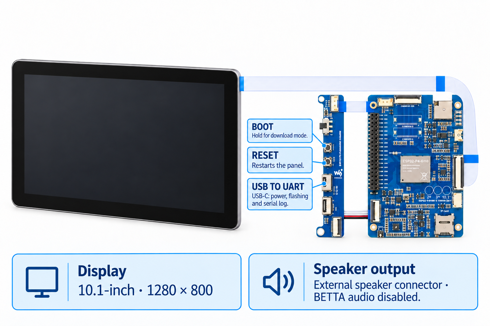

<!-- SPDX-License-Identifier: LicenseRef-FNCL-1.1 | Copyright (c) 2026 Cpt_Kirk | Copyright (c) 2026 andre68723 -- file added in the andre68723/BETTA-HA-PANEL fork, see docs/release-notes.md -->

# Waveshare 10.1-inch panel

<figure class="board-hero">
  
  <figcaption>Illustration based on Waveshare's LCD-X hardware diagram and 10.1-inch dimensions; firmware operation on this assembly has not been verified.</figcaption>
</figure>

This guide shows the Waveshare **ESP32-P4-WIFI6-Touch-LCD-10.1** from the
LCD-X series. The `panel10` firmware profile provides 1280 × 800 geometry and
has not been run on hardware yet. Its current controller setup still uses the inherited
Nano BSP; operation on this LCD-X assembly needs a hardware trial.

## Specifications

| Item | Device / firmware profile |
| --- | --- |
| Display | 10.1-inch, 1280 × 800 |
| Dashboard area | 1280 × 680, after the top and bottom bars |
| Host / Wi-Fi | ESP32-P4 at 360 MHz / ESP32-C6 through ESP-Hosted |
| Flash / PSRAM | 32 MB flash / Hex PSRAM at 200 MHz |
| Display / touch controller | Match the LCD-X assembly to the firmware's controller setup; hardware verification pending |
| Navigation | Up to 12 pages |
| Camera / sound | No configured ambient camera; ES8311 and external-speaker connector, no enabled BETTA audio driver |

## Firmware and revisions

Use the `panel10` factory image when the release lists your device and silicon revision.
Follow [Install and set up](../getting-started.md#2-flash-the-panel) for browser installation.

Use the exact `panel10` image. Follow [installation](../getting-started.md)
for packaging and first-run setup.

## Buttons and ports

For flashing, connect a USB data cable to **USB TO UART (USB-C)** on the I/O
board shown above. It is the upper of the two USB-C ports; the lower **USB OTG**
port has a different role.

## Validation status and next checks

Verify the chip revision, display and touch, backlight levels, Wi-Fi, editor and
OTA on the exact assembled unit. There are no measured memory or rendering
baselines for this variant in the fork; the shared build settings do not establish
hardware behaviour.

## Technical notes

Pin assignments, schematic checks, BSP versions and open points are in the [device technical notes](device-notes.md#panel10).

## Manufacturer references

- **Documentation:** [Waveshare ESP32-P4-WIFI6-Touch-LCD-10.1](https://docs.waveshare.com/ESP32-P4-WIFI6-Touch-LCD-X#esp32-p4-wifi6-touch-lcd-101), including the LCD-X hardware diagram and 10.1-inch dimensions.
- **Flashing instructions:** [Waveshare LCD-X firmware flashing](https://docs.waveshare.com/ESP32-P4-WIFI6-Touch-LCD-X/Firmware-Flashing), including download-mode recovery.

## Related guides

[Install and set up](../getting-started.md) · [Display and brightness](../display.md) · [Home Assistant setup](../home-assistant.md)
