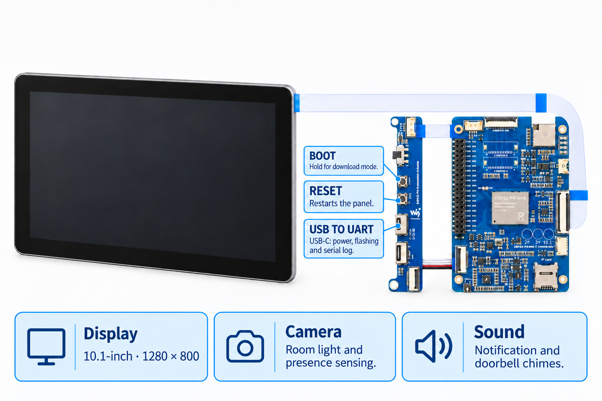

<!-- SPDX-License-Identifier: LicenseRef-FNCL-1.1 | Copyright (c) 2026 Cpt_Kirk | Copyright (c) 2026 andre68723 -- file added in the andre68723/BETTA-HA-PANEL fork, see docs/release-notes.md -->

# Waveshare 10.1-inch panel

<figure class="board-hero">
  
  <figcaption>Illustration based on Waveshare's LCD-X hardware diagram and 10.1-inch dimensions; firmware operation on this assembly has not been verified.</figcaption>
</figure>

This guide shows the Waveshare **ESP32-P4-WIFI6-Touch-LCD-10.1** from the
LCD-X series. The `panel10` firmware profile targets this ready-made display with the LCD-X BSP,
JD9365 display and GT9271 touch controller. It provides 1280 × 800 landscape
geometry and has not been run on this hardware in this fork.
The separate ESP32-P4-Nano plus DSI display kit is not supported by this profile.

## Specifications

| Item | Device / firmware profile |
| --- | --- |
| Display | 10.1-inch, 1280 × 800 |
| Dashboard area | 1280 × 680, after the top and bottom bars |
| Host / Wi-Fi | ESP32-P4 at 360 MHz / ESP32-C6 through ESP-Hosted |
| Flash / PSRAM | 32 MB flash / Hex PSRAM at 200 MHz |
| Display / touch controller | JD9365 / GT9271; fixed landscape rotation |
| Navigation | Up to 12 pages |
| Camera / sound | Built-in OV5647 camera; ES8311/ES7210 audio, two microphones and speaker. BETTA supports light/presence sensing and chimes; microphones are unused |

## Firmware and revisions

The current profile targets **ESP32-P4 Rev3.0 or later**. Check the chip revision
before installation; older Rev1.x units require a different build and are not
covered by this profile. The screen size alone does not identify compatible hardware.
Use the `panel10` factory image when the release lists this LCD-X device and revision.
Follow [Install and set up](../getting-started.md#2-flash-the-panel) for browser installation.

The LCD-X board uses PWM backlight control. BETTA's brightness, night mode and
wake-touch policy apply; camera-based brightness/presence and notification chimes are available as
optional features, with their saved settings off by default.

## Buttons and ports

For flashing, connect a USB data cable to **USB TO UART (USB-C)** on the I/O
board shown above. It is the upper of the two USB-C ports; the lower **USB OTG**
port has a different role.

## Camera and sound

The built-in **OV5647** front camera supplies light and presence sensing under
**Settings → Display**. **Adapt to room light** adjusts the backlight; **Wake on
approach** wakes a dimmed display. Night wake is a separate option. Both camera
options start off. **Test now** samples presence for at most 30 seconds; the
panel owns the timeout even if the browser disconnects. Images stay on the
panel; this feature records and streams nothing.

**Settings → Sound** provides notification and doorbell chimes through the
**ES8311** speaker path. Sound starts off, at 60% volume with night mute on;
**Test chime** uses the selected volume. The hardware also has an **ES7210**
and two microphones, which BETTA does not initialize. See [Display and
brightness](../display.md) and [notification sounds](../notifications.md#sound).

## Validation status and next checks

The profile is compile-checked only. Verify chip revision, display colours and
touch alignment, backlight levels, Wi-Fi/HA, editor and OTA on the exact unit.
Camera light calibration, approach/night wake, test expiry, audible chimes and
simultaneous camera/touch/audio operation still need device checks. There are no measured memory or rendering
baselines for this variant in the fork; the shared build settings do not establish
hardware behaviour.

## Technical notes

Pin assignments, schematic checks, BSP versions and open points are in the [device technical notes](device-notes.md#panel10).

## Manufacturer references

- **Documentation:** [Waveshare ESP32-P4-WIFI6-Touch-LCD-10.1](https://docs.waveshare.com/ESP32-P4-WIFI6-Touch-LCD-X#esp32-p4-wifi6-touch-lcd-101), including the LCD-X hardware diagram and 10.1-inch dimensions.
- **Official source and examples:** [Waveshare ESP32-P4-WIFI6-Touch-LCD-X](https://github.com/waveshareteam/ESP32-P4-WIFI6-Touch-LCD-X), including camera and audio identification.
- **Flashing instructions:** [Waveshare LCD-X firmware flashing](https://docs.waveshare.com/ESP32-P4-WIFI6-Touch-LCD-X/Firmware-Flashing), including download-mode recovery.

## Related guides

[Install and set up](../getting-started.md) · [Display and brightness](../display.md) · [Home Assistant setup](../home-assistant.md)
