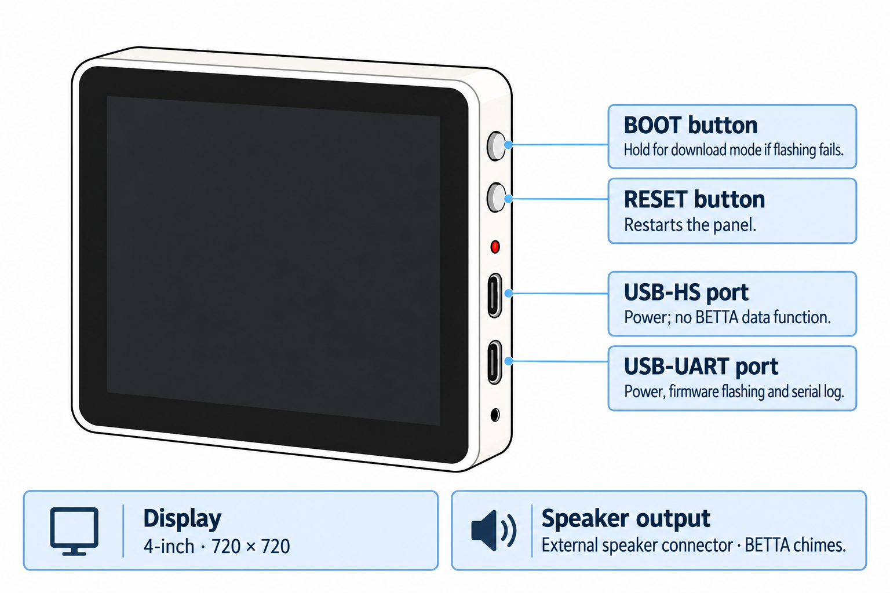

<!-- SPDX-License-Identifier: LicenseRef-FNCL-1.1 | Copyright (c) 2026 Cpt_Kirk | Copyright (c) 2026 andre68723 -- file added in the andre68723/BETTA-HA-PANEL fork, see docs/release-notes.md -->

# Waveshare 4-inch panel

<figure class="board-hero">
  
  <figcaption>Schematic illustration of the LCD-4B connectors and controls.</figcaption>
</figure>

`panel4` targets the ESP32-P4-WIFI6-Touch-LCD-4B. The maintainer uses a v1.3 unit; normal display, touch, Wi-Fi and dashboard operation have been exercised on hardware.

## Specifications

| Item | Device / firmware profile |
| --- | --- |
| Display | 4-inch IPS, 720 × 720 |
| Dashboard area | 720 × 600 |
| Host / Wi-Fi | ESP32-P4 at 360 MHz / ESP32-C6 through ESP-Hosted |
| Flash / PSRAM | 32 MB / 32 MB; Hex PSRAM at 200 MHz |
| Display / touch controller | ST7703 / GT911 |
| Navigation | Up to 8 pages |
| Camera / sound | No ambient camera; ES8311 chime driver and external-speaker connector |

## Firmware and revisions

Use the `panel4` factory image when the release lists your device and silicon revision.
Follow [Install and set up](../getting-started.md#2-flash-the-panel) for browser installation.

The current image targets pre-v3 ESP32-P4 silicon. Check the chip revision of a
new unit before flashing; newer Waveshare examples default to v3.x. The physical
LCD-4B name alone does not identify a compatible chip revision.

## Buttons and ports

For flashing, connect a USB data cable to the **lower USB-C connector (USB-UART)**
shown in the illustration above.

- **BOOT:** hold for download mode if normal flashing fails.
- **RESET:** restarts the panel.
- **USB-HS:** supplies power; BETTA does not use it for data.
- **USB-UART:** supplies power and carries firmware flashing and the serial log.

## Validation status and next checks

- Tested unit: ESP32-P4 v1.3; display and touch responded.
- Check the chip revision of a newly purchased unit. No v3.x unit has been tested in this fork.
- The audio API/driver path has been stress checked. Audible output, pop suppression and audio/touch coexistence still need verification; see [chime evidence](peripherals.md#optional-chime-output).

## Technical notes

Pin assignments, schematic checks, BSP versions and open points are in the [device technical notes](device-notes.md#panel4).

## Manufacturer references

- **Product:** [Waveshare ESP32-P4-WIFI6-Touch-LCD-4B](https://www.waveshare.com/esp32-p4-wifi6-touch-lcd-4b.htm).
- **Documentation:** [Waveshare LCD-4B guide](https://docs.waveshare.com/ESP32-P4-WIFI6-Touch-LCD-4B).
- **Source and schematics:** [Waveshare GitHub repository](https://github.com/waveshareteam/ESP32-P4-WIFI6-Touch-LCD-4B), including examples and ESP-Brookesia firmware.

## Related guides

[Install and set up](../getting-started.md) · [Display and brightness](../display.md) · [Home Assistant setup](../home-assistant.md)
