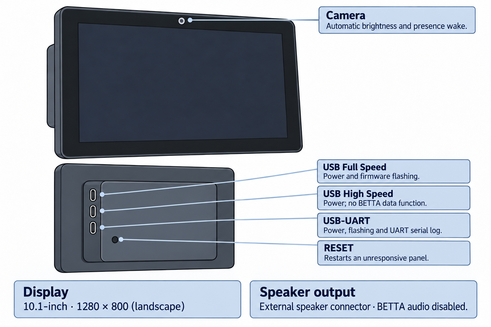

<!-- SPDX-License-Identifier: LicenseRef-FNCL-1.1 | Copyright (c) 2026 Cpt_Kirk | Copyright (c) 2026 andre68723 -- file added in the andre68723/BETTA-HA-PANEL fork, see docs/release-notes.md -->

# Guition JC8012P4A1

<figure class="board-hero">
  
  <figcaption>Schematic illustration; the three USB-C ports are on the rear electronics box.</figcaption>
</figure>

`paneljc` targets the original Guition display panel and runs on the maintainer's hardware. `paneljc-v2` targets the newer display panel and has not been tried on a real unit yet. Both current builds target pre-v3 ESP32-P4 silicon.

## Specifications

| Item | Device / firmware profile |
| --- | --- |
| Display | 10.1-inch, 1280 × 800 |
| Dashboard area | 1280 × 680 |
| Host / Wi-Fi | ESP32-P4 at 360 MHz / ESP32-C6 through ESP-Hosted |
| Flash / PSRAM | 16 MB / 32 MB; Hex PSRAM at 200 MHz |
| Display / touch controller | JD9365 (V1/V2 timing) / GSL3680 |
| Navigation | Up to 12 pages |
| Camera / sound | OV02C10 room-light/presence sensing; ES8311 external-speaker output, disabled in current builds |

The [manufacturer datasheet](#manufacturer-references) identifies a **Speaker
Interface** on the internal PCB (interface 11, page 5). This documents an
external-speaker connection, not a built-in loudspeaker. The illustration does
not depict a speaker grille. No audible output has been verified on the
maintainer's unit, and the current BETTA build disables the JC audio path.

## Firmware and revisions

### JC8012P4A1 Panel Revisions

Read the label on the back of the case before choosing an image:

| Rear label | Image | Status |
| --- | --- | --- |
| No V2 suffix after the material number | `paneljc` | Original display; exercised on hardware |
| V2 suffix after the material number | `paneljc-v2` | New display; compile-checked, no device trial |

The printed date code is not a reliable substitute for the V2 label.
Check the chip revision reported by the installer as well: both images target **pre-v3 ESP32-P4 silicon**.
Only install a variant when the release provides the matching image for your device and silicon.

### V3: ESP32-P4 v3.x silicon

Current images do **not** support v3.x chips, including those sold with a V2 display panel.
A V2 label identifies the display, not the P4 silicon revision. If the installer reports v3.x,
stop and use firmware that explicitly supports it. The
[revision research](device-notes.md#jc8012p4a1-panel-revisions) is in Development.

Continue with [Install and set up](../getting-started.md#2-flash-the-panel) for the matching factory image.

## Buttons and ports

For flashing, connect a USB data cable to the **top USB-C connector (USB Full Speed)**
on the rear box shown above; the **bottom USB-UART connector** also works.

- **Camera:** automatic brightness and presence wake; see [camera sensing](peripherals.md).
- **USB Full Speed (top):** supplies power and supports firmware flashing.
- **USB High Speed (middle):** supplies power; BETTA does not use it for data.
- **USB-UART (bottom):** supplies power and carries firmware flashing and the UART serial log.
- **RESET:** restarts an unresponsive panel.

## Validation status and next checks

- Original panel: display, touch, Wi-Fi and dashboard use have been exercised on hardware.
- V2 panel: not yet tried on a real unit. Verify display initialization/timing and touch on the exact unit.
- A v3.x P4 chip needs a different silicon build, which has not been built or tried here.
- Audio is disabled in the current images; there is no Sound page.

## Technical notes

Pin assignments, schematic checks, BSP versions and open points are in the [device technical notes](device-notes.md#paneljc).

## Manufacturer references

- **Specification:** [Guition datasheet (PDF)](https://www.guition.com/icms/upload/fb081940d6fc11f09850077a33e1404f/FTPData/UEditor/file/2026121/1768961095913/JC8012P4A1C_I_W%20Specifications-EN-v1.1%282%29.pdf),
  ESP32-P4, 32 MB PSRAM, 16 MB flash, JD9365 at 800x1280, active area 216.58 x 135.36 mm (about 5.9 px/mm), 5 V at about 700 mA.
- **Product:** [Guition JC8012P4A1](https://www.guition.com/de/esp32p4-display-module/10-1-inch-esp32p4-display-module).
- **Source and schematics:** [Guition full package (ZIP)](https://pan.jczn1688.com/directlink/1/HMI%20display/JC8012P4A1C_I_W_Y.zip), with schematics, datasheets,
  ESP-IDF 5.5.4 demos for the "Old Panel" and the "New Panel" (= V1 and V2 here), an ESP-IDF 6.0.2 demo for the
  "New Panel" on ESP32-P4 v3.x silicon, and factory images including the C6 slave firmware.

## Related guides

[Install and set up](../getting-started.md) · [Display and brightness](../display.md) · [Home Assistant setup](../home-assistant.md)
