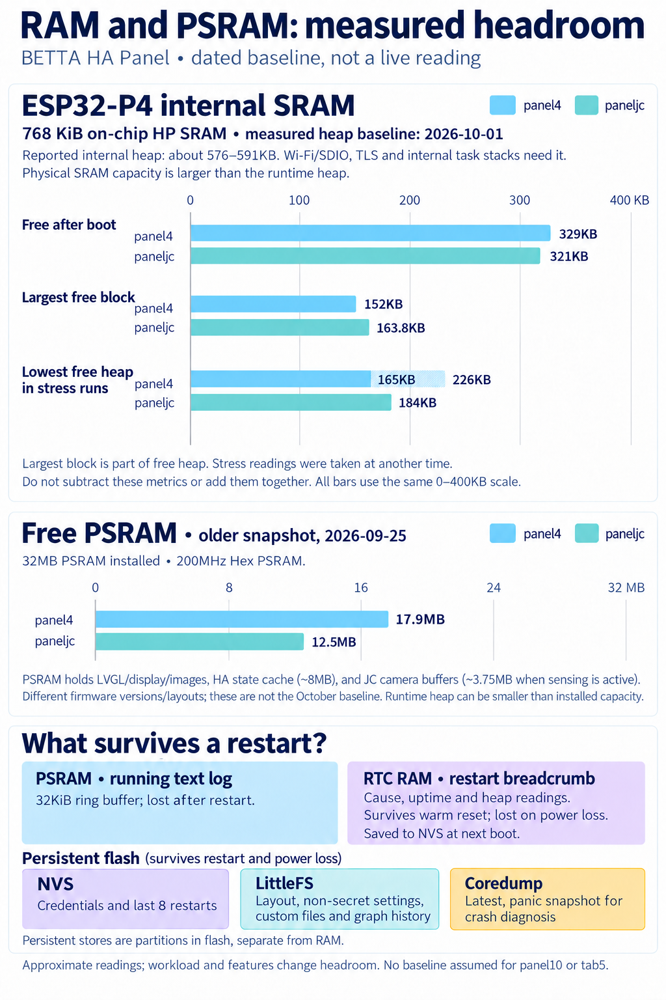

<!-- SPDX-License-Identifier: LicenseRef-FNCL-1.1 | Copyright (c) 2026 Cpt_Kirk | Copyright (c) 2026 andre68723 -- file added in the andre68723/BETTA-HA-PANEL fork, see docs/release-notes.md -->

# CPU, memory and rendering

This is the technical reference for the shared ESP32-P4 platform. For device
selection and validation status, start with [Hardware](../choose-display.md).
Measurements retain their recorded dates, display device and workload; they are not
benchmarks of the untested variants.

## CPU and network

The ESP32-P4 variants run at 360 MHz and use an ESP32-C6 coprocessor through ESP-Hosted for Wi-Fi. That gives better CPU headroom for UI rendering, JSON parsing and image decode work, but the hosted Wi-Fi path still consumes memory and tasks.

Simultaneous LVGL redraws, Home Assistant bursts, image decoding and HTTP editor traffic still compete for the CPU. Feature work should avoid blocking the UI task and should keep background refreshes staggered.

## RAM and PSRAM

The ESP32-P4 variants use 200 MHz Hex PSRAM and reserve more internal RAM for networking/TLS. They have more comfortable headroom for:

- Larger LVGL draw buffers.
- Cover-art decoding.
- Larger WebSocket and JSON payloads.
- More widgets visible at once.

### Where the internal RAM goes (measured 2026-10-01)

The ESP32-P4 has 768 KiB of internal high-performance SRAM (HP L2MEM); see the [Espressif datasheet](https://documentation.espressif.com/esp32-p4-chip-revision-v1.3_datasheet_en.html). This is the P4's on-chip memory, separate from external PSRAM and the low-power/RTC memory. The internal heap reported by the firmware on the P4 boards is about 576-591 KB; this is not the chip's full physical SRAM capacity. In earlier fork allocation tests, LVGL took 174 KB of it on the paneljc and 146 KB on the panel4, leaving
about 129 and 165 KB free after boot; LVGL now allocates from PSRAM first on every board (`ui/lvgl_alloc.c`), which gives about 320 KB free after boot, a largest
block of 150-160 KB and 165-226 KB as the lowest value under `tools/stress_test.py`, and made the editor-open freeze disappear in the stress test. `panel10` uses
the same setting but has not been measured. The numbers, the method and the task stack sizes are in [Working practices](../development/learnings.md#memory-and-heap).

The illustration uses horizontal bar charts of documented measurements, with LVGL preferring PSRAM. The internal-heap metrics share a 0-400 KB scale; the older free-PSRAM snapshots have a separate 0-32 MB scale. The internal-heap values below are approximate and retain the KB units of the measurement notes; they depend on layout, enabled features and workload. Bars compare separate metrics rather than forming a stacked allocation budget.

| Internal-heap metric (2026-10-01) | `panel4` | `paneljc` |
| --- | --- | --- |
| Free after boot | 329 KB | 321 KB |
| Largest free block after boot | 152 KB | 163.8 KB |
| Lowest free heap during the initial stress runs | 165-226 KB | 184 KB |

The largest block is part of the free heap, and the stress minimum is a reading at another time; these are not separate allocation buckets. The panel4 stress range spans different runs. PSRAM role annotations are examples rather than a complete allocation breakdown: the HA entity/state cache is about 8 MB, and the two JC camera buffers add about 3.75 MB when camera sensing is active. Installed PSRAM capacity is 32 MB; the runtime heap can be smaller because firmware and reserved regions also use PSRAM. Only the measured free amounts are drawn; empty chart space does not identify a measured used-memory category. The free-PSRAM readings of 17.9 MB (`panel4`) and 12.5 MB (`paneljc`) are the older 2026-09-25 snapshots discussed below, not measurements accompanying the October internal-heap baseline. No memory baseline is inferred for `panel10` or `tab5`.

### Headroom: 4-inch versus paneljc

Both `panel4` and `paneljc` use an ESP32-P4 host plus an ESP32-C6 over ESP-Hosted/SDIO; the JC network freeze is not explained by one board using native Wi-Fi. The 4-inch display is 720x720 (518,400 pixels), while the JC display is 1280x800 (1,024,000 pixels, nearly twice as many) and is rotated from native portrait to landscape. JC has the built-in OV02C10 enabled by default; with auto brightness or presence wake enabled, its two 1288x728 RGB565 capture buffers alone occupy about 3.75 MB of PSRAM. Tab5 camera sensing defaults off; one device trial began on 2026-10-05, but a comparable steady-state memory baseline remains pending. Both measured boards run the SDIO clock at 40 MHz; the firmware differs in the JC TX/RX queues, which are 26 versus 20 deep, trading about 19 KB more reserved internal RAM for burst tolerance.

A 2026-09-25 read-only snapshot showed `panel4` with about 197 KB free internal RAM (since-boot minimum 88 KB) and 17.9 MB free PSRAM; `paneljc` had about 103 KB free internal RAM (minimum 19 KB after a deliberately heavy editor stress test) and 12.5 MB free PSRAM. These were different firmware versions (`panel4` v0.8.3, JC v0.9.0) and not identical layouts or simultaneous controlled loads. They establish much less headroom on the JC, **not** that any one hardware difference alone caused the outage or that the 4-inch board is immune under the same stress.

## Rendering performance (paneljc)

These timings and accompanying memory readings are historical snapshots from
the rendering work. The later SRAM/PSRAM allocation changes and dated headroom
measurements are documented above.

Measured with the per-switch log lines (`page <id>: frame done <n> ms after the switch`, `GET /api/log`) after the
refresh optimisation: first finished frame 133 ms (energy page), 159 ms (house page, 16 rooms), 215 ms and 250 ms
(pages with weather, media and solar tiles); the state refresh itself is 0 to 35 ms. On `panel4` the same switch takes
58 to 117 ms. Free internal RAM was about 165 KB (lowest 77 KB), PSRAM about 12 MB of 28 MB free on `paneljc`.

Measured on `paneljc`: switching pages redraws the whole 1280 x 680 area, which
takes roughly 120 ms (a page with little on it) to 280 ms (a page full of
widgets). The panel is portrait natively, so every frame is rotated: by the PPA
hardware (`CONFIG_APP_DISPLAY_PPA`); drawing itself is software rendering
into PSRAM buffers. The refresh of the widgets on the new page runs after the
first frame in slices of about 8 ms (tiles that are updated while hidden are skipped, room tiles included), and LVGL's shadow, corner and image caches are enabled. Two
things were tried and do not work here: small render buffers in internal RAM
(each strip has a fixed cost, the frame took over a second) and multi-threaded
drawing (with ThorVG every draw thread needs a 32 KB internal-RAM stack, and
internal RAM is the scarce resource: about 100 to 200 KB stay free).

## Layout limits

The global layout caps are shared by all variants:

- Maximum pages: 12 on the 1280 px wide panels (`paneljc`, `paneljc-v2`, `panel10`, `tab5`), 8 on `panel4` (a 64 px tab per page; the first pages show icon and title, more switch the bar to compact tabs, see [development.md](../development/testing.md#bottom-navigation-full-and-compact-tabs); `APP_MAX_PAGES` in `main/app_config.h`, the editor reads `max_pages` from the panel)
- Maximum widgets per page: 32
- Maximum widgets total: 224 (pages x 32, capped)
- Layout JSON limit: 32 KB
- Home Assistant entity/state cache: 4096 entities and 4096 states on all ESP32-P4 variants (`paneljc`, `panel10`, `panel4`, `tab5`; kept in PSRAM, about 8 MB)
- Home Assistant attribute payload per cached state: 1280 bytes (the weather tile keeps its forecast and the current conditions there)

These caps are upper bounds, not good default design targets. On the 720 x 720 variant a dense page can become cramped before it hits the technical widget count. On the 1280 x 800 variants, the same widget count is usually constrained by Home Assistant state traffic and image/widget memory before visible space.

## Display and widget density

Dense pages are limited by space before they hit any technical cap. Prefer:

- Fewer widgets per page.
- Larger touch targets over dense lists.
- Shorter titles.
- One graph or media-heavy widget per page when possible.

`panel4` (its ESP32-P4 is chip revision v1.3, so the build targets revisions v1.0 to v1.99) has 720 x 600 dashboard pixels and is the middle ground. It can handle mixed pages, but large list widgets, media-player cover art and graphs still compete for space.

`panel10` and `paneljc` share the 1280 x 680 dashboard area. They are best for dense dashboards, wider graphs, energy pages, media widgets and room-control pages.

## Rules of thumb for layouts

- Test layout changes on `panel4` (the smallest remaining screen) if they affect widget minimum sizes, text, lists, cover art, weather, graphs or Home Assistant payload handling.
- Keep large widgets optional and degrade gracefully when their secondary entity is missing.
- Prefer compact cached attributes over raw Home Assistant attribute blobs.
- Keep touch rows at stable heights so resizing and scrolling do not fight each other.
- Treat 1280 x 680 as the roomy target and 720 x 600 as the compatibility target.

## Brightness and display policy

All variants share the brightness decisions in `main/drivers/display_policy.c`
(host-tested), state/timers in `display_brightness.c` and a device-specific
`display_backlight_write()`. Room-light scaling ranges from 10–100%; scaled
active/dimmed levels stay at least 5% unless their chosen level is lower.

`GET /api/version` reports `display.brightness_percent`, `display.state`
(`active`, `dimmed`, `night`, `weather`, `pages`, `off`, `test`) and
`display.room_light_percent`. `PUT /api/settings` with `"reboot": false`
applies the live settings group.

`POST /api/display/test` starts (`action: start`, `kind: active|dim|night`, `percent: 0..100`), updates
(`action: update`, `percent`) or stops (`action: stop`) the fixed backlight preview. `GET` on the same path returns
`active`, `kind`, `remaining_s` and `brightness_percent`. Requests hold the display lock for UI operations; a transparent
protection overlay consumes the first touch. The device owns the 30-second deadline, and updates never extend it.
The central backlight setter enforces the preview over scheduled/camera changes; camera presence cannot interrupt it.

The SDL simulator renders dashboards, but does not exercise this protection
overlay or physical backlight, touch wake and camera presence behaviour.
Device checks remain necessary; see the validation notes below.
