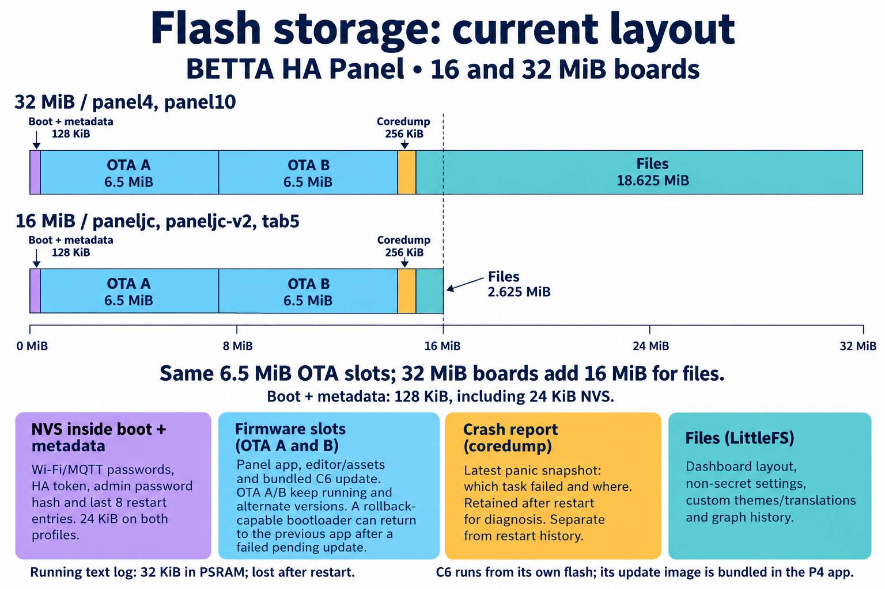

<!-- SPDX-License-Identifier: LicenseRef-FNCL-1.1 | Copyright (c) 2026 Cpt_Kirk | Copyright (c) 2026 andre68723 -- file added in the andre68723/BETTA-HA-PANEL fork, see docs/release-notes.md -->

# Flash partitions and storage

This reference explains the current flash layout, where configuration and
credentials live, and the firmware's size budget. For first installation use
[the installation guide](../getting-started.md); for a partition-table migration
use [the development procedure](../development/build.md#changing-the-partition-table).

## Partition tables

Both profiles in the illustration use the same 0-32 MiB capacity scale: a 16 MiB board ends halfway across it. Small segment widths are approximate at raster resolution. The image shows the current layout from the source CSVs and explains storage purposes without hexadecimal addresses. Explanation boxes use the same category colors as their bar segments: blue firmware, teal files, amber crash reports and purple boot/metadata including NVS. Sizes below are binary (1 MiB = 1,048,576 bytes; 1 KiB = 1,024 bytes). The first 128 KiB includes the bootloader, partition table, NVS, OTA metadata, PHY data and alignment gaps; it is not one partition.

The current layout uses two 6.5 MiB app slots on both flash profiles, with identical partition start addresses. Only LittleFS capacity differs: 2.625 MiB on 16 MiB boards and 18.625 MiB on 32 MiB boards, starting at 13.375 MiB in both cases. Both keep the 24 KiB NVS and the OTA/PHY metadata at their present addresses, plus a 256 KiB panic-report reserve. A coredump is a saved snapshot of a firmware crash, used to identify the failing task and code location after restart; it is separate from restart history and the running text log.

| Current profile | App slots | Coredump | LittleFS |
| --- | --- | --- | --- |
| 16 MiB: `config/partitions.paneljc.csv`, `config/partitions.tab5.csv` | ota_0 / ota_1, 6.5 MiB each, at 0x20000 / 0x6A0000 | 256 KiB at 0xD20000 | 2.625 MiB at 0xD60000 |
| 32 MiB: `config/partitions.csv` | ota_0 / ota_1, 6.5 MiB each, at 0x20000 / 0x6A0000 | 256 KiB at 0xD20000 | 18.625 MiB at 0xD60000 |

The common metadata partitions are `nvs` (24 KiB at 0x9000), `otadata` (8 KiB at 0xF000) and `phy_init` (4 KiB at 0x11000). These are partition capacities, not current firmware or filesystem usage. The Tab5 layout is build-checked; its presence in the map does not establish on-device behaviour.

### Factory partition and `*.factory.bin`

The `factory` partition type is an app image, not a store for factory settings. The editor's factory reset erases NVS and LittleFS and restarts the current firmware; it does not select a factory app. A release file named `*.factory.bin` is the combined USB installation image (bootloader, partition table and app), including for boards without a partition named `factory`.

The original Waveshare 10-inch (`panel10`, 32 MiB) v0.8.2 release had a 9 MiB factory partition containing the full initial panel firmware, including editor/assets and the bundled C6 update image. Its app bytes match the corresponding upstream OTA image exactly (5,095,088 bytes at 0x20000 in the combined image); it was not a separate small rescue application. The fork's two-slot table replaces that partition with ota_0. An ordinary OTA never changes a device's installed partition table, so a device on another table needs one USB installation of table and app.

Two OTA slots already support rollback to the preceding firmware when the rollback-capable bootloader is installed; no separate factory app is needed for that. The 256 KiB coredump partition stores an ELF panic dump; its actual size depends on the captured tasks and stacks.

### Where settings, credentials and diagnostics live

| Content | Storage | Persistence and use |
| --- | --- | --- |
| Firmware, embedded web editor and bundled assets | Active `ota_*` app partition (`factory` only on legacy tables) | Updated as part of the app image. |
| Bundled C6 firmware update image | Inside each P4 app image | Transferred over ESP-Hosted/SDIO when needed; the C6 runs from its own separate flash. Not stored in LittleFS. |
| Dashboard layout | LittleFS: `/littlefs/layout.json` | File-backed runtime configuration. |
| Non-secret settings, including Wi-Fi SSID, HA URL and MQTT username | LittleFS: `/littlefs/settings.json` | Passwords and the HA token are omitted from this file. |
| Themes and selected theme, translations | LittleFS: `/littlefs/themes/` and `/littlefs/i18n/` | Runtime files; built-in defaults remain in the app. |
| Persisted graph-widget history | LittleFS: `/littlefs/graphs/*.grph` | Local graph history, not the device log. |
| Wi-Fi password, HA access token, MQTT password | `nvs`, namespace `runtime_sec` | Alternating `secrets_0` / `secrets_1` records; the settings file selects their generation. |
| Editor/admin password verification data | `nvs`, namespace `betta_auth` | Salt and password hash; the admin password itself is not stored. |
| Restart history (`GET /api/reboot-log`) | `nvs`, namespace `reboot_log`, key `ring` | Last eight entries, saved once per boot. A breadcrumb in RTC RAM records the preceding run and survives warm resets, but not power loss. |
| Previous Wi-Fi diagnostics | `nvs`, namespace `wifi_diag`, key `last` | Diagnostic snapshot retained across restarts. |
| Panic/crash snapshot (`GET /api/coredump`) | Dedicated `coredump` partition | Latest stored panic dump, separate from restart history; see [coredump.md](../coredump.md). |
| Running text log (`GET /api/log`) | 32 KiB ring buffer in PSRAM | Volatile; starts again after a restart. Not a LittleFS file or the coredump. |
| Boot selection and OTA state | `otadata` | Identifies the OTA app to boot; not credentials or restart history. |

The diagrams distinguish persistent flash data from the volatile running log and RTC breadcrumb; the table above gives the storage paths. NVS is in the small shared low-address region on **both** profiles, at 0x9000 with a capacity of 24 KiB, independent of whether a factory app exists.

LittleFS is used for runtime configuration and persisted graph history, rather than the embedded editor, built-in fonts/images or C6 updater. Layout JSON is limited to 32 KiB and non-secret settings JSON to 4 KiB; custom themes/translations and graph histories add variable usage. A full graph file is about 32 KiB (4,096 samples plus its header). Local graph files share a budget of one quarter of LittleFS, capped at 1 MiB; each replacement also leaves at least 512 KiB free. A save outside this budget is skipped while the graph continues sampling in RAM. The history worker removes files for graphs absent from the saved layout, including graphs switched to Recorder history, and replaces retained files atomically. The partition sizes above describe reserved capacity, not occupied bytes; no live filesystem usage was measured for these diagrams.

Settings publish a new generation only after its complete secret record is committed to NVS. A failed save retains the previous endpoint/credential pair. Transient read or allocation errors leave existing settings and layouts on flash intact. During the first upgrade from upstream v0.8.2, generation zero preserves the old secret bundle, bound to its connection targets. Unchanged legacy credentials remain usable after a rollback. Changing a connection target or its credential clears that legacy key before publishing the new file; if firmware is downgraded afterwards, re-enter the affected credentials because older versions cannot read the new records. Legacy edits after rollback take precedence over a matching migration snapshot.

`main/CMakeLists.txt` embeds the matching `release/network_adapter_esp32c6_<version>.bin` directly in the P4 app. The current 3.0.10 payload is 1,377,696 bytes (about 1.314 MiB), contributing to each app copy's size. The C6's running firmware lives in the coprocessor's own flash. `wifi_mgr.c` checks versions and sends the bundled update over ESP-Hosted when required, deferring it until a pending P4 OTA image passes validation.

On the 32 MiB boards **both app slots must lie inside the first 16 MiB**. The
flash is quad flash and the cache cannot map addresses above 16 MiB (the
experimental `CONFIG_BOOTLOADER_CACHE_32BIT_ADDR_QUAD_FLASH` is not used). An
`ota_1` at 0x1220000 would fail verification ("Address 0x01220000 is out of range for 24bit flash
mapping") and could not boot. Data partitions above 16 MiB are fine because
LittleFS reads them through the SPI flash API. Changing the table needs one
USB flash (bootloader, table, app). A change that moves LittleFS discards its content unless it travels with it: see
[Changing the partition table](../development/build.md#changing-the-partition-table).

## Flash budget (paneljc)

The 16 MiB flash holds two 6.5 MiB app slots (ota_0, ota_1), a
256 KiB coredump partition and a 2.625 MiB LittleFS partition (`config/partitions.paneljc.csv`). Use
`scripts/build.sh <variant> size` or the `.map` file to see where the space goes.
Approximate composition of the image (paneljc, ESP-IDF 6.1, `-Og`):

| Item | Approx. size |
| --- | --- |
| Embedded ESP-Hosted C6 firmware (`network_adapter_esp32c6_<version>.bin`) | 1.2 MB |
| LVGL code (the ThorVG renderer used for Lottie is off by default, +0.22 MB with the easter egg) | 0.53 MB |
| Light-color images and the boot splash logo (PNG) | 0.25 MB |
| Generated font bitmaps (MDI icons and UI symbols, Poppins at five sizes, emoji) | 0.39 MB |
| Web editor (gzip-compressed; 412 KB as plain text) | 0.08 MB |
| Lottie easter egg animation (`betta.json`), only with the easter egg overlay | 0 (0.09 MB) |
| CA certificate bundle | 0.07 MB |
| Wi-Fi/TLS/HTTP/MQTT stacks, libc and the rest | remainder |

The local v0.9.0 build with the betta easter egg off (default) leaves about 1.9 MiB or 29 % in a `paneljc` app slot (6.5 MiB; image 4,824,944 bytes, measured 2026-10-03 on commit `e545b0d`), and `panel4` about 2.1 MiB or 33 % (4,582,784 bytes). The slot before v0.9.0-rc4 was 4.9375 MiB, where the same paneljc image left only about 7 % (358 KiB on 2026-10-01; 367 KiB on 2026-09-29; about 476 KiB or 9 % right after retiring Poppins 12 and 14); `panel4` had 47 % free in its 7.875 MiB slot. Earlier builds had about 530 KiB / 10 % (before the History popup, chime and Poppins 24) and about 720 KiB / 14 % free. The easter egg (Lottie, ThorVG, `betta.json` and the C++ runtime) is opt-in with `config/sdkconfig.defaults.easteregg` (`EXTRA_DEFAULTS=config/sdkconfig.defaults.easteregg scripts/build.sh paneljc reconfigure build`); it added about 490 KiB in an earlier build, but the current overlay has not been size-checked and may no longer fit safely. Every new widget has to be weighed against this; `CONFIG_COMPILER_OPTIMIZATION_SIZE=y` (see below) is the next lever. Measured
and possible levers:

- **Done:** the web editor is embedded gzip-compressed, which freed about
  330 KB.
- **Done:** the boot splash logo is an embedded lossless PNG (108 KB instead
  of 246 KB raw RGB565), decoded by LVGL when drawn.
- **Measured, not enabled:** `CONFIG_COMPILER_OPTIMIZATION_SIZE=y` (`-Os`) instead of the default `-Og`, together with
  silent assertions, made the then-current paneljc image 0x62280 bytes (about 402 KiB) smaller on 2026-09-29: 7 % free
  in the old 4.9375 MiB slot became 15 % (the 6.5 MiB slot has since given the room back). The overlay `config/sdkconfig.defaults.size` reproduces it (`EXTRA_DEFAULTS=...`). Trade-offs: debugging is harder (optimized-out variables,
  reordered code), timing changes slightly, and it exposes warnings that
  `-Og` does not (two were fixed for it). It has not been run through a full
  on-device regression, so it is not the default.
- **Not done (estimates):** trimming the CA bundle (around 50 KB), moving the C6
  firmware blob to its own partition (1.2 MB, needs another partition table change
  and a USB flash). The Lottie stack is gone by default now (only the
  easter egg used it here; the animated weather icons of upstream release images have no assets in this repository,
  `main/ui/weather_icons/UPSTREAM_LINK.txt`).

## Crash diagnostics (coredump partition)

`panel4` and `panel10` have a `coredump` partition (`config/partitions.csv`) and `CONFIG_ESP_COREDUMP_ENABLE_TO_FLASH`:
a panic writes an ELF core dump there, reported at the next boot and in `GET /api/version` without a USB connection,
downloadable and erasable from the editor's Settings > Device page or `GET`/`POST /api/coredump*`. See
[coredump.md](../coredump.md) for the full backtrace procedure and what it does and does not capture.

`paneljc` has its own `coredump` partition (`config/partitions.paneljc.csv`, verified end to end); a panel that was only ever updated over OTA still has the old table and needs one USB flash first (an OTA update never writes a partition table, see [coredump.md](../coredump.md)).
