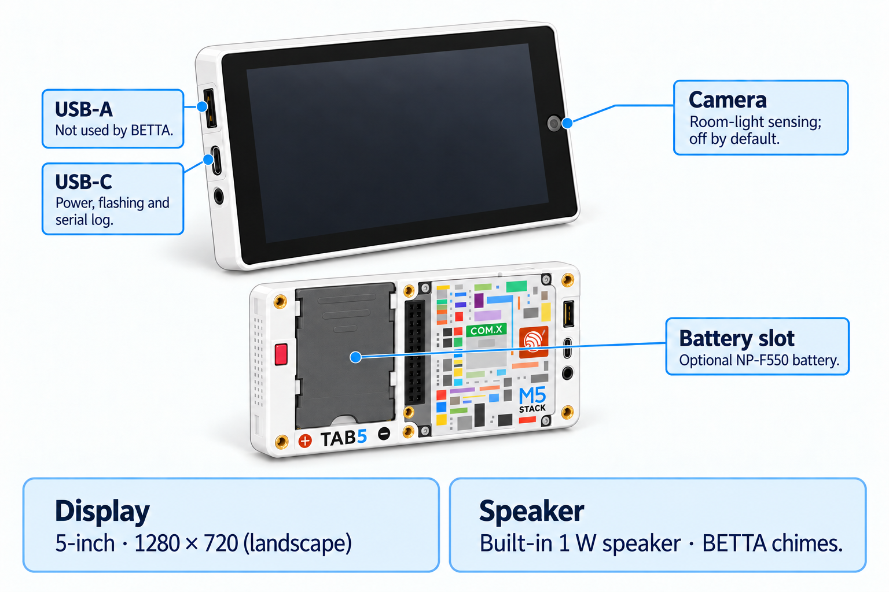

<!-- SPDX-License-Identifier: LicenseRef-FNCL-1.1 | Copyright (c) 2026 Cpt_Kirk | Copyright (c) 2026 andre68723 -- file added in the andre68723/BETTA-HA-PANEL fork, see docs/release-notes.md -->

# M5Stack Tab5

<figure class="board-hero">
  
  <figcaption>Illustration; rear geometry corrected from the maintainer's reference photo on 2026-10-05. The small printed rear legend is schematic.</figcaption>
</figure>

`tab5` targets M5Stack Tab5 in landscape and portrait. One ST7121 unit
(ESP32-P4 v1.3, 16 MB flash) ran the firmware on 2026-10-05. Automatic rotation
is enabled by default; night mode defaults on from 22:00 to 06:00 and chime
volume defaults to 60%. Sound remains opt-in, and camera options remain off
pending broader calibration. Saved preferences survive an OTA update.

## Specifications

| Item | Device / firmware profile |
| --- | --- |
| Display | 5-inch IPS, 1280 × 720 landscape; 720 × 1280 native portrait, MIPI DSI, about 294 ppi |
| Dashboard area | 1280 × 600 landscape; 720 × 1160 portrait, with vertical page scrolling |
| Host / Wi-Fi | ESP32-P4NRW32 at 360 MHz / ESP32-C6-MINI-1U (Wi-Fi 6) through ESP-Hosted |
| Flash / PSRAM | 16 MB / 32 MB; Hex PSRAM at 200 MHz |
| Display / touch controller | ILI9881C + GT911 on early units; ST7123 integrated touch from October 2025; ST7121 from April 2026 (the BSP drove an ST7121 unit on 2026-10-05) |
| Navigation | Up to 12 pages; horizontal navigation scrolling above eight in portrait |
| Camera / sound | SC2356 (SC202CS driver), sensing off by default; ES8388 and built-in 1 W speaker |

## Firmware and revisions

Use the `tab5` factory image when the release lists your device and silicon revision.
Follow [Install and set up](../getting-started.md#2-flash-the-panel) for browser installation.

Current images target pre-v3 ESP32-P4 silicon. Check the revision reported by the installer;
matching the Tab5 product name alone is not enough. Early ILI9881C and ST7123 units have not been tested here.

## Buttons and ports

For flashing, connect a USB data cable to the **USB-C connector** shown in the
illustration above.

## Validation status and next checks

One ST7121 unit (ESP32-P4 v1.3, 16 MB flash) was tried on 2026-10-05.

| Area | Status |
| --- | --- |
| Boot, ESP-Hosted link to the C6 (reset line GPIO15 active high), C6 firmware update | Worked |
| Display at 720 × 1280, portrait after the rotation crash fix; touch | Responded |
| Ambient light from the camera | Read about 89 % uncovered and 27–28 % covered |
| Chime | A test chime played |
| Touch alignment in all four orientations, long-run I2C/touch coexistence | Not checked |
| Low-brightness dimming (ST7121 unit, 2026-10-13) | Little visible difference at 1–50%; 75% brighter, 0% off. BSP defaults retained as an accepted limitation |
| Presence wake | Not checked; both camera options stay off by default |
| ILI9881C and ST7123 units, ESP32-P4 v3.x silicon | Not tested |

Check the chip revision reported by the installer on a new unit. For rotation checks disable **Rotate automatically**
to retain landscape; see [display settings](../display.md#tab5-automatic-rotation).

## Technical notes

Pin assignments, schematic checks, BSP versions and open points are in the [device technical notes](device-notes.md#tab5).

## Manufacturer references

- **Documentation:** [M5Stack Tab5 guide](https://docs.m5stack.com/en/core/Tab5), including specifications, display/touch revisions and connector positions.
- **BSP:** [Espressif M5Stack Tab5 component](https://components.espressif.com/components/espressif/m5stack_tab5), providing display, touch, power and backlight support.

## Related guides

[Install and set up](../getting-started.md) · [Display and brightness](../display.md) · [Home Assistant setup](../home-assistant.md)
