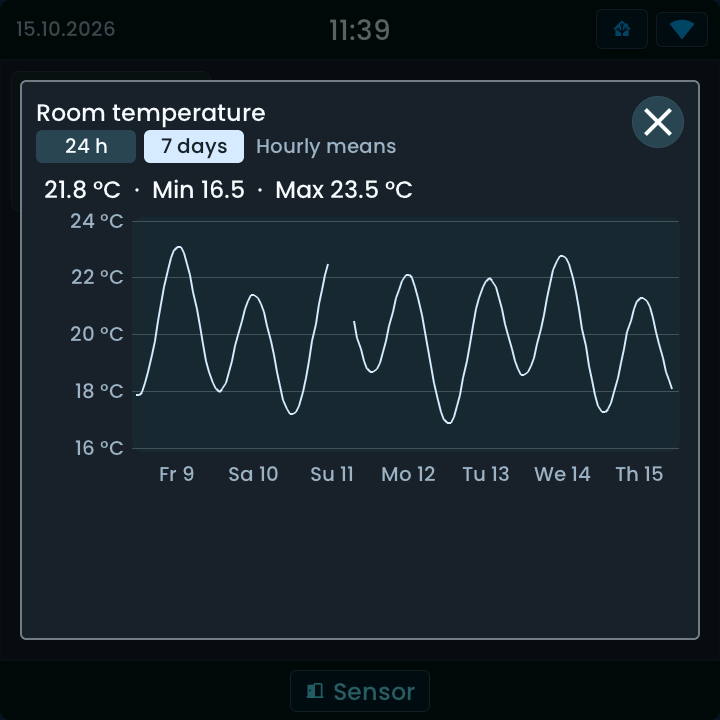
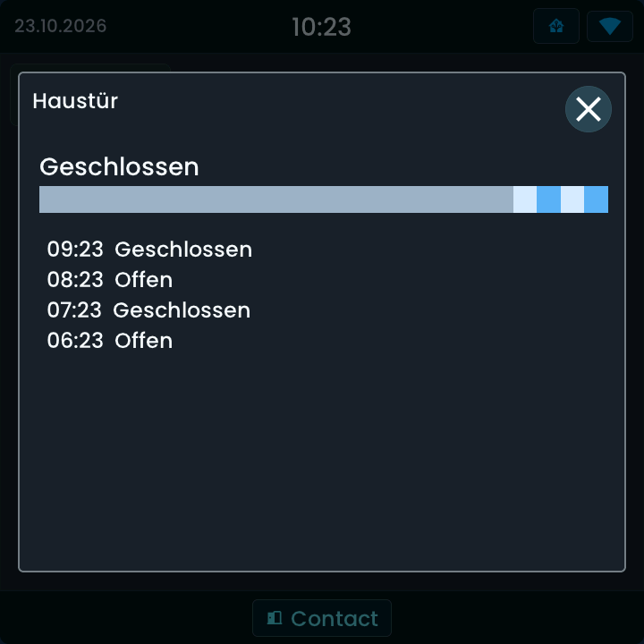

<!-- SPDX-License-Identifier: LicenseRef-FNCL-1.1 | Copyright (c) 2026 andre68723 -- file added in the andre68723/BETTA-HA-PANEL fork, see docs/release-notes.md -->
# History popups

Open an entity's last **24 hours** without leaving the dashboard. The optional
detail popup reads Home Assistant Recorder on demand; it does not change the entity.
Measurement sensors can also show the last **7 days** as hourly means.

## Examples

<figure>

<figcaption>Numeric sensor: current value, Min/Max, unit and a 24-hour chart.</figcaption>
</figure>
<figure>

<figcaption>7 days: hourly means with real gaps and a label per local day.</figcaption>
</figure>
<figure>

<figcaption>Contact: current state, coloured timeline and recent timestamped changes (German example).</figcaption>
</figure>

These previews use public synthetic data rendered by the firmware's LVGL/SDL
simulator. Click to enlarge. Widget guides explain the controls for each tile.

## Enable and open history

1. Select a [Sensor](widgets/sensor.md), [Binary sensor](widgets/binary_tile.md),
   [Contact](widgets/contact_tile.md), [Lock](widgets/lock_tile.md) or [Vacuum](widgets/vacuum_tile.md) in the editor.
2. Enable **History on tap** in its inspector; on a Lock or Vacuum it is called **History on long press**.
3. Save the layout.
4. On the panel, tap a Sensor, Binary sensor or Contact tile. **Long-press a Lock or Vacuum**;
   their regular controls keep their actions.
5. Close with the X or tap the shaded area outside the card.

The option is off by default. It applies to the widget's primary entity, not
every secondary reading in a compound widget.

## Numeric values and states

| Entity data | Detail view |
| --- | --- |
| Numeric sensor | Current value, recorded minimum/maximum and chart with the sensor's unit |
| Binary sensor, contact, lock or vacuum | Current state, coloured state timeline and up to 20 recent changes with local timestamps |

## 7 days

A **24 h | 7 days** selector appears next to the title of a numeric sensor when Home Assistant
keeps long-term statistics with a mean for it. Every popup opens at 24 h.

- The week is the last 168 hours as **hourly means**, a line with up to 168 points. A missing hour
  is a gap, not a filled value. The current hour has no statistic yet; the header shows the
  current value of the sensor.
- Min and Max are the lowest and highest hourly extremes in the shown week, not exact readings.
- Day labels follow the panel's time zone. Around a daylight-saving change a local day has 23 or
  25 hours.
- No selector for binary sensors, contacts, locks, vacuums, text states, energy or water counters and
  angles, or when Home Assistant has no statistics for the entity. The selector appears only
  after the check succeeded, so it never reports an unsupported entity.
- **No statistics for the last 7 days** means Home Assistant knows the entity but holds no hourly
  values in that period. **Could not load statistics** is a failed request; **24 h** stays available.

Unavailable periods remain gaps rather than invented values. Large responses can
be reduced, or the requested period shortened to 12 or 6 hours, to fit the panel; **History shortened to fit** identifies that case.

The Energy page shows [seven-day details](pages.md#seven-day-details) of Gas, Water and Solar as daily bars; they
are not part of the sensor popup.

## Choose the history view

| View | Source | Use it for |
| --- | --- | --- |
| Sensor, Binary sensor, Contact, Lock or Vacuum popup | Home Assistant Recorder, fetched when opened | Inspect a value or state without leaving the dashboard |
| [Graph](widgets/graph.md), default mode | Samples collected and stored on the panel | A persistent chart that builds up as the panel receives values |
| Graph with **History from Home Assistant** | Recorder, refreshed every 15 minutes while its page is shown | A 24-hour chart populated from existing records after a restart |
| [Energy timeline](widgets/energy_timeline.md) | Recorder statistics for cumulative energy counters | Energy flows and source shares over 24 hours |

The popup option and the Graph's data-source option are configured separately.
Up to eight Graph widgets can use Home Assistant history; their requests run
one after another.

## Requirements and troubleshooting

Home Assistant must be configured and reachable, and Recorder must retain the
entity. The 7-day view reads long-term statistics: the sensor needs a
`state_class` of `measurement`, and the panel must receive it with the entity's attributes. The popup shows **Loading history…** while fetching. **No history recorded**
means there are no usable records for this period; check Recorder exclusions and
whether the entity is new. **Could not load history** indicates a failed request;
check the Home Assistant connection and logs.

A recently opened entity can reuse its result for up to one minute; later
requests fetch a fresh period. The popup is an inspection view,
not an export or a replacement for Home Assistant's full History dashboard.
