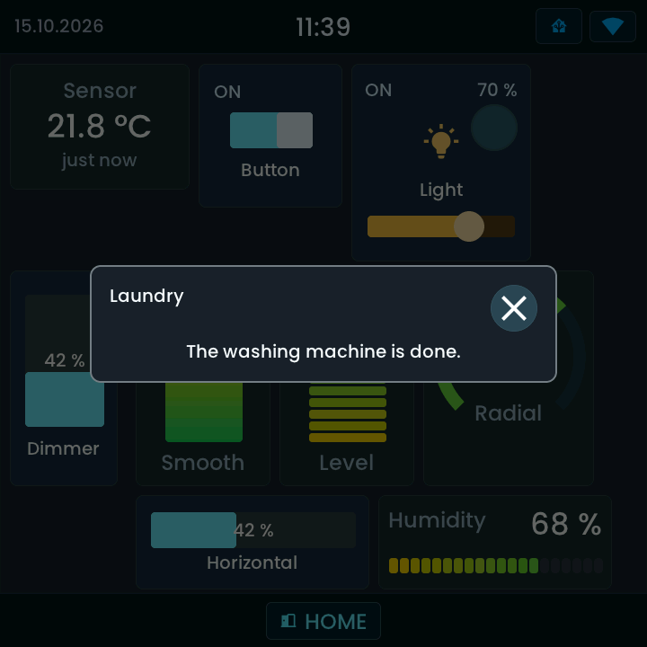
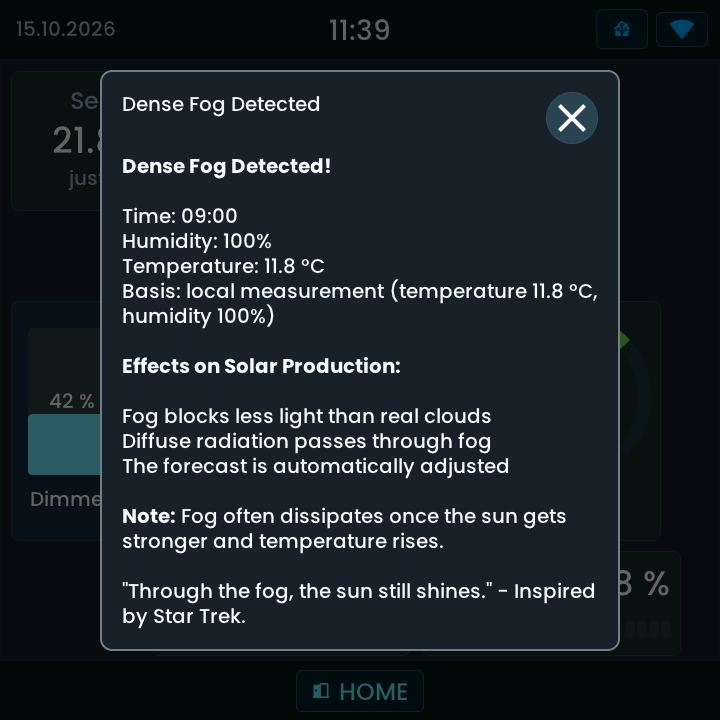

<!-- SPDX-License-Identifier: LicenseRef-FNCL-1.1 | Copyright (c) 2026 andre68723 -- file added in the andre68723/BETTA-HA-PANEL fork, see docs/release-notes.md -->

# Notifications

A doorbell or sensor can show an alert with a camera snapshot and an optional action button.
You can also send messages such as “The washing machine is done” from Home Assistant.
Both wake the screen and appear over the dashboard.

<div class="appearance-comparison">
<figure>
<a href="img/gallery/gallery_notification_flat.png"></a>
<figcaption>A message sent from Home Assistant.</figcaption>
</figure>
<figure>
<a href="img/gallery/gallery_doorbell_flat.png"></a>
<figcaption>An editor-configured doorbell alert.</figcaption>
</figure>
</div>

## Choose a route

- **Doorbell or sensor alert:** configure it in the editor. No broker, automation or YAML is needed.
- **Message from an HA automation:** use MQTT and the graphical Notify action below. An MQTT broker is required.
- **Message over HTTP:** an [advanced YAML setup](http-notifications.md), if you prefer not to use MQTT.

## Doorbell and event alerts

Alerts let the panel raise a card itself, with no automation. Open **Settings → Alerts** (up to four alerts).

1. Choose **Add alert**.
2. **Trigger:** an `event.*` entity (fires on each new event, such as a Ring Intercom's ring) or any entity that
   turns `on`.
3. Enter a **title**, a **message** and how long to **show** it (0 = until tapped).
4. Optional: a **button entity** (a `button.*`, `lock.*`, script or scene) with its **button text**, and a
   **camera** for a snapshot in the card.
5. Choose a **sound** (the doorbell *ding-dong* is preselected for new alerts) and **Save alerts**.

Alerts are saved with the layout, so use the **Save alerts** button on that page; the Save button on the right
does not include them. The state present when the panel starts is only remembered, so a restart never rings.

## Send from Home Assistant

### Connect MQTT

1. Set up a broker and HA's [MQTT integration](https://www.home-assistant.io/integrations/mqtt/)
   if you do not already use them. MQTT is optional for the dashboard itself.
2. In the panel editor open **Settings → Home Assistant & MQTT** and enable MQTT.
   Enter the broker host, port (normally 1883), username and password. Save; the panel restarts.
3. In HA open **Settings → Devices & services → MQTT → Devices** and find your panel.
   Its entities include **Notify**, **Online** and its **IP address**.

### Send a test message without YAML

1. Open HA's **Developer tools → Actions** in **UI mode**.
2. Choose **Notifications: Send a notification message** (`notify.send_message`).
3. Under **Target**, select your panel's Notify entity.
4. Enter `Hello from Home Assistant!` in **Message**, then select **Perform action**.
5. Confirm that the message appears on the panel. Tap it or its close button to dismiss it.

The [HA notification guide](https://www.home-assistant.io/integrations/notify/#testing-a-notification-action)
explains testing notification actions. HA's field labels follow your selected language.

### Add the message to an automation

1. Open **Settings → Automations & scenes → Create automation → Create new automation**.
2. Add a trigger, for example your washing machine's completion sensor changing state.
3. Under **Then do**, add **Notifications: Send a notification message**.
4. Choose the panel's Notify entity and enter the message. Save the automation.
5. Use the action's **Run** command to test it; then test the real trigger separately.

The Notify entity carries plain text only. It does not forward a title, sound, timeout, camera or button.
For those options use an editor alert, or the [advanced MQTT/HTTP message options](http-notifications.md).
A plain message remains until dismissed; a new message replaces it.

## Sound

On displays with a speaker (Waveshare 4-inch and Tab5), **Settings → Sound** turns sounds on. Sound starts off at
**60 %** volume with *mute during night mode* on; muting follows the night schedule even if a touch has woken the
screen. **Test chime** plays at the selected volume. The 10-inch panels have no Sound page. Validation status per
device: [Cameras and chimes](hardware/peripherals.md#optional-chime-output).

## Dismiss and recall

Tap the card, its close button or the shaded area outside it to dismiss it. Long messages scroll inside the card.
There is no queue or persistent notification history. The panel keeps only the last HTTP/MQTT message until reboot:
double-tap the clock to recall it silently, without its action button. Doorbell and event alerts are not recalled.
Closing a message on the panel does not dismiss a Home Assistant notification.

## Text

Message bodies support **bold** with paired `**text**` or `__text__`, including within a sentence:

```text
**Dense Fog Detected!**

Time: 09:00
Humidity: **100%**

__Effects on Solar Production:__
Diffuse radiation passes through fog.
```

The original Markdown markers must reach the panel through HTTP/MQTT. Forwarding only the rendered plain text
loses the emphasis. Paragraphs and line breaks stay intact; long messages scroll. Unmatched markers remain visible.
Escaped markers and text in backticks remain literal; other Markdown and HTML formatting are not interpreted.
A message requiring more than 32 text spans is shown as plain text with its markers.



Messages support accented Latin text, subscript digits such as **CO₂** and **PM₂.₅**, and units such as **m²** and **m³**.
Send these as Unicode characters; the panel does not interpret HTML or expressions such as `m^3`.

## Emoji

About 190 emoji appear in the text colour: faces, reactions, weather, alerts, devices, states and arrows. A selected 37 are drawn in color in the
notification card (title, message and action label):

| Group | Color emoji |
| --- | --- |
| Alerts | ⚠️ 🚨 ❌ ✅ 🛑 🔔 📢 |
| Power and battery | 🔋 🪫 ⚡ 🔌 |
| House and devices | 🚪 🪟 🔒 🔓 💡 🏠 🚗 📦 🗑️ 🤖 📶 🚶 ☕ |
| Weather and climate | ☀️ 🌤️ 🌥️ 🌧️ 🌙 🌅 🌟 🌡️ 🔥 ❄️ 💧 |
| Other | 💬 ↗️ |

Every other emoji keeps the text colour. A skin tone is dropped and the base emoji shown. Flags, joined emoji (for example a family),
keycaps and emoji the panel does not have show as `[Emoji]`. The color set is the same on every board; the text size of the card decides the size.

## Troubleshooting

- **No alert:** check the chosen trigger entity. `event.*` reacts to a new event; a normal entity must change to `on`.
  Its state at panel startup does not trigger an alert. Save with **Save alerts** on the Alerts page.
- **Notify entity missing:** check that MQTT is enabled on the panel, both use the same broker,
  and HA's MQTT integration is set up. The top-bar MQTT chip opens connection details.
- **No sound:** enable it under **Settings → Sound**, check the volume and night mute, then use **Test chime**.
  The 10-inch panels have no Sound page.
- **HTTP error:** see [HTTP troubleshooting](http-notifications.md#http-troubleshooting).

For payload limits, MQTT topics and firmware internals, see
[Notification implementation](notifications-implementation.md).
