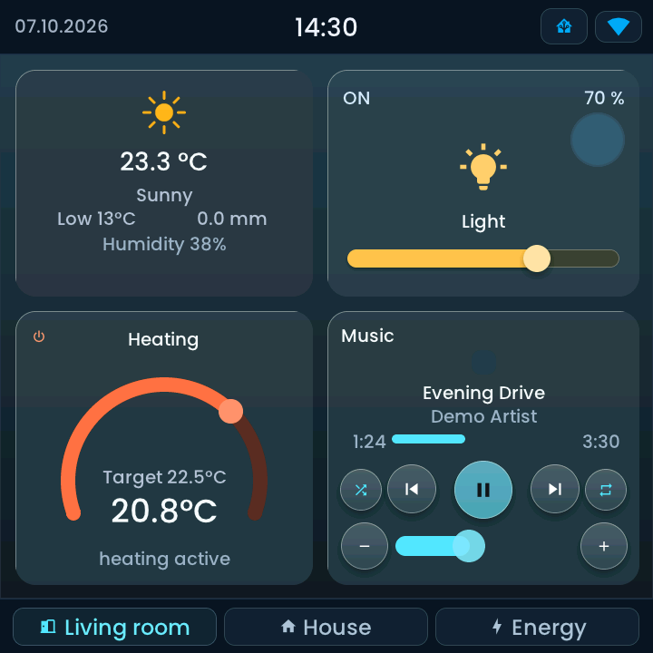
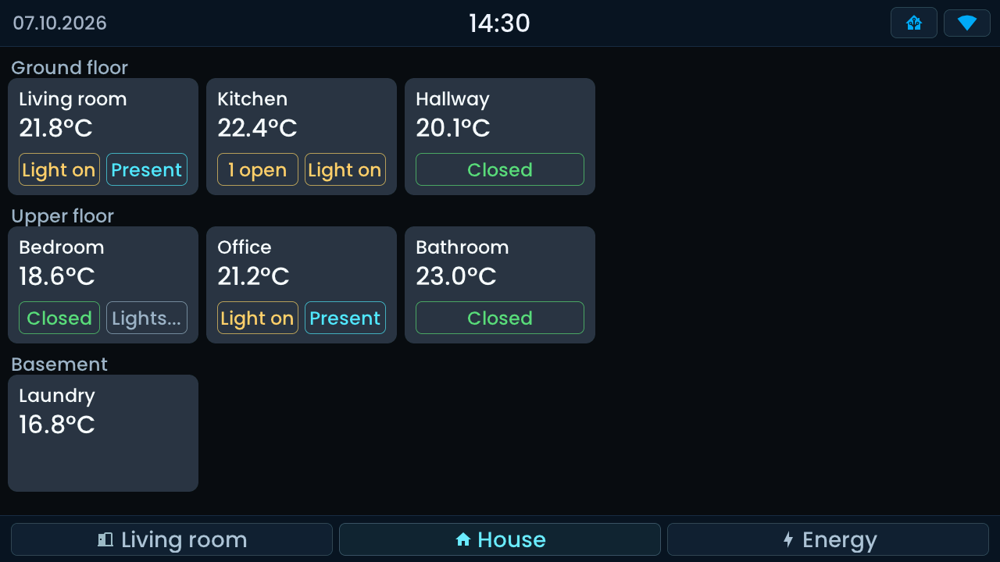
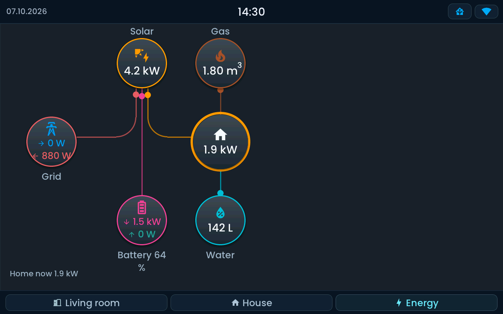
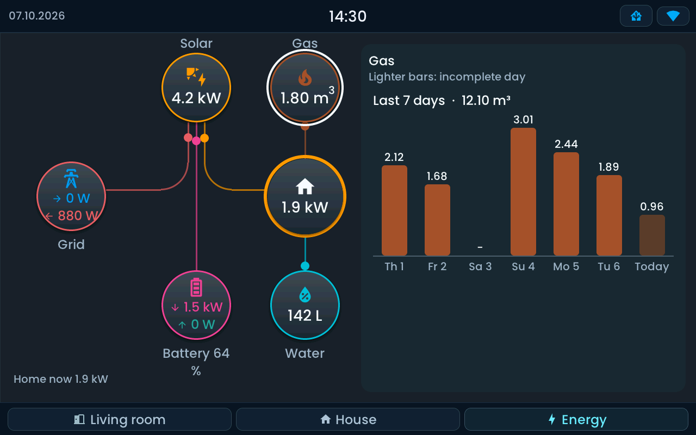
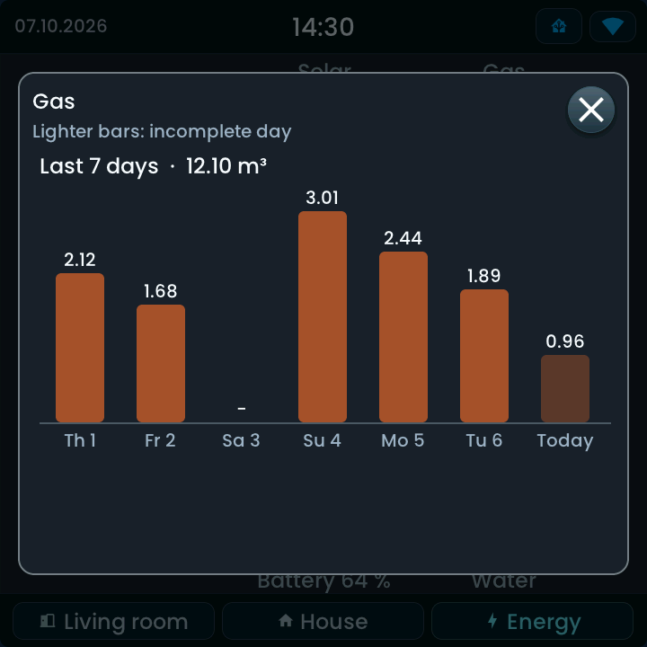

<!-- SPDX-License-Identifier: LicenseRef-FNCL-1.1 | Copyright (c) 2026 andre68723 -- file added in the andre68723/BETTA-HA-PANEL fork, see docs/release-notes.md -->
# Pages and layouts

A panel shows one **page** at a time; the bottom bar switches between them. Create, reorder and edit pages
in the [web editor](editor.md) through **Pages → + Page**. There are three kinds of page.

- **Blank page:** place and resize widgets freely; optionally import one HA room.
- **Room overview:** one room card per area, grouped by floor.
- **Energy dashboard:** fixed energy flows from HA Energy or your own power sensors.

## Free pages

Add widgets with **+ Widget** or by searching for an entity first; the editor then offers the widget types that
fit it. Drag to move, drag the corner to resize, and set the entity, title and options in the inspector.

**+ Page → Room page ...** starts from an area: choose it, assign its entities to roles and the editor
proposes a layout with values on top, climate and media on the left, and lights and blinds on the right. The
result is an ordinary page you can change freely.

## Room overview

Choose **+ Page → Room overview**. It is created from your Home Assistant **areas** and **floors**. Each [room card](widgets/room_tile.md) shows the
temperature and humidity and status chips for windows and doors, lights, presence and low batteries. Wide
displays place more cards per row. Assign devices to areas in Home Assistant before you import; floors are
optional and only add the headings.

## Energy dashboard

Choose **+ Page → Energy dashboard**, then select the source in the page inspector:

| Source | You need |
| --- | --- |
| Home Assistant Energy | The sources configured in Home Assistant's Energy dashboard |
| Manual live sensors | Live power sensors for grid, solar, home and optionally battery; gas and water are optional |

Energy nodes follow the selected appearance: Flat uses plain outlined circles, Glow adds coloured
light halos, Glass uses translucent surfaces with light rims, and Matte uses opaque borderless surfaces.
Source colours and the home consumption ring keep their meaning in every style.

Both sources use the same fixed page layout; an HA Lovelace Energy card is not imported.
The 24-hour [Energy timeline](widgets/energy_timeline.md) is a separate widget and needs no energy page.
See [Home Assistant setup](home-assistant.md#energy-and-rooms) for what each needs.

### Seven-day details

Tap **Gas**, **Water** or **Solar** to see the last seven days: daily consumption for Gas/Water and daily production
for Solar, with one bar per local calendar day,
today last. Today is lighter because it is not complete yet; a day without statistics shows a dash instead of a bar.
Water and Gas use the sources of Home Assistant's Energy dashboard, or with *Manual live sensors* the Gas and Water
entities of the page. Solar sums its production counters. A source needs long-term statistics as a cumulative counter
in a volume or energy unit; otherwise the popup says **No statistics for this source**. Grid, Battery and Home are not
tappable, and a manual Solar value is a power sensor without consumption history.

Choose where the details appear in the page inspector (**Seven-day details**):

| Choice | Result |
| --- | --- |
| Popup | A tap opens the details in a popup. This is the default. |
| Right-hand panel | On a wide display the free right half of the page shows the selected node's details and the flow diagram stays on the left. The selected node is outlined. |

<figure>

<figcaption>Right-hand panel on the 10-inch display (simulator, synthetic data).</figcaption>
</figure>
<figure>

<figcaption>Popup on the 4-inch display (simulator, synthetic data).</figcaption>
</figure>

The panel needs room for seven readable bars at the current text size. Narrower pages, such as the 4-inch display, and
larger text sizes open the popup instead, whatever the page setting says. Nothing is loaded until you tap a node.

## Navigation and limits

| | 4-inch panel | 10-inch and Tab5 (1280 px wide) |
| --- | --- | --- |
| Pages | up to **8** | up to **12** |
| Tabs with icon and title | up to 5 pages | up to 10 pages |

Beyond that the bottom bar turns compact: the shown page keeps its title, the others show an icon or a number.
Give every page its own **navigation icon** so compact tabs stay recognisable; the editor warns when a page
has no icon or shares one. A dashboard holds up to **224 widgets** in total.

!!! info "Tab5 rotation"

    Portrait and landscape layouts of the Tab5 are stored separately. Reload the layout in the editor to edit
    the other orientation, see [automatic rotation](display.md#tab5-automatic-rotation).

Related: [Display devices](choose-display.md) for each display's usable area, [Top bar](top-bar.md) for the strip above the page.
