<!-- SPDX-License-Identifier: LicenseRef-FNCL-1.1 | Copyright (c) 2026 andre68723 -- generated by tools/generate_widget_docs.py, see docs/release-notes.md -->

# Widget library

34 widgets, grouped by what you want to do. Each guide starts with a summary and a preview, then lists the entities, requirements, options, behaviour on the panel and size limits. The previews are rendered by the LVGL simulator in the Glow style with synthetic data (click to enlarge); the other styles keep the same functions.

To add one, open a page in the [web editor](../editor.md#layout-workspace), choose the widget in **Add**, pick its entity by clicking its entity row, size it and **Save** the layout. Start with [your first light](../getting-started.md#5-control-your-first-light). Whole pages (room overview, energy dashboard) are in [Pages and layouts](../pages.md); for a different look, use [Appearance](../appearance.md).

## Show values

Numbers, trends and states you want to read at a glance.

-   [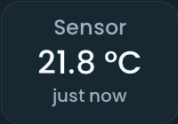](sensor.md)

    **[Sensor](sensor.md)**

    Shows the **value** of a `sensor.*` or `binary_sensor.*` entity, formatted by its device class, with optional name, age and Recorder history.

-   [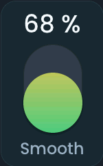](gauge.md)

    **[Gauge](gauge.md)**

    Shows a numeric `sensor.*` as a **vertical, horizontal or radial gauge**.

-   [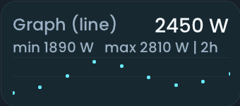](graph.md)

    **[Graph](graph.md)**

    Follows a numeric value over time as a **line, smoothed line or bar chart**; usually a `sensor.*`, any entity with a numeric state works.

-   

    **[Binary sensor](binary_tile.md)**

    Shows the **state** of a `binary_sensor.*` or `event.*` entity, with optional history on tap.

-   

    **[Contact](contact_tile.md)**

    Shows whether a **door or window** `binary_sensor.*` is open, with optional history on tap.

-   [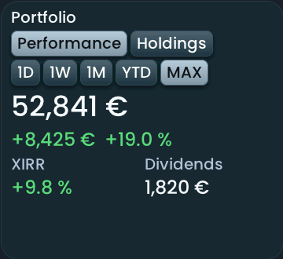](parqet_portfolio.md)

    **[Parqet portfolio](parqet_portfolio.md)**

    Shows a **Parqet portfolio** from its `sensor.*` entities: total value, gain, XIRR, dividends and the largest holdings.

-   [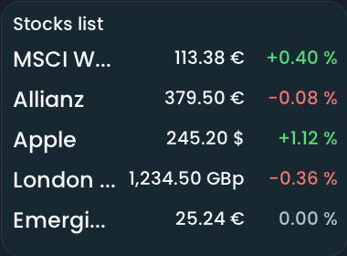](stock_quotes.md)

    **[Stocks & ETFs](stock_quotes.md)**

    Shows **up to eight quotes** of Easy Stock `sensor.*` entities as a list, as charts or as tiles, with the last session's change and a detail view over five periods.

## Control your home

Switches, lights, heating, blinds and other things you operate by touch.

-   

    **[Button](button.md)**

    Switches a `switch.*` entity or sends a `media_player.*` action from a **compact touch button**.

-   [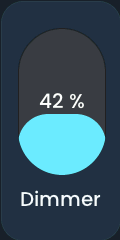](slider.md)

    **[Slider](slider.md)**

    Adjusts a **writable number** such as light brightness, cover position or an input number.

-   [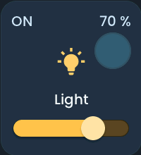](light_tile.md)

    **[Light](light_tile.md)**

    Switches a `light.*` entity and adjusts **brightness, colour temperature, colour and effects** as far as the light supports them.

-   [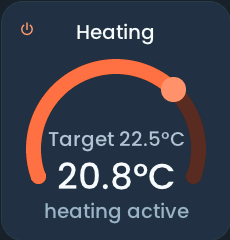](heating_tile.md)

    **[Heating](heating_tile.md)**

    Shows a heating `climate.*` entity's **measured and target temperatures** and adjusts the target.

-   

    **[Climate](climate_tile.md)**

    Controls a `climate.*` entity such as an air conditioner through its **supported HVAC modes**.

-   [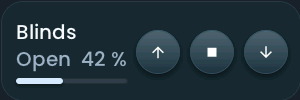](cover_tile.md)

    **[Cover](cover_tile.md)**

    Shows the **position** of a `cover.*` entity such as a blind and operates it with up, stop and down.

-   [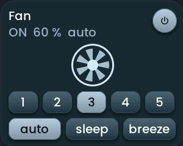](fan_tile.md)

    **[Fan](fan_tile.md)**

    Controls a `fan.*` entity with the **speed, preset and oscillation** controls it supports.

-   

    **[Lock](lock_tile.md)**

    Shows the state of a `lock.*` entity and **locks or unlocks** it; optional history opens with a long press.

-   

    **[Alarm](alarm_tile.md)**

    Shows the **state** of an `alarm_control_panel.*` entity and arms or disarms it, asking for a code when the entity needs one.

-   

    **[Select](select_tile.md)**

    Chooses an **option** of a `select.*` or `input_select.*` entity.

-   

    **[Date/Time](datetime_tile.md)**

    Shows and edits an `input_datetime.*`, `time.*`, `date.*` or `datetime.*` entity with a **roller popup**.

-   

    **[Scene](scene_tile.md)**

    Runs a `scene.*`, `script.*`, `button.*`, `input_button.*` or `lock.*` **action** from a compact tile.

## Rooms

Everything about one room in a single card.

-   [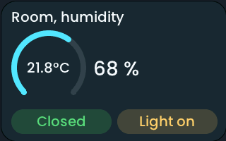](room_tile.md)

    **[Room](room_tile.md)**

    Groups a **room's values and controls** in one card, with a popup for its entities; any domain, filled from a Home Assistant area or by hand.

## Weather and energy

Forecasts, solar production and the energy balance.

-   [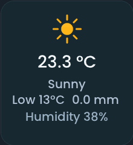](weather_tile.md)

    **[Weather (now)](weather_tile.md)**

    Shows the **current conditions** of a `weather.*` entity, with optional hourly forecasts and a detail popup for readings and the DWD weather report.

-   [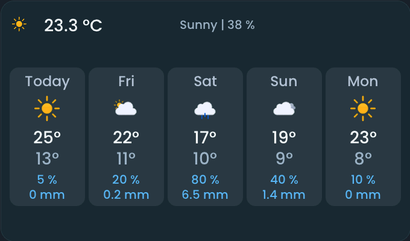](weather_3day.md)

    **[Weather forecast](weather_3day.md)**

    Compares **forecast days** of a `weather.*` entity: temperatures and precipitation in configurable columns.

-   [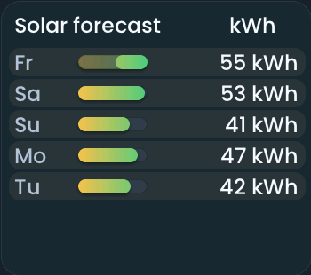](solar_forecast.md)

    **[Solar forecast](solar_forecast.md)**

    Compares the **predicted solar production** from `sensor.*` forecasts for today and the next six days.

-   [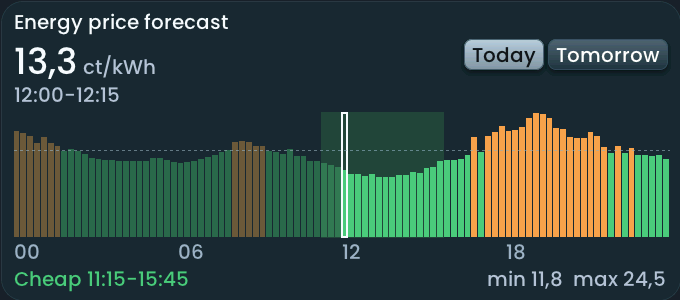](energy_price_forecast.md)

    **[Energy price forecast](energy_price_forecast.md)**

    Shows **electricity prices** for today or tomorrow from a price `sensor.*` as bars, with the current interval's price and the next cheap window.

-   

    **[Energy timeline](energy_timeline.md)**

    Compares **cumulative energy counters** (`sensor.*`, kWh) over 24 hours, with rings and a detailed timeline.

## Media and tasks

Playback, favourites and shopping lists.

-   

    **[Media player](media_player.md)**

    Controls **playback and volume** of a `media_player.*` entity, with the current track and cover art.

-   

    **[Sonos favorites](sonos_favorites.md)**

    Plays a **Sonos favourite** on a `media_player.*` from a list on the dashboard.

-   [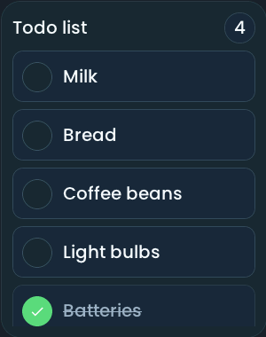](todo_list.md)

    **[Todo list](todo_list.md)**

    Shows a `todo.*` list and **marks single items done**.

## Devices

Vacuum, camera, car, wallbox and 3D printer.

-   

    **[Vacuum](vacuum_tile.md)**

    Shows a `vacuum.*` entity's status, its **cleaning actions** and an optional map in the tile.

-   [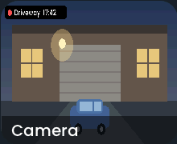](camera_tile.md)

    **[Camera](camera_tile.md)**

    Shows **snapshots** of a `camera.*` or `image.*` entity, or an optional MJPEG live picture.

-   [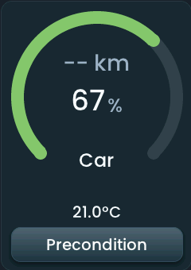](car_widget.md)

    **[Car](car_widget.md)**

    Shows a **car's battery level** from a `sensor.*` entity as rings, with optional range, charging power and vehicle controls.

-   [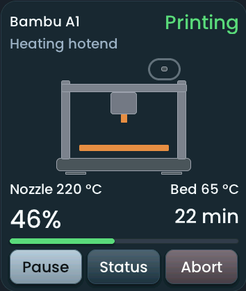](bambu_printer.md)

    **[Bambu printer](bambu_printer.md)**

    Shows a **Bambu Lab printer's status**, temperatures, progress and remaining time from its `sensor.*` entities, with one Pause/Resume control and a separate print-abort button.

-   [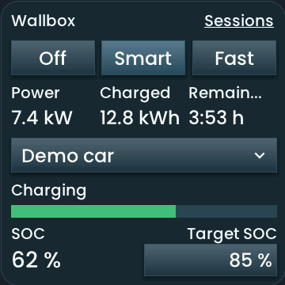](wallbox.md)

    **[Wallbox](wallbox.md)**

    Shows and controls an **evcc loadpoint** through its Home Assistant integration. The detected mode `select.*` and related sensors supply charging mode, vehicle, target SOC, power, energy and remaining time.

## Layout

Space for the design itself.

-   

    **[Empty spacer](empty_tile.md)**

    Reserves **dashboard space**. It has no entity and subscribes to nothing.

