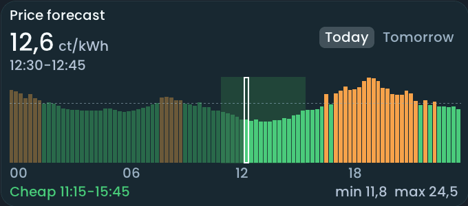

<!-- SPDX-License-Identifier: LicenseRef-FNCL-1.1 | Copyright (c) 2026 andre68723 -- generated by tools/generate_widget_docs.py, see docs/release-notes.md -->

# Widget library

33 widgets, grouped by what you want to do. Each guide shows its setup, a preview, the entities it works with, its touch interactions and its size limits.

Start with [your first light](../getting-started.md#5-control-your-first-light), then add more widgets in the [web editor](../editor.md). Whole pages (room overview, energy dashboard) are in [Pages and layouts](../pages.md). For a different look, use [Appearance](../appearance.md).

## Show values

Numbers, trends and states you want to read at a glance.

-   

    **[Sensor](sensor.md)**

    Show an entity's current value and unit, with optional name, age and Recorder history.

-   

    **[Gauge](gauge.md)**

    Show a numeric sensor as a vertical, horizontal or radial gauge.

-   

    **[Graph](graph.md)**

    Follow a numeric value over time as a line, smoothed line or bar chart.

-   

    **[Binary sensor](binary_tile.md)**

    Show a binary sensor or event state, with optional history on tap.

-   

    **[Contact](contact_tile.md)**

    Show whether a door or window is open, with optional Recorder history on tap.

-   

    **[Parqet portfolio](parqet_portfolio.md)**

    Show a Parqet portfolio: total value, gain, XIRR, dividends and the largest holdings.

## Control your home

Switches, lights, heating, blinds and other things you operate by touch.

-   

    **[Button](button.md)**

    Trigger a switch or a media action directly from a compact touch button.

-   

    **[Slider](slider.md)**

    Adjust a numeric value such as light brightness, cover position or an input number.

-   

    **[Light](light_tile.md)**

    Switch a light and adjust the brightness or colour controls reported by Home Assistant.

-   

    **[Heating](heating_tile.md)**

    Show a heating thermostat's measured and target temperatures and adjust the target.

-   

    **[Climate](climate_tile.md)**

    Control an air conditioner or other climate entity using its supported HVAC modes.

-   

    **[Cover](cover_tile.md)**

    Show a blind or cover's position and operate its up, stop and down controls.

-   

    **[Fan](fan_tile.md)**

    Control a fan using the speed, preset and oscillation capabilities reported by its entity.

-   

    **[Lock](lock_tile.md)**

    Show a lock's state and lock or unlock it; optional history opens with a long press.

-   

    **[Alarm](alarm_tile.md)**

    Show an alarm panel's state and arm or disarm it, asking for a code when the entity needs one.

-   

    **[Select](select_tile.md)**

    Choose an option from a select or input-select entity.

-   

    **[Date/Time](datetime_tile.md)**

    View and edit a date, time or combined date/time entity with a roller popup.

-   

    **[Scene](scene_tile.md)**

    Run a scene, script or momentary action from a compact tile.

## Rooms

Everything about one room in a single card.

-   

    **[Room card](room_tile.md)**

    Group a room's values and controls in one card with a popup for its entities.

## Weather and energy

Forecasts, solar production and the energy balance.

-   

    **[Weather (now)](weather_tile.md)**

    Show current weather conditions, temperature and the available extra readings.

-   

    **[Weather forecast](weather_3day.md)**

    Compare forecast days, temperatures and precipitation in configurable columns.

-   

    **[Solar forecast](solar_forecast.md)**

    Compare predicted solar production for today and the next four days.

-   

    **[Price forecast](price_forecast.md)**

    Show a day of electricity prices as bars, with the price now, today and tomorrow, and the cheap hours.

-   

    **[Energy timeline](energy_timeline.md)**

    Compare cumulative energy counters over 24 hours with rings and a detailed timeline.

## Media and tasks

Playback, favourites and shopping lists.

-   

    **[Media player](media_player.md)**

    Control playback and volume while showing the current track and cover art.

-   

    **[Sonos favorites](sonos_favorites.md)**

    Play a Sonos favourite directly from a list on the dashboard.

-   

    **[Todo list](todo_list.md)**

    Show a Home Assistant to-do list and mark individual items done.

## Devices

Vacuum, camera, car, wallbox and 3D printer.

-   

    **[Vacuum](vacuum_tile.md)**

    Show vacuum status, supported cleaning actions and an optional map preview inside the tile.

-   

    **[Camera](camera_tile.md)**

    Show camera snapshots or an optional MJPEG live picture.

-   

    **[Car](car_widget.md)**

    Show a car's battery or charge level, with optional range and vehicle controls.

-   

    **[Bambu printer](bambu_printer.md)**

    Show a Bambu Lab printer's status, temperatures, progress and remaining time, with Pause/Resume and Stop buttons.

-   

    **[Wallbox](wallbox.md)**

    Show an evcc loadpoint's charging mode, vehicle assignment and target SOC, with charging status, power, charged energy, remaining time and current vehicle SOC.

## Layout

Space for the design itself.

-   

    **[Empty spacer](empty_tile.md)**

    Reserve dashboard space without adding a control or subscribing to an entity.

