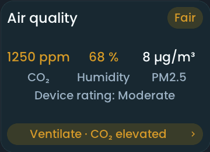

<!-- SPDX-License-Identifier: LicenseRef-FNCL-1.1 | Copyright (c) 2026 andre68723 -- generated by tools/generate_widget_docs.py, see docs/release-notes.md -->

# Air quality

Shows the **room air quality** as one BETTA status from humidity, with optional temperature, CO₂ and PM2.5 from `sensor.*` entities; a tap on a value opens its history graph, a tap elsewhere the details.

<figure></figure>

## Entities

| Entity | Domains |
| --- | --- |
| Humidity | `sensor.*` |
| Temperature, CO₂, PM2.5, VOC and device rating *(optional)* | `sensor.*` |
| Outdoor temperature and humidity *(optional)* | `sensor.*`, `weather.*` |
| Window contact *(optional)* | `binary_sensor.*` |

## Requirements

Bind each role explicitly using the reported device class and unit; the tile shows only what is bound. No direct device polling.

| Level | Bound readings | Example |
| --- | --- | --- |
| 1 | Humidity and temperature | Zigbee temperature/humidity sensor, e.g. a Tuya sensor with display |
| 2 | Level 1 plus CO₂, PM2.5 and the device's own rating | IKEA ALPSTUGA |
| 3 | Level 2 plus VOC and more values | Awair Element |

## Options

| Option | Effect |
| --- | --- |
| Icon before the name | a small air-quality symbol in front of the name, off by default; shown only with the name |
| Sources | optional roles stay independent; outdoor comparison can be disabled without losing its bindings |
| Rating | fixed, not adjustable; see [How the status is determined](#how-the-status-is-determined) |

## On the panel

- A neutral card like the Room widget: the name on top, the readings (up to three, four on wide tiles) as value over label, and chips at the bottom with the status (Good, Fair, Poor) and, only when there is something to do, a short advice. Colour appears only in the chips and in readings rated amber or red.
- A tap on a value opens its history graph; a tap on a chip or a gap opens the details: status and advice first, then every bound reading with its level (a tap on a row opens its graph), the outdoor absolute-humidity comparison and the window state.
- Temperature is context only. VOC, Awair scores and IKEA ratings are displayed but never change the status. Unbound pollutants are not evaluated, and the window state does not prove sufficient ventilation.

### How the status is determined

Humidity, CO₂ and PM2.5 are each rated green, amber or red against fixed bands. The worst of the bound readings sets the status: **Good** is green, **Fair** amber, **Poor** red. A reading that is bound but missing adds a partial-data marker, and when everything else is green the status then stays neutral (**Not evaluated**) instead of Good.

| Reading | Green (Good) | Amber (Fair) | Red (Poor) |
| --- | --- | --- | --- |
| Humidity | 40 to 60 % | 30 to below 40 % or above 60 to 70 % | below 30 % or above 70 % |
| CO₂ | below 1000 ppm | 1000 to below 2000 ppm | 2000 ppm and above |
| PM2.5 | below 15 µg/m³ | 15 to below 35 µg/m³ | 35 µg/m³ and above |

The bands are fixed. CO₂ follows the [UBA traffic-light reference](https://www.umweltbundesamt.de/richtig-lueften-in-schulen) with explicit BETTA boundaries; the humidity and PM2.5 bands are product display choices, not health limits. The [WHO PM2.5 reference](https://cdn.who.int/media/docs/default-source/who-compendium-on-health-and-environment/who_compendium_chapter2.pdf) of 15 µg/m³ is a 24-hour average, which this widget does not calculate.

To keep the status from flickering, a reading must move 2 percentage points of humidity, 50 ppm CO₂ or 3 µg/m³ PM2.5 back across a boundary before the band improves. A new warning appears immediately; an improving advice settles for 60 seconds. With an outdoor pair, drying advice starts when the indoor absolute humidity is at least 1 g/m³ above the outdoor one; that is a benefit margin, not a prediction of the airflow.

## Size

- Minimum: **280 × 220 px**.
- Maximum: **dashboard width × dashboard height**, capped by the display's dashboard area.

The minimum is a validation limit, not a recommended size. [Choose your display](../choose-display.md) lists the dashboard geometry; [Widget anatomy](../widget-anatomy.md) explains spacing and touch targets.

## Related guides

[Widget library](README.md) · [Web editor](../editor.md) · [Appearance](../appearance.md#compare-the-four-styles) · [Home Assistant requirements](../home-assistant.md)
