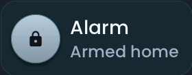

<!-- SPDX-License-Identifier: LicenseRef-FNCL-1.1 | Copyright (c) 2026 andre68723 -- generated by tools/generate_widget_docs.py, see docs/release-notes.md -->

# Alarm

Shows the **state** of an `alarm_control_panel.*` entity and arms or disarms it, asking for a code when the entity needs one.

<figure></figure>

## Entities

| Entity | Domains |
| --- | --- |
| Alarm panel | `alarm_control_panel.*` |

## Requirements

None beyond the entities.

## Options

| Option | Effect |
| --- | --- |
| Actions offered on tap | the arm and disarm actions the tile offers; by default all the entity supports |
| History on long press | a long press opens the Recorder history |

## On the panel

- States: disarmed, armed home, away, night, vacation and custom bypass, arming, pending; triggered in the error colour.
- A tap opens the action list; a PIN pad follows when the entity needs a code.

## Size

- Minimum: **180 × 80 px**.
- Maximum: **dashboard width × 200 px**, capped by the display's dashboard area.

The minimum is a validation limit, not a recommended size. [Choose your display](../choose-display.md) lists the dashboard geometry; [Widget anatomy](../widget-anatomy.md) explains spacing and touch targets.

## Related guides

[Widget library](README.md) · [Web editor](../editor.md) · [Appearance](../appearance.md#compare-the-four-styles) · [Home Assistant requirements](../home-assistant.md)
