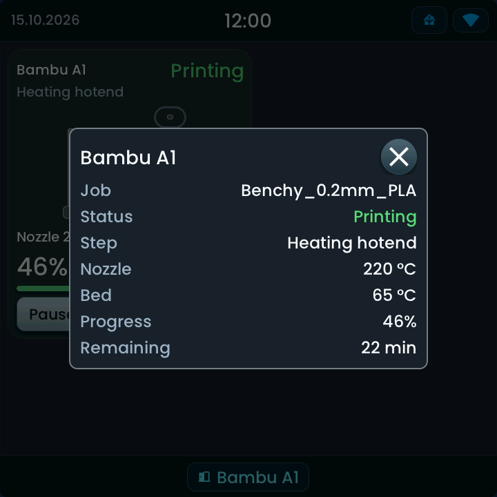

<!-- SPDX-License-Identifier: LicenseRef-FNCL-1.1 | Copyright (c) 2026 andre68723 -- generated by tools/generate_widget_docs.py, see docs/release-notes.md -->

# Bambu printer

Shows a **Bambu Lab printer's status**, temperatures, progress and remaining time from its `sensor.*` entities, with one Pause/Resume control and a separate print-abort button.

<figure></figure>

## Entities

| Entity | Domains |
| --- | --- |
| Print status | `sensor.*` |
| Nozzle and bed temperature | `sensor.*` |
| Progress, remaining time | `sensor.*` |
| Current step, job name *(optional)* | `sensor.*` |
| Pause, Resume and Stop buttons *(optional)* | `button.*` |
| Live camera *(optional)* | `camera.*` (MJPEG) |

## Requirements

The **[Bambu Lab integration (`ha-bambulab`)](https://github.com/greghesp/ha-bambulab)**. The panel only talks to Home Assistant; it has no direct connection to the printer. Setting up the integration is described by its own project.

## Options

| Option | Effect |
| --- | --- |
| Printer | the printer whose entities **Find printers** fills in; with a single printer it is chosen at once |
| Entities (adjust single ones) | change or clear a single binding; without the buttons the card stays read-only |

### Find printers

The editor asks Home Assistant for your Bambu Lab printers; with a single printer it is chosen at once. With several, choose yours in **Printer** (**Find printers** looks again). The entities are found through the integration's own entity registry, so it works in any Home Assistant language. They are saved with the layout; after renaming or re-creating entities, press **Find printers** and choose the printer again.

| Entity | Unit |
| --- | --- |
| Nozzle and bed temperature | °C |
| Progress | % |
| Remaining time | minutes, hours or seconds, as Home Assistant reports it |
| Print status, current step, job name | text |

## On the panel

- Status in the header, with the current step below it on a tall card.
- A drawing of the printer with nozzle and bed temperature; both take a warm colour while hot.
- Progress bar and remaining time of a running or paused job; a finished or failed job is marked **Last job**.
- **Pause** or **Resume** (one button), **Status** and **Abort**. The primary control is accented while printing; Abort asks for confirmation and ends the job.

### Controls

- **Pause / Resume** shares one button and follows the printer's status. It is enabled only while Home Assistant is connected and the printer is printing or paused.
- **Stop** asks **Stop this print?** first; only the confirmation sends the command.
- **Status** opens a read-only popup with the job, status, step, both temperatures, progress and remaining time.
- With **Live camera (optional, MJPEG)**, **Status → Live camera** opens the same live view as the Camera widget. An A1 supplies low-rate images, so live view follows its camera rate.
- A command is sent once through Home Assistant and is not retried. The card then waits up to 15 seconds for the printer's status to change; if it does not, the card shows **Command not confirmed**.
- A missing or unavailable reading shows a dash, never zero.

Simulator example (Glow style) with synthetic data.

Some firmware or access settings of the printer remove the command buttons from the integration; the panel keeps those buttons disabled. The A1 is the initial target: other Bambu Lab models may work with the same bindings but have not been tested.

## Size

- Minimum: **320 × 320 px**.
- Maximum: **dashboard width × dashboard height**, capped by the display's dashboard area.

The minimum is a validation limit, not a recommended size. [Choose your display](../choose-display.md) lists the dashboard geometry; [Widget anatomy](../widget-anatomy.md) explains spacing and touch targets.

## Related guides

[Widget library](README.md) · [Web editor](../editor.md) · [Appearance](../appearance.md#compare-the-four-styles) · [Home Assistant requirements](../home-assistant.md)
