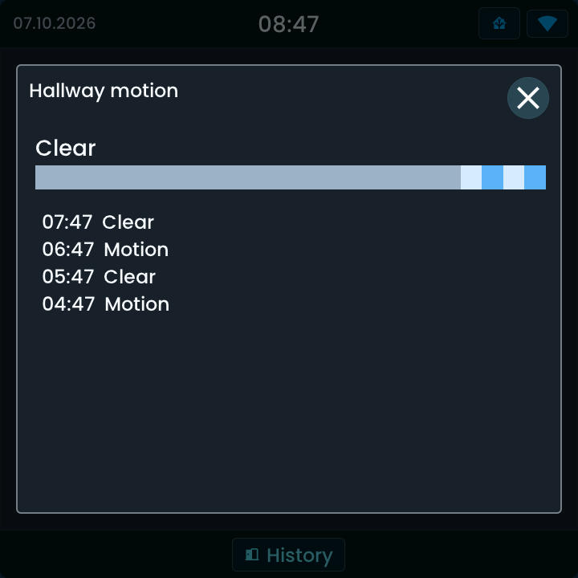

<!-- SPDX-License-Identifier: LicenseRef-FNCL-1.1 | Copyright (c) 2026 andre68723 -- generated by tools/generate_widget_docs.py, see docs/release-notes.md -->

# Binary sensor

Shows the **state** of a `binary_sensor.*` or `event.*` entity, with optional history on tap.

<figure></figure>

## Entities

| Entity | Domains |
| --- | --- |
| Binary sensor or event | `binary_sensor.*`, `event.*` |

## Requirements

None beyond the entities.

## Options

| Option | Effect |
| --- | --- |
| Display | text with the time since the change, an icon, or the time since only |
| History on tap | a tap opens the Recorder history |

## On the panel

- State words follow the device class (Open, Motion, Power on).
- An `event.*` entity shows **Triggered** and **Last 5 min**.
- Read-only.

### History

Enable **History on tap**, save, then tap the tile. History is loaded from Home Assistant Recorder when opened; it is read-only. See [History details](../history.md) for the 24-hour numeric chart, state timeline, requirements and troubleshooting.

*LVGL/SDL simulator, Flat style: a motion sensor's last 24 hours, with its current **Clear** state, coloured activity timeline and recent **Motion / Clear** changes. Public synthetic events; click to enlarge.*

## Size

- Minimum: **160 × 70 px**.
- Maximum: **dashboard width × 160 px**, capped by the display's dashboard area.

The minimum is a validation limit, not a recommended size. [Choose your display](../choose-display.md) lists the dashboard geometry; [Widget anatomy](../widget-anatomy.md) explains spacing and touch targets.

## Related guides

[Widget library](README.md) · [Web editor](../editor.md) · [Appearance](../appearance.md#compare-the-four-styles) · [Home Assistant requirements](../home-assistant.md)
