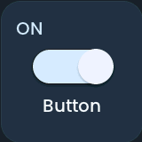

<!-- SPDX-License-Identifier: LicenseRef-FNCL-1.1 | Copyright (c) 2026 andre68723 -- generated by tools/generate_widget_docs.py, see docs/release-notes.md -->

# Button

Switches a `switch.*` entity or sends a `media_player.*` action from a **compact touch button**.

<figure></figure>

## Entities

| Entity | Domains |
| --- | --- |
| Switch or media player | `switch.*`, `media_player.*` |

## Requirements

None beyond the entities.

## Options

| Option | Effect |
| --- | --- |
| Button mode | auto, play/pause, stop, next or previous |
| Button accent color | the colour of the active button |

## On the panel

- A tap runs the action directly, without a popup.

## Size

- Minimum: **100 × 100 px**.
- Maximum: **480 px × 320 px**, capped by the display's dashboard area.

The minimum is a validation limit, not a recommended size. [Choose your display](../choose-display.md) lists the dashboard geometry; [Widget anatomy](../widget-anatomy.md) explains spacing and touch targets.

## Related guides

[Widget library](README.md) · [Web editor](../editor.md) · [Appearance](../appearance.md#compare-the-four-styles) · [Home Assistant requirements](../home-assistant.md)
