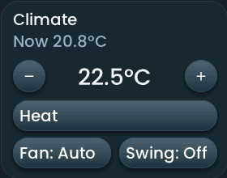

<!-- SPDX-License-Identifier: LicenseRef-FNCL-1.1 | Copyright (c) 2026 andre68723 -- generated by tools/generate_widget_docs.py, see docs/release-notes.md -->

# Climate

Controls a `climate.*` entity such as an air conditioner through its **supported HVAC modes**.

<figure></figure>

## Entities

| Entity | Domains |
| --- | --- |
| Climate | `climate.*` |

## Requirements

None beyond the entities.

## Options

No options beyond the entities; the controls follow what the entity supports.

## On the panel

- Current and target temperature in 0.5° steps.
- Mode, fan and swing chips when the entity supports them; a tap on a chip opens its picker.

## Size

- Minimum: **240 × 180 px**.
- Maximum: **480 px × 480 px**, capped by the display's dashboard area.

The minimum is a validation limit, not a recommended size. [Choose your display](../choose-display.md) lists the dashboard geometry; [Widget anatomy](../widget-anatomy.md) explains spacing and touch targets.

## Related guides

[Widget library](README.md) · [Web editor](../editor.md) · [Appearance](../appearance.md#compare-the-four-styles) · [Home Assistant requirements](../home-assistant.md)
