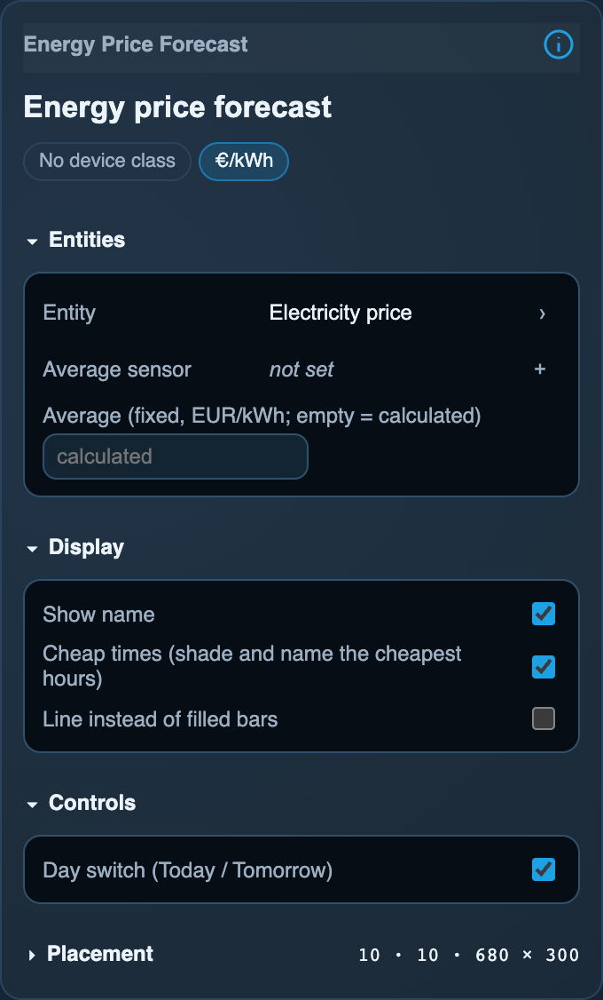
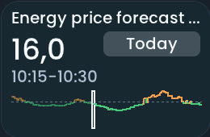

<!-- SPDX-License-Identifier: LicenseRef-FNCL-1.1 | Copyright (c) 2026 andre68723 -- generated by tools/generate_widget_docs.py, see docs/release-notes.md -->

# Energy price forecast

Shows **electricity prices** for today or tomorrow from a price `sensor.*` as bars, with the current interval's price and the next cheap window.

<figure></figure>

## Entities

| Entity | Domains |
| --- | --- |
| Price sensor | `sensor.*` with a price list |
| Average sensor (EUR/kWh) *(optional)* | `sensor.*` |

## Requirements

Choose the price-list sensor, not a scalar current price or CO₂ reading. Open the Inspector’s **Entities** info icon for supported data, average-reference precedence and troubleshooting.

## Options

| Option | Effect |
| --- | --- |
| Average (fixed, EUR/kWh; empty = calculated) | a fixed average instead of the day's own; an average sensor replaces it too |
| Show selector buttons on the tile | Today/Tomorrow buttons, one toggle on a narrow tile; off (default) shows the 24 hours around now, starting at the first price of the list when the sensor drops yesterday's prices |
| Cheap times (shade and name the cheapest hours) | shades the cheap windows and names the next one |
| Line instead of filled bars | a stepped line |

*Inspector in the web editor, with the widget of the preview above.*

### Price list

The price sensor carries the list of prices as an attribute named `data`, in EUR per kWh, hourly or every 15 minutes. Home Assistant keeps the full list; the panel reduces it to a compact series, so two days of 15-minute prices fit. If a list is still too large, whole hours are averaged; missing intervals stay gaps. A list that cannot be kept exactly (conflicting interval lengths, two prices in one slot) shows "No prices".

Raw lists (`raw_today`, `raw_tomorrow`) require a unit: EUR or euro cents (`c`, `ct`, `¢`) per Wh, kWh or MWh. They are converted to EUR/kWh before display; an unknown unit or a currency other than EUR shows "No prices". For example, 20 c/kWh and 200 EUR/MWh both display as 20 ct/kWh. When creating a helper, include each interval's end as `end_time` (or `end` in a raw list), so missing intervals keep their correct duration. Without end times the interval is inferred from the supplied starts.

- **[EPEX Spot](https://github.com/mampfes/ha_epex_spot)** (HACS; Germany and many other markets): works directly. Use the market price or the total price sensor.
- **Nord Pool** (Home Assistant integration): its sensors have no list, the prices come from the action `nordpool.get_prices_for_date` (EUR per MWh, divide by 1000). A helper that calls the action for today and tomorrow and stores `start_time` and `price_per_kwh` as `data` makes it work. Checked with real data through such a helper. The Nord Pool custom component (`raw_today`, `raw_tomorrow`) needs no helper when configured in EUR or euro cents.
- **Tibber** (Home Assistant integration): not verified. As far as known its sensors carry no price list either (action `tibber.get_prices`), so it probably needs the same kind of helper.
- **Day Ahead Optimizer** (`time_ts`, `da_cons`): read too, but only checked against a stand-in.

## On the panel

- One bar per interval in cent per kWh: green below the average, orange above it; past intervals dimmed, the running one outlined.
- Price now, interval, minimum and maximum.
- A cheap window is the lowest quarter of the day's prices (rounded to 0.001 EUR/kWh), at least one hour long and not over yet.
- Design inspired by the community's price timeline cards, for example [Neisi/ha-price-timeline-card](https://github.com/Neisi/ha-price-timeline-card); the code is the panel's own.

## Variants

<figure>
<figcaption>Energy price forecast (small)</figcaption></figure>

## Size

- Minimum: **240 × 150 px**.
- Maximum: **dashboard width × dashboard height**, capped by the display's dashboard area.

The minimum is a validation limit, not a recommended size. [Choose your display](../choose-display.md) lists the dashboard geometry; [Widget anatomy](../widget-anatomy.md) explains spacing and touch targets.

## Related guides

[Widget library](README.md) · [Web editor](../editor.md) · [Appearance](../appearance.md#compare-the-four-styles) · [Home Assistant requirements](../home-assistant.md)
