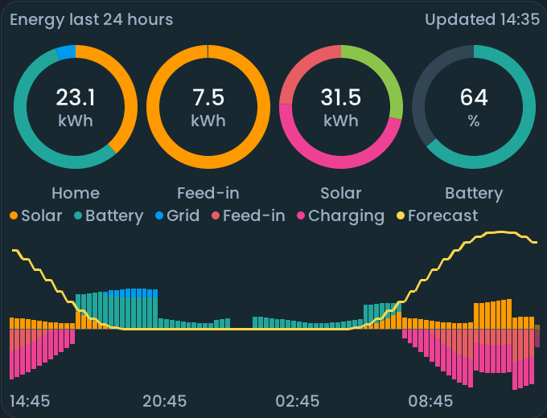
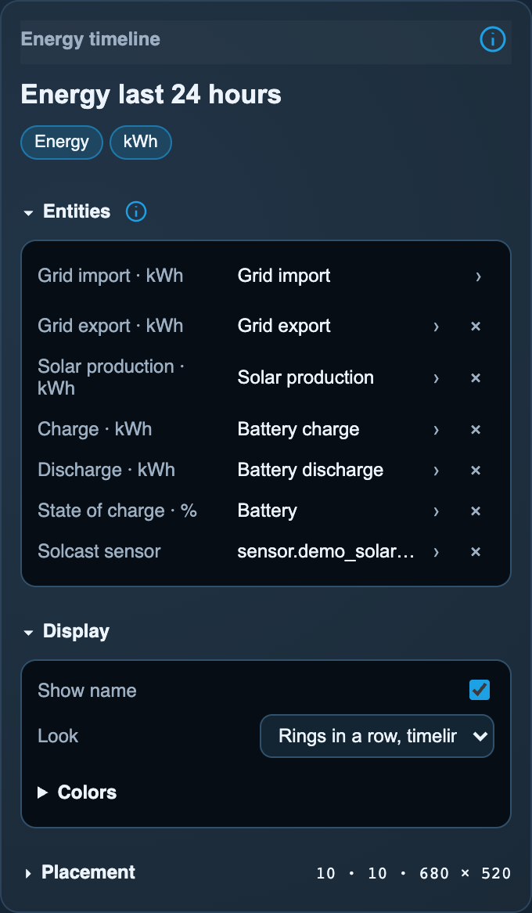
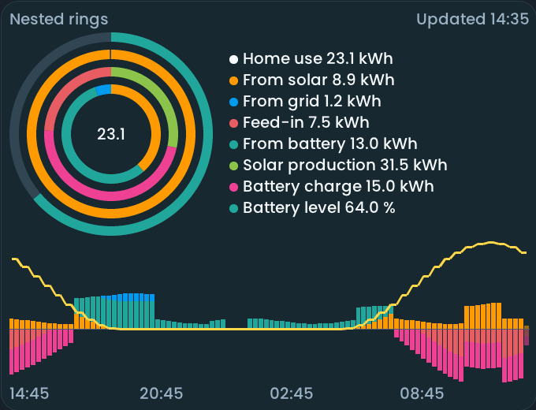

<!-- SPDX-License-Identifier: LicenseRef-FNCL-1.1 | Copyright (c) 2026 andre68723 -- generated by tools/generate_widget_docs.py, see docs/release-notes.md -->

# Energy timeline

Compares **cumulative energy counters** (`sensor.*`, kWh) over 24 hours, with rings and a detailed timeline.

<figure></figure>

## Entities

| Entity | Domains |
| --- | --- |
| Grid import · kWh | `sensor.*` |
| Grid export · kWh *(optional)* | `sensor.*` |
| Solar production · kWh *(optional)* | `sensor.*` |
| Battery charge and discharge · kWh *(optional)* | `sensor.*` |
| State of charge · % *(optional)* | `sensor.*` |
| Solcast sensor *(optional)* | `sensor.*` |

## Requirements

Cumulative counters in Wh, kWh or MWh (state class `total` or `total_increasing`) from your meter, inverter or battery integrations, and Home Assistant's **[Recorder](https://www.home-assistant.io/integrations/recorder/)** with their long-term statistics (enabled by default).

## Options

| Option | Effect |
| --- | --- |
| Optional entities | only configured roles are shown; choose a free function with Add assignment, then select its entity; × removes a binding |
| Look | nested rings with values, or rings in a row with the timeline below |
| Colors (Appearance) | the six flow colours, as swatches or HEX; **Reset to defaults** restores them |

*Inspector in the web editor, with the widget of the preview above.*

## On the panel

- Search offers cumulative energy counters; the battery SOC and Solcast fields use their own filters. Counters also need Recorder statistics. The Entities info icon explains the requirements and troubleshooting; confirmed incompatible sources get a short status.
- A wider card shows more details.
- A tap opens a popup with the measured counters and the estimated mix.

## Variants

<figure>
<figcaption>Nested rings</figcaption></figure>

## Size

- Minimum: **300 × 200 px**.
- Maximum: **dashboard width × dashboard height**, capped by the display's dashboard area.

The minimum is a validation limit, not a recommended size. [Choose your display](../choose-display.md) lists the dashboard geometry; [Widget anatomy](../widget-anatomy.md) explains spacing and touch targets.

## Related guides

[Widget library](README.md) · [Web editor](../editor.md) · [Appearance](../appearance.md#compare-the-four-styles) · [Home Assistant requirements](../home-assistant.md)

The visual concept is inspired by [aharren/ios-energy-widget](https://github.com/aharren/ios-energy-widget) (MIT); the panel's implementation is newly written for LVGL.
