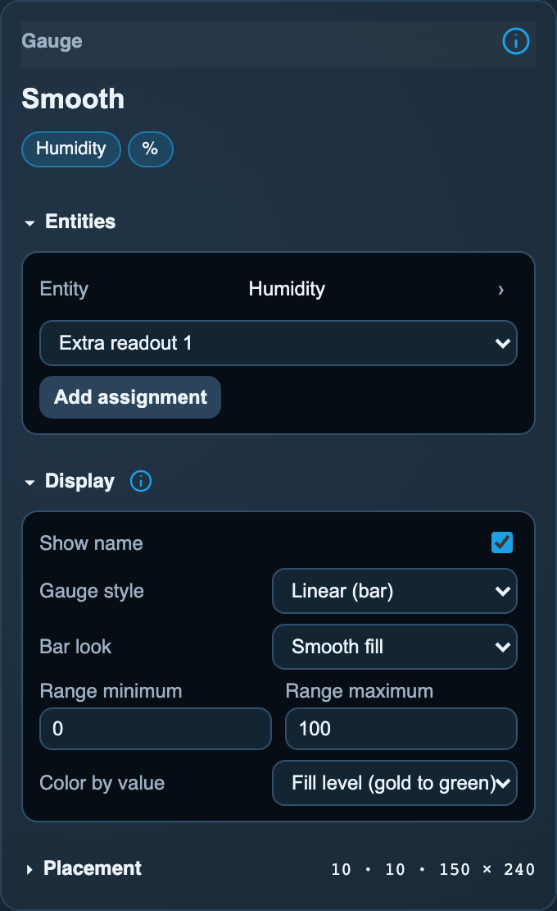

<!-- SPDX-License-Identifier: LicenseRef-FNCL-1.1 | Copyright (c) 2026 andre68723 -- generated by tools/generate_widget_docs.py, see docs/release-notes.md -->

# Gauge

Shows a numeric `sensor.*` as a **vertical, horizontal or radial gauge**.

<figure></figure>

## Entities

| Entity | Domains |
| --- | --- |
| Sensor | `sensor.*` |
| Extra readout 1 and 2 *(optional)* | `sensor.*` |

## Requirements

None beyond the entities.

## Options

| Option | Effect |
| --- | --- |
| Gauge style | linear (vertical bar), horizontal (bar, title and value in one row above it) or radial (arc) |
| Bar look | linear and horizontal: smooth fill or segmented LED blocks |
| LED blocks (4-30, empty = 10) | the number of segments; fewer on a short column |
| Range minimum, Range maximum | the values the bar or arc fills between; the number shown is always the real state |
| Extra readouts | only configured readouts are shown; choose a free one with Add assignment, then select its sensor; × removes it |

*Inspector in the web editor, with the widget of the preview above.*

## On the panel

- Radial and horizontal show the extra readouts as small text, inside the arc or in a row under the bar when there is room.
- A distance in metres is shown in km.
- Read-only.

## Variants

<figure>
<figcaption>Segmented</figcaption></figure>
<figure>
<figcaption>Horizontal gauge</figcaption></figure>
<figure>
<figcaption>Radial</figcaption></figure>

## Size

- Minimum: **80 × 160 px** by default; **100 × 70 px** for horizontal.
- Maximum: **dashboard width × dashboard height**, capped by the display's dashboard area.

The minimum is a validation limit, not a recommended size. [Choose your display](../choose-display.md) lists the dashboard geometry; [Widget anatomy](../widget-anatomy.md) explains spacing and touch targets.

## Related guides

[Widget library](README.md) · [Web editor](../editor.md) · [Appearance](../appearance.md#compare-the-four-styles) · [Home Assistant requirements](../home-assistant.md)
