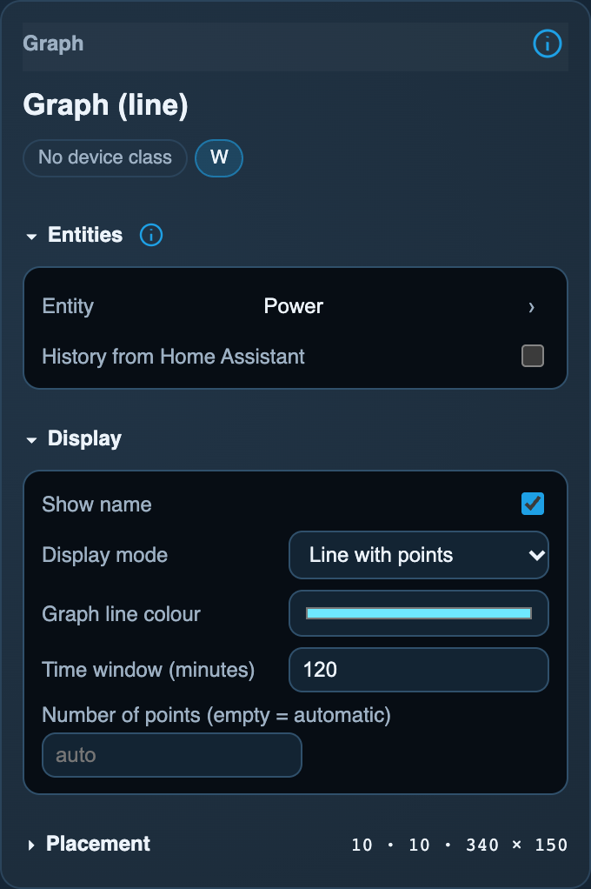
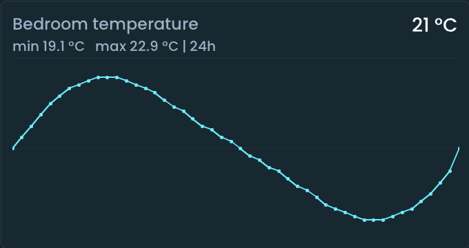

<!-- SPDX-License-Identifier: LicenseRef-FNCL-1.1 | Copyright (c) 2026 andre68723 -- generated by tools/generate_widget_docs.py, see docs/release-notes.md -->

# Graph

Follows a numeric value over time as a **line, smoothed line or bar chart**; usually a `sensor.*`, any entity with a numeric state works.

<figure></figure>

## Entities

| Entity | Domains |
| --- | --- |
| Numeric entity | a sensor or another entity with a numeric state |

## Requirements

For **History from Home Assistant**: the [Recorder](https://www.home-assistant.io/integrations/recorder/) must retain the entity.

## Options

| Option | Effect |
| --- | --- |
| Display mode | line, smoothed line, smoothed line with points, or bars |
| Time window (minutes) | the period shown |
| Bar interval (min) | bars only: the period one bar covers |
| History from Home Assistant | the last 24 hours from the Recorder instead of samples collected on the panel; see below |
| Render points (empty = auto) | the number of points drawn |
| Graph line color | the line colour |

*Inspector in the web editor, with the widget of the preview above.*

### History source

| History from Home Assistant | Data source | After a restart |
| --- | --- | --- |
| Off (default) | Samples collected on the panel, retained locally for 24 hours | Restores its saved samples; a new graph starts collecting |
| On | Last 24 hours from Home Assistant Recorder; no samples stored on the panel | Fetches existing Recorder records when its page is shown |

Switching it on expands the default two-hour time window to **1440 minutes (24 hours)**; a custom window is kept. Recorder data refreshes every **15 minutes while the page is shown**. Up to **eight** graphs can use this source; requests run one after another. See [history requirements and troubleshooting](../history.md#requirements-and-troubleshooting).

*LVGL/SDL simulator, Flat style: bedroom temperature over 24 hours (1440 minutes), line graph and **History from Home Assistant** enabled. Public synthetic data; click to enlarge.*

**History on tap** on the Sensor, Binary sensor, Contact and Lock widgets opens a detail popup; it does not select the Graph's source.

## On the panel

- Read-only.

## Variants

<figure>
<figcaption>Graph (bars)</figcaption></figure>

## Size

- Minimum: **220 × 140 px**.
- Maximum: **dashboard width × dashboard height**, capped by the display's dashboard area.

The minimum is a validation limit, not a recommended size. [Choose your display](../choose-display.md) lists the dashboard geometry; [Widget anatomy](../widget-anatomy.md) explains spacing and touch targets.

## Related guides

[Widget library](README.md) · [Web editor](../editor.md) · [Appearance](../appearance.md#compare-the-four-styles) · [Home Assistant requirements](../home-assistant.md)
