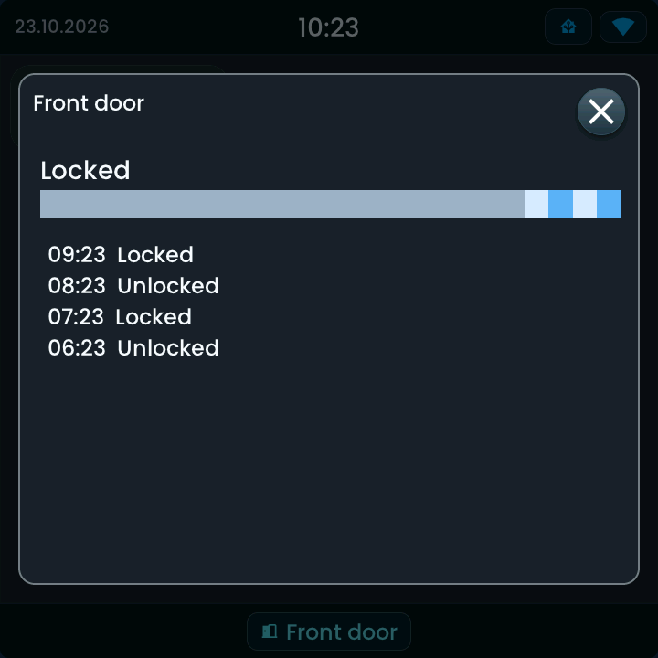

<!-- SPDX-License-Identifier: LicenseRef-FNCL-1.1 | Copyright (c) 2026 andre68723 -- generated by tools/generate_widget_docs.py, see docs/release-notes.md -->

# Lock

Shows the state of a `lock.*` entity and **locks or unlocks** it; optional history opens with a long press.

<figure></figure>

## Entities

| Entity | Domains |
| --- | --- |
| Lock | `lock.*` |

## Requirements

None beyond the entities.

## Options

| Option | Effect |
| --- | --- |
| Ask before unlocking or opening | a confirmation before unlocking or opening; off by default |
| History on long press | a long press opens the Recorder history |

## On the panel

- States: locked, unlocked, locking, unlocking, open, opening; jammed in the error colour.
- A tap locks or unlocks; a jammed lock is locked again.
- From 260 px width an **Open** button when the lock supports it.

### History

Enable **History on long press**, save, then long-press the tile. History is loaded from Home Assistant Recorder when opened; it is read-only. See [History details](../history.md) for the 24-hour numeric chart, state timeline, requirements and troubleshooting.

## Size

- Minimum: **180 × 80 px**.
- Maximum: **dashboard width × 200 px**, capped by the display's dashboard area.

The minimum is a validation limit, not a recommended size. [Choose your display](../choose-display.md) lists the dashboard geometry; [Widget anatomy](../widget-anatomy.md) explains spacing and touch targets.

## Related guides

[Widget library](README.md) · [Web editor](../editor.md) · [Appearance](../appearance.md#compare-the-four-styles) · [Home Assistant requirements](../home-assistant.md)
