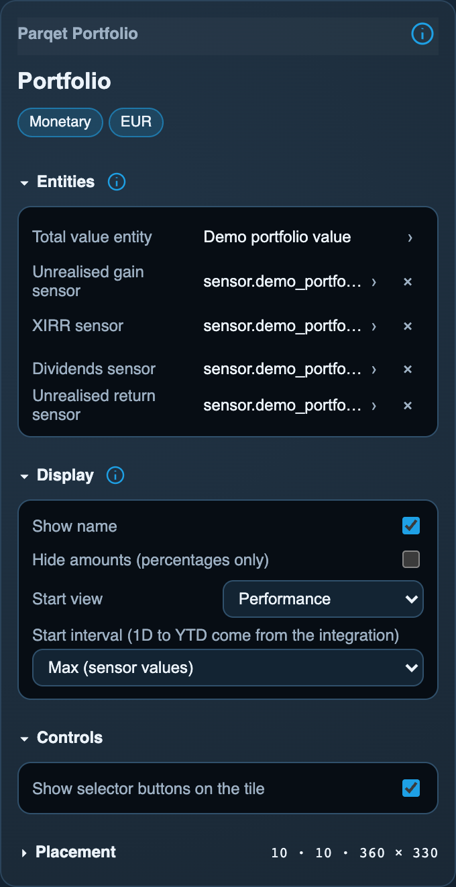

<!-- SPDX-License-Identifier: LicenseRef-FNCL-1.1 | Copyright (c) 2026 andre68723 -- generated by tools/generate_widget_docs.py, see docs/release-notes.md -->

# Parqet portfolio

Shows a **Parqet portfolio** from its `sensor.*` entities: total value, gain, XIRR, dividends and the largest holdings.

<figure></figure>

## Entities

| Entity | Domains |
| --- | --- |
| Total value entity | `sensor.*` |
| Unrealised gain sensor *(optional)* | `sensor.*` |
| Unrealised return sensor (%) *(optional)* | `sensor.*` |
| XIRR sensor *(optional)* | `sensor.*` |
| Dividends sensor *(optional)* | `sensor.*` |

## Requirements

The **[Parqet Companion integration](https://github.com/cubinet-code/ha-parqet-companion)** (HACS) for a portfolio you track on [Parqet](https://www.parqet.com). The panel only talks to Home Assistant; setting up the integration is described by its own project.

Search filters amounts by **Monetary** device class and XIRR/return by **%**; choose the corresponding financial metric.

The sensors report one **interval**, set in the integration's options (default Max). The largest holdings come from the attribute `top_holdings` of the total value sensor (five entries). The integration disables its detailed sensors by default; only the unrealised return in percent is useful here: enable *Unrealised return (gross)* in its entity settings.

## Options

| Option | Effect |
| --- | --- |
| Optional entities | only configured roles are shown; choose a free function with Add assignment, then select its entity; × removes a binding |
| Hide amounts (percentages only) | percentages and weights only; the value is replaced by the return (or the XIRR), dividends are not shown |
| Show selector buttons on the tile | on by default: **Performance** and **Holdings** tabs and the intervals **1D, 1W, 1M, YTD, MAX**; off shows the start view |
| Start view, Start interval | what the tile starts with; without the buttons they choose what it shows |

*Inspector in the web editor, with the widget of the preview above.*

### Intervals

- **MAX** shows the sensors' own figures (the integration reports one interval, Max by default).
- **1D, 1W, 1M and YTD** are asked from the integration for the portfolio (the sensor's `entry_id` and `portfolio_id` attributes). Performance shows the value, the gain with its return, XIRR, TTWROR, dividends, realised gain and the value curve of the interval; Holdings lists five holdings with their return in the interval: the largest by value, the best (**Top 5**) or the worst (**Flop 5**). The choice is made by touch on the tile and is not saved; best and worst need an interval other than MAX.
- The integration's reply contains every holding and can be large (about 76 KB for a month and 119 KB for the year to date, with 49 holdings). The panel receives at most 128 KB: a reply above that does not arrive and the tile says so. Later in the year the interval YTD can reach that limit.

## On the panel

- The value, the gain with the return in percent, XIRR and dividends, and on a taller tile the largest holdings as weight bars.
- The tile names the interval in its corner.
- The widget does not compute the return: the total value includes cash, and the result would differ from Parqet's figure.
- A gain or dividends sensor in another currency than the total value, or a percentage sensor without `%`, is left out and the line says **Unit differs**.

## Variants

<figure>
<figcaption>Portfolio (small)</figcaption></figure>
<figure>
<figcaption>Portfolio (percent only)</figcaption></figure>
<figure>
<figcaption>Portfolio (1 month)</figcaption></figure>
<figure>
<figcaption>Portfolio (holdings)</figcaption></figure>

## Size

- Minimum: **240 × 150 px**.
- Maximum: **dashboard width × dashboard height**, capped by the display's dashboard area.

The minimum is a validation limit, not a recommended size. [Choose your display](../choose-display.md) lists the dashboard geometry; [Widget anatomy](../widget-anatomy.md) explains spacing and touch targets.

## Related guides

[Widget library](README.md) · [Web editor](../editor.md) · [Appearance](../appearance.md#compare-the-four-styles) · [Home Assistant requirements](../home-assistant.md)
