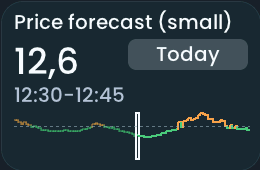

<!-- SPDX-License-Identifier: LicenseRef-FNCL-1.1 | Copyright (c) 2026 andre68723 -- generated by tools/generate_widget_docs.py, see docs/release-notes.md -->

# Price forecast

Show a day of electricity prices as bars, with the price now, today and tomorrow, and the cheap hours.

## Required Home Assistant integration

The widget reads a price sensor that carries the list of prices as an attribute named `data`, in EUR per kWh, hourly or every 15 minutes. Home Assistant keeps the full list; the panel reduces it to a compact series, so two days of 15-minute prices fit. If a list is still too large, whole hours are averaged; missing intervals stay gaps. A list that cannot be kept exactly (conflicting interval lengths, two prices in one slot) shows "No prices".

Raw lists (`raw_today`, `raw_tomorrow`) require a unit: EUR or euro cents (`c`, `ct`, `¢`) per Wh, kWh or MWh. They are converted to EUR/kWh before display; an unknown unit or a currency other than EUR shows "No prices". For example, 20 c/kWh and 200 EUR/MWh both display as 20 ct/kWh. When creating a helper, include each interval's end as `end_time` (or `end` in a raw list), so missing intervals keep their correct duration. Without end times the interval is inferred from the supplied starts.

**Sources**

- **[EPEX Spot](https://github.com/mampfes/ha_epex_spot)** (HACS; Germany and many other markets): works directly. Use the market price or the total price sensor. Checked with real 15-minute data.
- **Nord Pool** (Home Assistant integration): its sensors have no list, the prices come from the action `nordpool.get_prices_for_date` (EUR per MWh, divide by 1000). A helper that calls the action for today and tomorrow and stores `start_time` and `price_per_kwh` as `data` makes it work. Checked with real data through such a helper. The Nord Pool custom component (`raw_today`, `raw_tomorrow`) needs no helper when configured in EUR or euro cents.
- **Tibber** (Home Assistant integration): not verified. As far as known its sensors carry no price list either (action `tibber.get_prices`), so it probably needs the same kind of helper.
- **Day Ahead Optimizer** (`time_ts`, `da_cons`): read too, but only checked against a stand-in.

## Configure in the editor

1. Open a page in the [web editor](../editor.md#layout-workspace) and add **Price forecast**.
2. Use **Search** beside the entity field to choose an entity by name. Configure its options below.
3. Resize the widget for its content, then **Save** the layout. Try its controls on the panel.

Choose the price sensor. One bar per interval: below the average green, above it orange. Intervals that are over are dimmed and the running one is outlined. Prices are shown in cent per kWh.

**Display options** (as in the community's price timeline cards, for example [Neisi/ha-price-timeline-card](https://github.com/Neisi/ha-price-timeline-card); the code is the panel's own):

- **Average**: the day's own average in whole cents by default; a fixed value in EUR/kWh, or an average sensor in the secondary entity, replaces it.
- **Day switch**: Today/Tomorrow buttons, one toggle button on a narrow tile. Off shows the 24 hours around now, the running interval in the middle (tomorrow once published).
- **Cheap times**: shade the cheap windows and name the next one. A window is the lowest quarter of the day's prices (rounded to 0.001 EUR/kWh), at least one hour long and not over yet.
- **Line**: draw the prices as a stepped line instead of filled bars (the default).

## Preview

<figure>
<figcaption>Price forecast</figcaption></figure>
<figure>
<figcaption>Price forecast (small)</figcaption></figure>

Glow style, LVGL simulator with synthetic data. Click to enlarge. Other styles keep the same functions.

## Entities and interaction

**Supported primary entities:** `sensor.*`

| Setting / behaviour | What it does |
| --- | --- |
| Display | one bar per interval, green below and orange above the average, past hours dimmed, the running interval outlined |
| Options | Today/Tomorrow buttons: show Today and Tomorrow (one toggle button on a narrow tile); cheap times: shade the cheap windows and name the next; line instead of bars: a stepped line instead of filled bars; fixed average (EUR/kWh): a fixed value instead of the day's own average, or a sensor in secondary entity |
| Extras | price now, interval, minimum and maximum; the cheap windows are the lowest quarter of the day's prices, at least one hour |

## Layout limits

- Minimum: **240 × 150 px**.
- Maximum: **dashboard width × dashboard height**, capped by the selected display device's dashboard area.
- Leave space for the value, title and touch controls; the minimum is a validation limit, not a recommended size.

The [display device overview](../choose-display.md) lists usable dashboard geometry. [Widget anatomy](../widget-anatomy.md) explains title/content spacing and touch targets.

## Related guides

[Widget overview](README.md) · [Appearance comparison](../appearance.md#compare-the-four-styles) · [Home Assistant requirements](../home-assistant.md)
