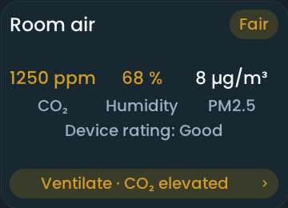

<!-- SPDX-License-Identifier: LicenseRef-FNCL-1.1 | Copyright (c) 2026 andre68723 -- generated by tools/generate_widget_docs.py, see docs/release-notes.md -->

# Room air

Shows the **room air quality** as one BETTA status from humidity, with optional temperature, CO₂ and PM2.5 from `sensor.*` entities; a tap opens read-only details.

<figure></figure>

## Entities

| Entity | Domains |
| --- | --- |
| Humidity | `sensor.*` |
| Temperature, CO₂, PM2.5, VOC and device rating *(optional)* | `sensor.*` |
| Outdoor temperature and humidity *(optional)* | `sensor.*`, `weather.*` |
| Window contact *(optional)* | `binary_sensor.*` |

## Requirements

Bind each role explicitly using the reported device class and unit; the tile shows only what is bound. No direct device polling.

| Level | Bound readings | Example |
| --- | --- | --- |
| 1 | Humidity and temperature | Zigbee temperature/humidity sensor, e.g. a Tuya sensor with display |
| 2 | Level 1 plus CO₂, PM2.5 and the device's own rating | IKEA ALPSTUGA |
| 3 | Level 2 plus VOC and more values | Awair Element |

## Options

| Option | Effect |
| --- | --- |
| Icon before the name | a small air-quality symbol in front of the name, off by default; shown only with the name |
| Sources | optional roles stay independent; outdoor comparison can be disabled without losing its bindings |
| Evaluation | editable humidity, CO₂ and PM2.5 display bands and drying margin; Reset restores defaults |

## On the panel

- A neutral card like the Room widget: the name on top, the readings (up to three, four on wide tiles) as value over label in the middle, and chips at the bottom: the BETTA status (Good, Fair, Poor) and, only when there is something to do, the short advice. Colour appears only in the chips and in the readings that are rated amber or red. Tap for every bound value.
- The worst usable indoor band controls green/amber/red. A configured humidity, CO₂ or PM2.5 reading that is missing or unsupported adds a partial-data marker; if the remaining bands are green, the status is neutral.
- Temperature is context. VOC is displayed but not evaluated; Awair scores and IKEA ratings never drive BETTA colour or advice.
- The popup shows per-reading status, source IDs, simultaneous reasons, outdoor absolute humidity and moisture conflicts. Window state does not prove effective ventilation.
- HA availability is not sample age. Unbound pollutants are outside the evaluation. No outdoor PM input, automatic actions or countdown.
- Default display bands: humidity green 40–60 %, amber 30–<40 or >60–70 %, red below 30 or above 70 %; CO₂ green below 1000 ppm, amber 1000–<2000, red from 2000 ppm; PM2.5 green below 15 µg/m³, amber 15–<35, red from 35 µg/m³.
- CO₂ follows the [UBA traffic-light reference](https://www.umweltbundesamt.de/richtig-lueften-in-schulen) with explicit BETTA boundaries. Humidity and PM bands are configurable product display choices, not health limits. The [WHO PM2.5 reference](https://cdn.who.int/media/docs/default-source/who-compendium-on-health-and-environment/who_compendium_chapter2.pdf) of 15 µg/m³ is a 24-hour average; this widget does not calculate that average.
- Band exits use 2 percentage points RH, 50 ppm CO₂ and 3 µg/m³ PM2.5 of hysteresis. New warnings appear immediately; improving advice settles for 60 seconds. Outdoor drying starts at an indoor-minus-outdoor difference of 1 g/m³; this is a configurable benefit margin, not an airflow prediction.

## Size

- Minimum: **280 × 220 px**.
- Maximum: **dashboard width × dashboard height**, capped by the display's dashboard area.

The minimum is a validation limit, not a recommended size. [Choose your display](../choose-display.md) lists the dashboard geometry; [Widget anatomy](../widget-anatomy.md) explains spacing and touch targets.

## Related guides

[Widget library](README.md) · [Web editor](../editor.md) · [Appearance](../appearance.md#compare-the-four-styles) · [Home Assistant requirements](../home-assistant.md)
