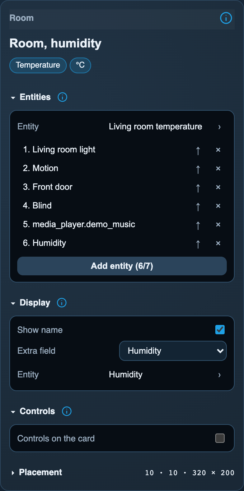

<!-- SPDX-License-Identifier: LicenseRef-FNCL-1.1 | Copyright (c) 2026 andre68723 -- generated by tools/generate_widget_docs.py, see docs/release-notes.md -->

# Room

Groups a **room's values and controls** in one card, with a popup for its entities; any domain, filled from a Home Assistant area or by hand.

<figure></figure>

## Entities

| Entity | Domains |
| --- | --- |
| Main entity | any |
| Room entities (up to 7) *(optional)* | any |
| Extra field *(optional)* | one of the room entities |

## Requirements

None beyond the entities.

## Options

| Option | Effect |
| --- | --- |
| Room entities | Add entity extends the list up to seven additional entities; ↑ reorders, × removes, and a click changes an entity; importing an area fills the list |
| Extra field | humidity, cover (status and open/close) or media player (status and play/pause) |
| Controls on the card | lights, switches and covers as buttons, on a card of about 400 × 240 px |

*Inspector in the web editor, with the widget of the preview above.*

## On the panel

- A tap opens a popup with every entity and toggles for lights, switches, covers, fans and media players.
- With **Controls on the card** lights and switches toggle together and covers get up and down.

## Variants

<figure>
<figcaption>Room, cover</figcaption></figure>
<figure>
<figcaption>Room, media player</figcaption></figure>
<figure>
<figcaption>Room card</figcaption></figure>

## Size

- Minimum: **220 × 120 px**.
- Maximum: **640 px × 320 px**, capped by the display's dashboard area.

The minimum is a validation limit, not a recommended size. [Choose your display](../choose-display.md) lists the dashboard geometry; [Widget anatomy](../widget-anatomy.md) explains spacing and touch targets.

## Related guides

[Widget library](README.md) · [Web editor](../editor.md) · [Appearance](../appearance.md#compare-the-four-styles) · [Home Assistant requirements](../home-assistant.md)
