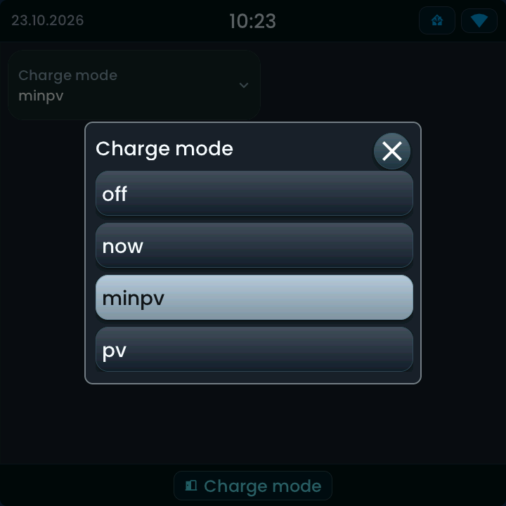

<!-- SPDX-License-Identifier: LicenseRef-FNCL-1.1 | Copyright (c) 2026 andre68723 -- generated by tools/generate_widget_docs.py, see docs/release-notes.md -->

# Select

Chooses an **option** of a `select.*` or `input_select.*` entity.

<figure></figure>

## Entities

| Entity | Domains |
| --- | --- |
| Select | `select.*`, `input_select.*` |

## Requirements

None beyond the entities.

## Options

No options beyond the entities; the controls follow what the entity supports.

## On the panel

- A tap opens the option list; picking one requests it.
- Leave enough width for the title and the longest option; the example is 360 × 100 px.

### Option picker

The current option is marked. Tap another option to request it, or close the popup to leave it unchanged. The tile updates only after Home Assistant reports the new state.

## Size

- Minimum: **160 × 80 px**.
- Maximum: **dashboard width × 200 px**, capped by the display's dashboard area.

The minimum is a validation limit, not a recommended size. [Choose your display](../choose-display.md) lists the dashboard geometry; [Widget anatomy](../widget-anatomy.md) explains spacing and touch targets.

## Related guides

[Widget library](README.md) · [Web editor](../editor.md) · [Appearance](../appearance.md#compare-the-four-styles) · [Home Assistant requirements](../home-assistant.md)
