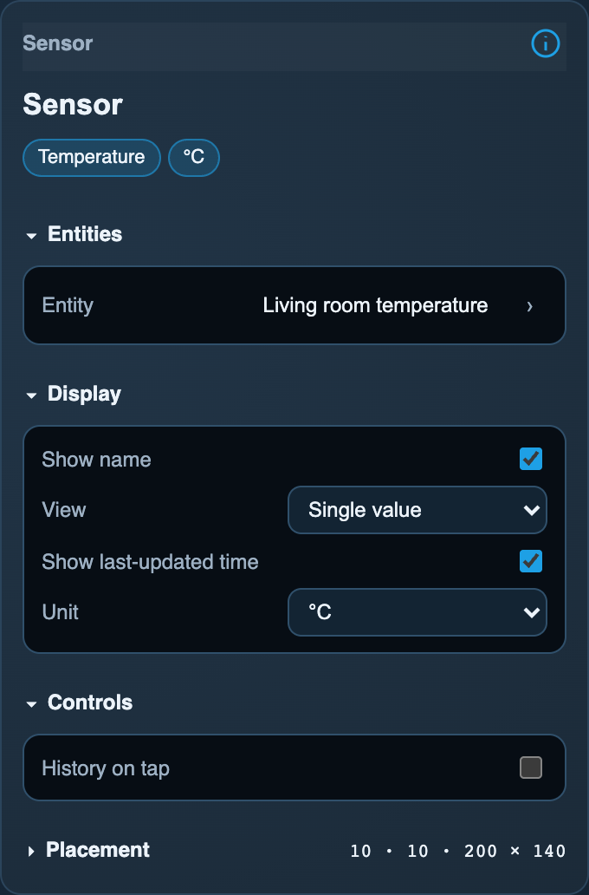

<!-- SPDX-License-Identifier: LicenseRef-FNCL-1.1 | Copyright (c) 2026 andre68723 -- generated by tools/generate_widget_docs.py, see docs/release-notes.md -->

# Sensor

Shows the **value** of a `sensor.*` or `binary_sensor.*` entity, formatted by its device class, with optional name, age and Recorder history.

<figure></figure>

## Entities

| Entity | Domains |
| --- | --- |
| Sensor | `sensor.*`, `binary_sensor.*` |

## Requirements

None beyond the entities.

## Options

| Option | Effect |
| --- | --- |
| View | Single value or List, with up to eight sensor or binary-sensor entities; Add sensors selects and orders the entries, ↑ moves and × removes a row. Lists use each entity’s default device-class formatting and scroll when needed |
| Show name | the widget name; on by default |
| Show last-updated time | the age of the value; on by default |
| Unit, Format, Time format, Currency | by device class, see below. The inspector header shows the class and unit as chips ("No device class" when Home Assistant gives none) and offers only that class's choices |
| History on tap | a tap opens the Recorder history; only when the Recorder retains the entity |

*Inspector in the web editor, with the widget of the preview above.*

### Device classes

| Device class | Option | Choices | Example |
| --- | --- | --- | --- |
| Any numeric with a unit | Unit | Show, Hide | `48 %`, `48` |
| Temperature, temperature difference | Unit | °C, °, Hide | `21,5 °C`, `21,5°`, `21,5` |
| Power, apparent power, reactive power, energy, stored energy | Unit | As in Home Assistant, Automatic, Hide | `2350 W`, `2,35 kW` |
| Duration | Format | Text, Clock, As in Home Assistant | `1 h 2 min`, `1:02:05`, `3725 s` |
| Timestamp | Time format | Date and time, Date, Time, Relative | `21.10.2026 07:56`, `21.10.2026`, `07:56`, `in 9 hours` |
| Date | Format | Date, Relative | `21.10.2026`, `tomorrow` |
| Monetary | Currency | Symbol, Code, Hide | `12,34 €`, `12,34 EUR` |

The first choice is the default. Without an option:

| Device class | Shown as | Example |
| --- | --- | --- |
| Any numeric | Decimal separator of the panel language | `21,5` (German), `21.5` (English) |
| Monetary in a currency | Two decimals unless Home Assistant sets a display precision | `0.9682` → `0,97 €` |
| Enum | Readable text | `no_risk` → `No risk` |
| Binary sensor | State text of its class, as on the Binary tile | `on` → `Open` (door) |

**Automatic** switches to kW, kWh or MWh from 1000 of the smaller unit. A duration as text drops the seconds from an hour and the minutes from a day (`2 d 3 h`). Timestamps are shown in the panel's local time; the date follows the panel language like the Date/Time tile. Relative needs the synchronised clock and otherwise shows the date (and time).

Units Home Assistant can convert (power, energy, duration, temperature, distance, pressure, speed) are set per entity in Home Assistant: *Settings → Entities → Unit of measurement*.

## On the panel

- The value as formatted for its device class (see Options).
- Read-only.

### History

Enable **History on tap**, save, then tap the tile. History is loaded from Home Assistant Recorder when opened; it is read-only. See [History details](../history.md) for the 24-hour numeric chart, state timeline, requirements and troubleshooting.

## Variants

<figure>
<figcaption>Sensor list</figcaption></figure>

## Size

- Minimum: **120 × 80 px**.
- Maximum: **dashboard width × dashboard height**, capped by the display's dashboard area.

The minimum is a validation limit, not a recommended size. [Choose your display](../choose-display.md) lists the dashboard geometry; [Widget anatomy](../widget-anatomy.md) explains spacing and touch targets.

## Related guides

[Widget library](README.md) · [Web editor](../editor.md) · [Appearance](../appearance.md#compare-the-four-styles) · [Home Assistant requirements](../home-assistant.md)
