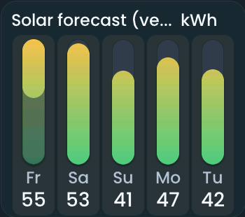

<!-- SPDX-License-Identifier: LicenseRef-FNCL-1.1 | Copyright (c) 2026 andre68723 -- generated by tools/generate_widget_docs.py, see docs/release-notes.md -->

# Solar forecast

Compares the **predicted solar production** from `sensor.*` forecasts for today and the next six days.

<figure></figure>

## Entities

| Entity | Domains |
| --- | --- |
| Remaining today (sensor) | `sensor.*` |
| Today forecast *(optional)* | `sensor.*` |
| Tomorrow, Day 3–7 forecast *(optional)* | `sensor.*` |

## Requirements

Sensors that forecast the solar production per day, for example from **[Solcast PV Forecast](https://github.com/BJReplay/ha-solcast-solar)**; any integration that provides them works. The editor suggests Solcast entity ids as examples.

## Options

| Option | Effect |
| --- | --- |
| Optional entities | only configured roles are shown; Add assignment offers the next free day, so days are filled in order and an entity is used once; × removes the last day |
| Bar orientation | horizontal or vertical |
| Bar max (kWh) | the value of a full bar |
| Line up days with the weather tile | vertical bars only: the columns use the weather forecast's day grid, so a solar tile with the same left edge, width and day count puts each day under its weather day |

## On the panel

- Today's row carries two readings: its bar and value are the day's total (**Today forecast**); the part still to come (**Remaining today**) is the bright start of the bar over the dimmed total, so the dimmed end reads as already produced. This needs both sensors; in the example 25 of 55 kWh are still to come.
- Tap today's bar to see a compact **Solar forecast today** popup with **Total** and **Remaining**. Future days do not open a popup. It closes with **×** or after a minute.

## Variants

<figure>
<figcaption>Solar forecast (vertical)</figcaption></figure>

## Size

- Minimum: **260 × 220 px**.
- Maximum: **640 px × 480 px**, capped by the display's dashboard area.

The minimum is a validation limit, not a recommended size. [Choose your display](../choose-display.md) lists the dashboard geometry; [Widget anatomy](../widget-anatomy.md) explains spacing and touch targets.

## Related guides

[Widget library](README.md) · [Web editor](../editor.md) · [Appearance](../appearance.md#compare-the-four-styles) · [Home Assistant requirements](../home-assistant.md)
