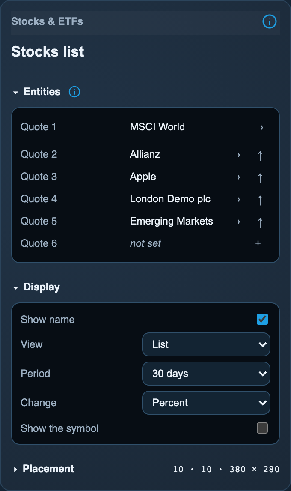
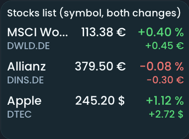
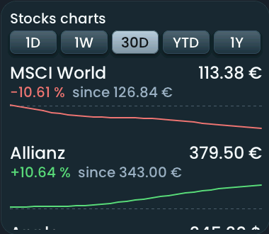
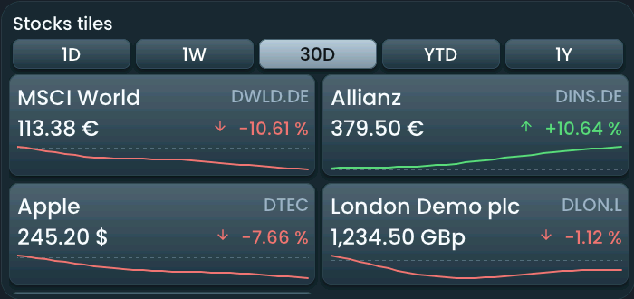

<!-- SPDX-License-Identifier: LicenseRef-FNCL-1.1 | Copyright (c) 2026 andre68723 -- generated by tools/generate_widget_docs.py, see docs/release-notes.md -->

# Stocks & ETFs

Shows **up to eight quotes** of Easy Stock `sensor.*` entities as a list, as charts or as tiles, with the last session's change and a detail view over five periods.

<figure></figure>

## Entities

| Entity | Domains |
| --- | --- |
| Quote 1 | `sensor.*` of Easy Stock |
| Quote 2 to 8 *(optional)* | `sensor.*` of Easy Stock |

## Requirements

The **[Easy Stock](https://github.com/derspe/ha-easy-stock)** integration from HACS; its quotes come from Yahoo Finance. The panel reads from Home Assistant's entity registry which integration a sensor belongs to; a sensor of another integration shows **Not a quote**. Easy Stock's daily closes come from the integration's own history endpoint.

### History

**Easy Stock downloads up to one year of daily closes when the sensor is first set up, including prices from before the sensor existed. A new ETF sensor can therefore show a 1Y chart immediately, as far back as Yahoo Finance, the integration's source, has data for that symbol.**

| In BETTA | Easy Stock |
| --- | --- |
| Setup | Home Assistant UI, one asset per entry |
| History before sensor creation | **Yes: up to one year of daily closes is downloaded at setup** |
| 1D | Today's Recorder data; an explicit no-trading flag gives a flat 0% chart |
| 1W | Home Assistant hourly means (trend) |
| 30D, YTD, 1Y | Daily closes from the integration, as far back as its history reaches |
| Currency | Sensor's native currency; Lovelace card conversion does not change BETTA |

It supplies no exchange real-time guarantee. The panel refreshes histories every 15 minutes; quote freshness also depends on the integration's polling interval. For 1D, keep Recorder enabled for the sensors. Easy Stock's Lovelace card settings do not configure the panel.

A 1Y chart shows price change, not a total return with reinvested distributions. If the close before the period is missing, BETTA marks the history as shorter and uses the first available close as its starting point.

Integration setup and options: [Easy Stock](https://github.com/derspe/ha-easy-stock#setup).

## Options

| Option | Effect |
| --- | --- |
| Quote 1 to 8 | the same list for List, Charts and Tiles; Add quote opens a multiple selection with numbered slots for up to eight sensors; changes apply together; ↑ moves a quote up, × removes it, an emptied row closes the gap |
| View | **List**: name, price and the last session's change; **Charts**: a small chart per quote; **Tiles**: a card per quote with name, price, the period change and a chart, in two columns on a wide tile and one on a narrow one |
| Period | 1 day, 1 week, 30 days, year to date or 1 year: the charts' first period and the one the details open with |
| Change | percent, amount, or both |
| Show the symbol | the ticker under the name (list), after it (charts) or beside it (tiles) |
| Show selector buttons on the tile | on by default, charts and tiles: the period buttons **1D, 1W, 30D, YTD, 1Y**; off shows the period above |

*Inspector in the web editor, with the widget of the preview above.*

## On the panel

- The price is the sensor's state with its currency; pence stay pence (GBp). A change that does not belong to the shown price is left out, a missing change shows `--`. Prices below 1 retain up to eight significant digits.
- Tiles show the percentage change on the right with an up/down arrow. With both changes enabled, the amount sits below the price. Rows and tiles scroll when they do not fit; a tap (not a drag) opens the details: price, the last session's change, market state, the time of the last update in Home Assistant, and a chart over **1D, 1W, 30D, YTD, 1Y**.
- Every chart names its source: **Closes** (Easy Stock, against the close before the period), **Recorded** (a day of Home Assistant's records from local midnight, against the previous close) or Home Assistant's daily, weekly or hourly means, whose change is a **trend**, not a market return. A shorter history says from when it starts.
- **1D means today**, from local midnight to now in the panel's time zone. Keep the panel and Home Assistant in the same time zone. When Easy Stock explicitly reports no trading today, the 1D chart is flat at 0%; the list keeps the last session's change. Without that attribute, 1D uses the previous close as its reference.
- Charts are fetched only for a page on screen, one at a time, and refreshed every 15 minutes.

## Variants

<figure>
<figcaption>Stocks list (symbol, both changes)</figcaption></figure>
<figure>
<figcaption>Stocks charts</figcaption></figure>
<figure>
<figcaption>Stocks tiles</figcaption></figure>

## Size

- Minimum: **240 × 120 px**.
- Maximum: **dashboard width × dashboard height**, capped by the display's dashboard area.

The minimum is a validation limit, not a recommended size. [Choose your display](../choose-display.md) lists the dashboard geometry; [Widget anatomy](../widget-anatomy.md) explains spacing and touch targets.

## Related guides

[Widget library](README.md) · [Web editor](../editor.md) · [Appearance](../appearance.md#compare-the-four-styles) · [Home Assistant requirements](../home-assistant.md)
