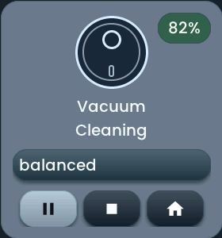
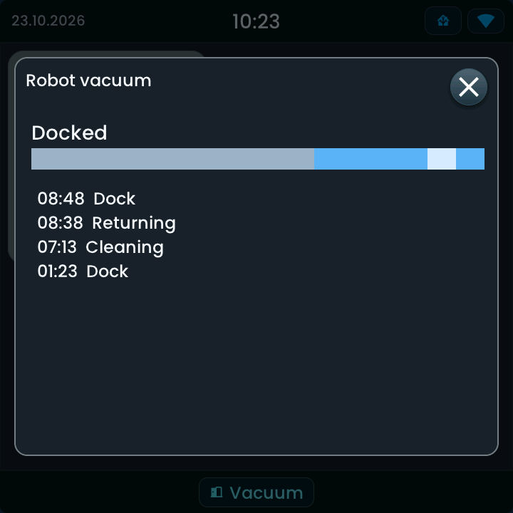
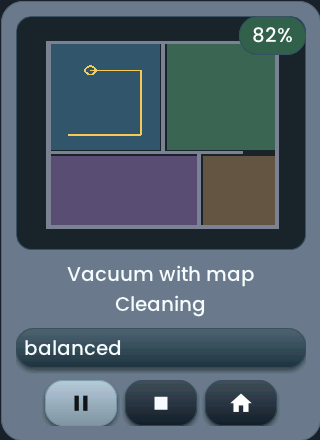

<!-- SPDX-License-Identifier: LicenseRef-FNCL-1.1 | Copyright (c) 2026 andre68723 -- generated by tools/generate_widget_docs.py, see docs/release-notes.md -->

# Vacuum

Shows a `vacuum.*` entity's status, its **cleaning actions** and an optional map in the tile.

<figure></figure>

## Entities

| Entity | Domains |
| --- | --- |
| Vacuum | `vacuum.*` |
| Map image *(optional)* | `image.*` |
| Cleaning mode *(optional)* | `select.*` |
| Battery sensor *(optional)* | `sensor.*` |

## Requirements

None beyond the entities.

## Options

| Option | Effect |
| --- | --- |
| Default cleaning program | set on the mode entity before Start (not when resuming); empty keeps the last program |
| History on long press | a long press opens the last 24 hours of activity |

## On the panel

- Start/pause, stop and dock follow the vacuum's capabilities; a suction picker appears when it reports fan speeds.
- The battery sensor is the only source of the charge since Home Assistant 2026.9; the chip is hidden while no value is known.
- The map is read-only. The legacy layout name `roborock_tile` uses this widget.

### Activity

With **History on long press** a long press on the card (not a button) shows the last 24 hours of the vacuum's state from Home Assistant Recorder as a timeline and a list of changes (cleaning, returning, docked); it is read-only.

Simulator example (Glow style) with synthetic data.

## Variants

<figure>
<figcaption>Vacuum with map</figcaption></figure>

## Size

- Minimum: **240 × 220 px**.
- Maximum: **dashboard width × dashboard height**, capped by the display's dashboard area.

The minimum is a validation limit, not a recommended size. [Choose your display](../choose-display.md) lists the dashboard geometry; [Widget anatomy](../widget-anatomy.md) explains spacing and touch targets.

## Related guides

[Widget library](README.md) · [Web editor](../editor.md) · [Appearance](../appearance.md#compare-the-four-styles) · [Home Assistant requirements](../home-assistant.md)
