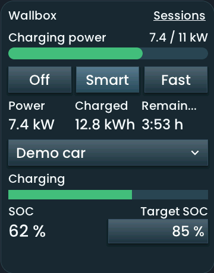
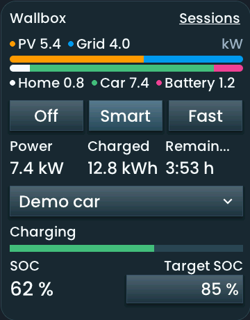
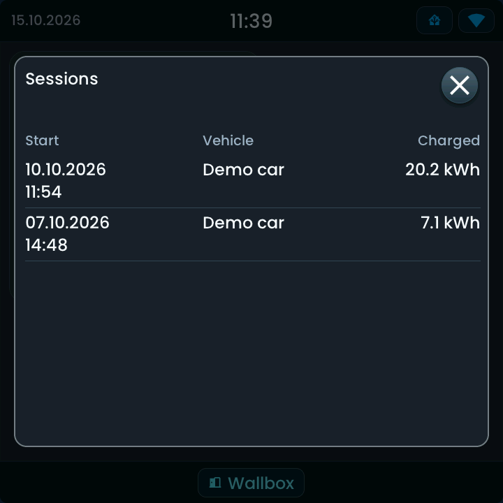
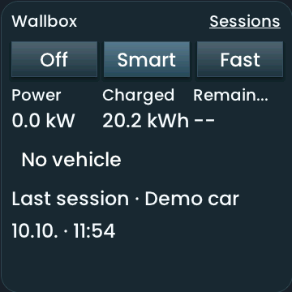

<!-- SPDX-License-Identifier: LicenseRef-FNCL-1.1 | Copyright (c) 2026 andre68723 -- generated by tools/generate_widget_docs.py, see docs/release-notes.md -->

# Wallbox

Shows and controls an **evcc loadpoint** through its Home Assistant integration. The detected mode `select.*` and related sensors supply charging mode, vehicle, target SOC, power, energy and remaining time.

<figure></figure>

## Entities

| Entity | Domains |
| --- | --- |
| Loadpoint mode | `select.*` |
| Vehicle, target SOC *(optional)* | `select.*`, `number.*` |
| Status, power, energy, remaining time, SOC *(optional)* | `sensor.*`, `binary_sensor.*` |
| PV, battery, grid and home power (energy-flow header) *(optional)* | `sensor.*` |

## Requirements

The **[evcc Home Assistant integration](https://github.com/marq24/ha-evcc)** (HACS), connected to an evcc server (the add-on or a standalone server). Enable the loadpoint mode, vehicle, charge limit, power, charged energy, remaining duration, SOC and connection entities. Smart mode needs integration 2026.8.3 or later; checked with 2026.10.2. All actions pass through Home Assistant.

## Options

| Option | Effect |
| --- | --- |
| Loadpoint | **Find loadpoints** refreshes the complete bindings from the selected evcc instance |
| Detected entities | read-only bindings from the selected evcc instance |
| Header | off, the charging power as a bar up to **Maximum charging power (kW)** (empty = 11), or the energy flow: one bar of the sources with brackets naming them above and the consumers below; the selected loadpoint automatically supplies the site sensors |

## On the panel

- Status, power, charged energy, remaining time and the current SOC on a green bar.
- The optional header sits above the modes: the charging power against its maximum, or the site's flow as in the evcc app: one bar of the sources (PV, battery, grid) with their values in kW, brackets with icons above for the sources and below for the consumers (home, car, battery charge, export). On the 10-inch panel it needs about 410 px (power) or 450 px (flow) of height, more with larger text, and stays off on a shorter card; the Inspector names the height.

### Headers

**Charging power** shows the current load against the configured maximum. **Energy flow** compares the site's sources and consumers on one scale. Both are hidden in the editor preview and on the panel when the tile is too short; the editor names the required height. Increase it under **Placement**.

Simulator examples in Glow style, 360 × 460 px, with public synthetic data from `gallery_data.json`.

All bindings are detected through the selected evcc instance; the entity rows are read-only. Enable missing power sensors in the evcc Home Assistant integration and press **Find loadpoints** again. PV is positive generation; battery is positive discharge and negative charge; grid is positive import and negative export. The evcc site sensors already represent the whole installation. Energy counters in kWh cannot supply this live flow. Missing readings leave empty segments.

### Charging controls

- **Off** requests stop through the loadpoint mode entity. **Smart** and **Fast** send the exact HA options `smart` and `now`. Older mode options use a picker. A request stays pending until Home Assistant confirms the entity state; the Charging status reports whether the charger is actually charging.
- **Vehicle** changes this loadpoint's car assignment, including **Guest vehicle** (the HA option `null`). It remains usable when the SOC is missing. Names for all choices come from Home Assistant's option translations; the raw selection value is sent unchanged. Repeated HA refreshes keep the picker open; a changed selection, options or availability dismisses it.
- **Target SOC** opens a slider using the number entity's minimum, maximum and step. **Apply** sends one value. A select fallback shows the complete reported options when no number binding is available.
- Missing or invalid values show `-- %`. Unavailable or disabled controls cannot issue commands. With no cable connected, Off/Smart/Fast remain available to preset the next charge; vehicle and target controls are disabled.

### Sessions

**Sessions** opens the activity popup with Start, Vehicle and Charged columns, newest first. It shows up to 20 completed sessions from the last 24 calendar months, in the panel's local time zone, read through the evcc integration's WebSocket commands (checked with ha-evcc 2026.10.2). The Lovelace card and the Recorder are not required.

Without a connected vehicle the vehicle row reads **No vehicle**. The last completed session's energy, vehicle and start time replace the live values; remaining time is unavailable. An empty history, unsupported session interface or failed request has its own message; unavailable data is never treated as zero. Session data is cached for five minutes and refreshed when a connected vehicle disconnects.

Simulator examples in Glow style, using the synthetic `wallbox_sessions.json` and `wallbox_disconnected.json` fixtures.

## Size

- Minimum: **320 × 360 px**.
- Maximum: **dashboard width × dashboard height**, capped by the display's dashboard area.

The minimum is a validation limit, not a recommended size. [Choose your display](../choose-display.md) lists the dashboard geometry; [Widget anatomy](../widget-anatomy.md) explains spacing and touch targets.

## Related guides

[Widget library](README.md) · [Web editor](../editor.md) · [Appearance](../appearance.md#compare-the-four-styles) · [Home Assistant requirements](../home-assistant.md)
