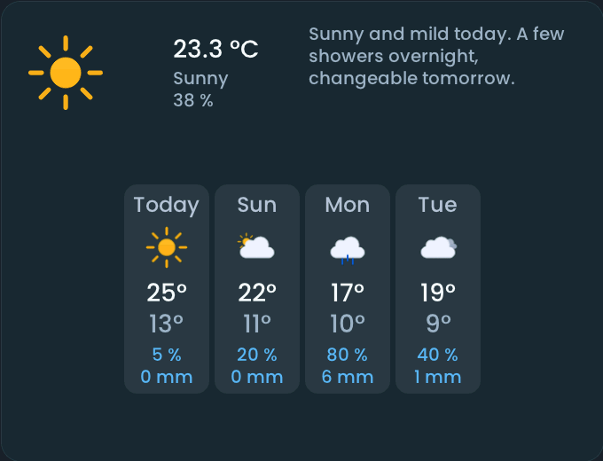

<!-- SPDX-License-Identifier: LicenseRef-FNCL-1.1 | Copyright (c) 2026 andre68723 -- generated by tools/generate_widget_docs.py, see docs/release-notes.md -->

# Weather forecast

Compares **forecast days** of a `weather.*` entity: temperatures and precipitation in configurable columns.

<figure></figure>

## Entities

| Entity | Domains |
| --- | --- |
| Weather | `weather.*` |
| DWD weather report *(optional)* | `sensor.*` |

## Requirements

A **[weather](https://www.home-assistant.io/integrations/weather/)** entity with daily forecasts. The report text needs the **[DWD Weather integration](https://github.com/FL550/dwd_weather)** and its separate *Weather report* sensor (see [DWD report setup](../home-assistant.md#what-a-feature-needs)); the report is German.

## Options

| Option | Effect |
| --- | --- |
| Visible days | fewer days give each column more room; Auto shows as many as are readable |
| Show rain chance and amount | on by default |
| Show name | off by default |

## On the panel

- A tap on a day opens a popup with pressure, wind, UV and that day's report.
- With the report, a tap on the temperature shows the full text; a wide header shows a summary (about 150 × 40 px free).

## Variants

<figure>
<figcaption>Weather forecast</figcaption></figure>

## Size

- Minimum: **260 × 220 px**.
- Maximum: **dashboard width × dashboard height**, capped by the display's dashboard area.

The minimum is a validation limit, not a recommended size. [Choose your display](../choose-display.md) lists the dashboard geometry; [Widget anatomy](../widget-anatomy.md) explains spacing and touch targets.

## Related guides

[Widget library](README.md) · [Web editor](../editor.md) · [Appearance](../appearance.md#compare-the-four-styles) · [Home Assistant requirements](../home-assistant.md)
