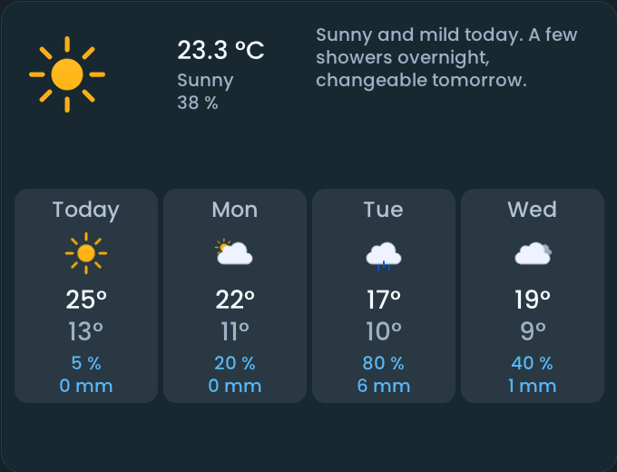
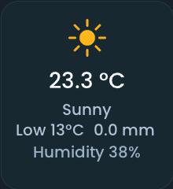
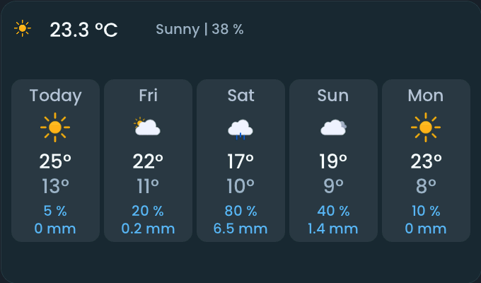
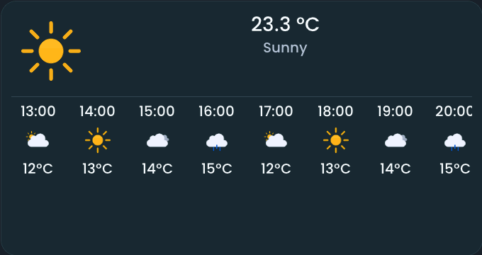

<!-- SPDX-License-Identifier: LicenseRef-FNCL-1.1 | Copyright (c) 2026 andre68723 -- generated by tools/generate_widget_docs.py, see docs/release-notes.md -->

# Weather

Shows the **weather** of a `weather.*` entity: current conditions with optional hourly forecasts, or the **forecast days** as columns; a button pair switches between them.

<figure></figure>

## Entities

| Entity | Domains |
| --- | --- |
| Weather | `weather.*` |
| DWD weather report *(optional)* | `sensor.*` |

## Requirements

A **[weather](https://www.home-assistant.io/integrations/weather/)** entity: current conditions need no forecast, the days need daily forecasts. **Show hourly forecast** needs that provider's hourly forecasts; daily forecasts are not substituted. The optional German report needs the **[DWD Weather integration](https://github.com/FL550/dwd_weather)** and its separate *Weather report* sensor (see [DWD report setup](../home-assistant.md#what-a-feature-needs)); enable it in Home Assistant if it is disabled.

## Options

| Option | Effect |
| --- | --- |
| View | **Today** (default) or **Forecast days**: the view the tile starts with; the forecast days need at least 260 × 220 px |
| Show day selection | off by default; two buttons at the top of the tile switch between today and the forecast days, as the period buttons of Stocks do |
| Show hourly forecast | off by default; adds a horizontal strip of up to 24 upcoming hours with time, condition and temperature |
| Visible days | forecast days only; fewer days give each column more room, Auto shows as many as are readable |
| Show rain chance and amount | forecast days only; on by default |
| DWD weather report | optional sensor, shown in the details and on the forecast days |
| Show name | off by default, to leave room for the conditions |

## On the panel

- The hourly strip appears only when a full column fits below the current weather; a tile that is too short shows the current weather alone.
- A tap on today opens its details: temperatures, the available humidity, pressure, wind and visibility, and the optional DWD report. A tap on a forecast day opens that day's pressure, wind, UV and report; with the report, a tap on the temperature shows the full text, and a wide header shows a summary (about 150 × 40 px free).
- With hourly forecasts, scroll horizontally for later hours; scrolling does not open the popup. The strip shows the next 24 hours from now, so it usually crosses midnight: a divider and the weekday mark the first column of the new day. Times use the panel's time zone.
- Hourly forecasts are fetched only while the tile is visible and refreshed every 15 minutes. A missing hourly forecast is shown explicitly; current conditions remain available.
- Without the hourly strip, today's low and precipitation appear when there is room. Today and the days use the same Meteocons.
- Layouts saved with the former Weather forecast tile are converted to this tile (View: Forecast days) when they are opened in the editor; the panel keeps displaying the old type until then.
- Close details with the close button or a tap outside; they also close automatically after one minute.

## Variants

<figure>
<figcaption>Weather (now)</figcaption></figure>
<figure>
<figcaption>Weather forecast</figcaption></figure>
<figure>
<figcaption>Weather hourly forecast</figcaption></figure>

## Size

- Minimum: **220 × 200 px**.
- Maximum: **dashboard width × dashboard height**, capped by the display's dashboard area.

The minimum is a validation limit, not a recommended size. [Choose your display](../choose-display.md) lists the dashboard geometry; [Widget anatomy](../widget-anatomy.md) explains spacing and touch targets.

## Related guides

[Widget library](README.md) · [Web editor](../editor.md) · [Appearance](../appearance.md#compare-the-four-styles) · [Home Assistant requirements](../home-assistant.md)
